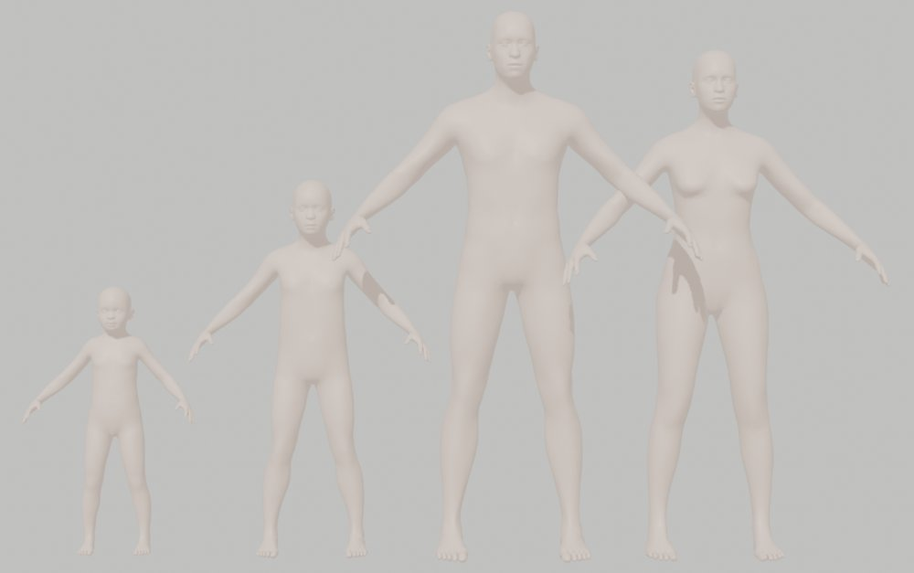
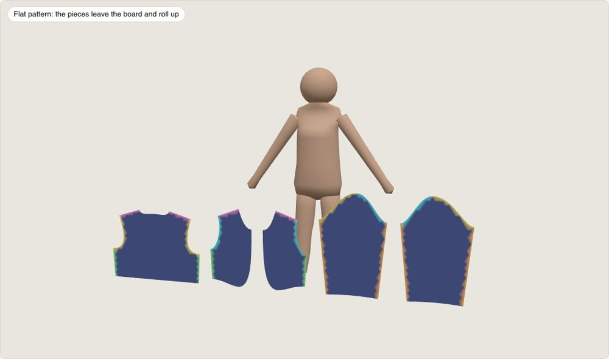
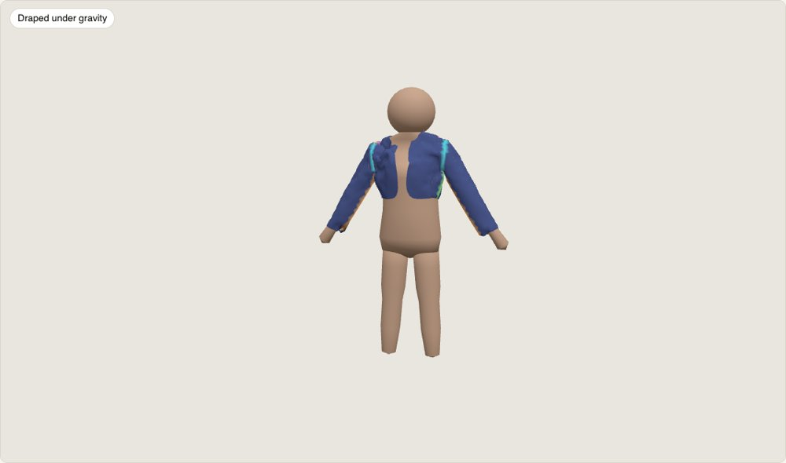
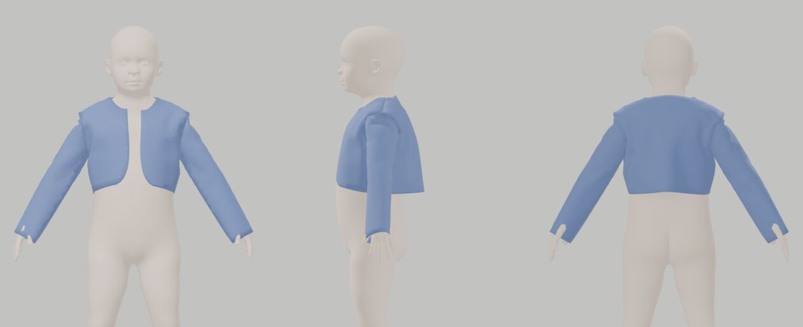

# FrankenTextiles

<div align="center">

[](#honest-status)
[](#oracles-and-pins)
[-2ea44f)](#bodies-anny-not-a-dress-form)
[](#architecture)
[](#workspace-and-budget)
[](LICENSE)

</div>

**FrankenTextiles makes sewing patterns that demonstrably sew together and fit a specific body, and writes
the files people and machines need to make them.**

Give it a garment idea, an existing pattern, or a pattern sheet an image model drew. Give it whatever you
know about the wearer: a few tape measurements, photos with a sheet of paper in frame, a short video, or just
age and height. It drafts or traces the pattern, checks every seam and every fit point on the flat pattern,
fits a realistic body model to the wearer, sews the pieces together around that body with a contact-correct
cloth solver, and exports print-at-home PDFs, DXF for cutting services, HPGL for plotters, cutter files and
embroidery files for the braid.

It is the mechanical core of the `fabric-pattern-creation-and-alteration` agent skill, rebuilt in Rust so it
is deterministic, testable against known answers, and runs in a browser with nothing to install.

---

## Honest status

**Phase 1.** Six crates have code: `ftx-core` (deterministic maths, geometry kernels), `ftx-body` (the Anny
body model, poses, landmarks), `ftx-pattern` (the pattern model, structure checks and validation, bit-exact
with the reference), `ftx-drape` (the garment mesh, start state, cloth solver with body contact and friction,
fold-up animation, metrics and flags), `ftx-cli` (`ftx validate`, `ftx drape`) and `ftx-conformance` (oracle
fixtures). Drafting, alteration, exports, tracing, the round and the browser build are not ported yet.

| Question | Answer |
|---|---|
| Is there a design? | **Yes**: [`COMPREHENSIVE_PLAN_FOR_THE_DESIGN_OF_FRANKENTEXTILES.md`](COMPREHENSIVE_PLAN_FOR_THE_DESIGN_OF_FRANKENTEXTILES.md) |
| Is the reference behaviour specified? | **Yes**: four behaviour specifications extracted from the Python reference by running it, and one for the Anny forward model ([`docs/spec/`](docs/spec/)), about 7,100 lines with fixture cases. The Anny spec was checked by re-implementing the model in NumPy from the text alone (agrees to 2e-15 m) |
| Is there a Cargo workspace with code? | **Partly**: `ftx-core`, `ftx-body`, `ftx-pattern`, `ftx-drape`, `ftx-cli` and `ftx-conformance` (tests pass natively and, where run, as wasm under Node); `ftx-measure`, `ftx-export`, `ftx-trace` and `ftx-wasm` are planned |
| Can I run it? | **Yes, two commands**: `ftx validate PATTERN --measurements M --fit F` (the reference's validation table and exit codes) and `ftx drape PATTERN --measurements M --fit F --out DIR` (an Anny body of the wearer's age, sex and stature, the drape, the fit flags, and a self-contained 3D fold-up page). Both take `--json` |
| Does the body model work? | **Yes, in Rust**: the Anny forward model matches the Python package on 16 reference bodies (newborn to adult, extremes, local changes, two poses) to 1e-14 m, about 0.3–0.4 ms per body against 7 ms upstream. The drape poses (A-pose 35°/50°, arms up, seated, squat, with a ramp from rest and an optional nappy) match the package to 1e-15 m, and the skin comes out as a checked, closed, outward-wound mesh for contact. It is fitted to a wearer's age, sex and stature (the height parameter bisected to the stature); fitting it to tape measurements is next |
| Does the drape solver exist? | **Yes, and it drapes a drafted garment on a realistic body**: orthotropic membrane, hinge bending and Newton on a sparse LDLᵀ pass their known-answer tests (anisotropy; a Peirce cantilever within 1.5 % of the exact elastica). Barrier contact on the thickness-offset gap with Coulomb friction passes its own: a ring on a cylinder holds below 2πμT and slides above it, a ring on a cone slides iff tan α > μ, and tight and loose tubes settle at the predicted strain and clearance. Results are bit-identical native and in wasm. The garment mesh and start state match the reference (all 42,003 triangles; pre-sew and relaxation to 1e-12 m), and the drafted bolero sews and drapes on an Anny toddler in about two and a half minutes (picture below) with no fit flag. The metrics and flags match the reference's to the bit on recorded drapes, and the fold-up animation plays in a self-contained page. The drafted trousers drape too, but their waistband slides down: elastics, gathers as a material field and self-contact are next, and the reference still judges fit in Blender |
| Has anything been benchmarked? | **No**. Every number in the plan is a target or a measurement of the reference |

The plan is written to be falsifiable: it names kill gates that can stop the body port or the drape solver
early and fall back to the reference's tools.

---

## TL;DR

**The problem.** An AI image model will happily draw a convincing pattern sheet for a toddler's costume. The
reference implementation audited one: side seams 8 % apart, a sleeve cap shorter than its armhole (it cannot
be set in), printed dimensions contradicting each other by up to 57 %. A pattern has to be checked as
geometry, and then on a body, before anyone cuts cloth.

**What the reference already does.** The Python skill drafts measured patterns, walks every seam, checks
ease against the body, alters patterns, exports industry files with acceptance checks, and folds the pieces up
in Blender.

**What it cannot do, and why this project exists.**
- Its body is a stack of ellipses. The armpit sits 45 mm too high and the crotch had to be special-cased, so
  correct patterns looked wrong in 3D.
- Blender's cloth needs a collider inset (or every girth gains 4.4 cm), depends on the start state, jitters,
  and cannot say whether an elastic waistband holds.
- It needs Python, OpenCV and Blender installed.

**FrankenTextiles** replaces the body with a real parametric body model fitted to the wearer, replaces the
cloth with an incremental-potential solver with barrier contact and Coulomb friction, ports the rest
spec-first with conformance fixtures captured from the reference, and compiles to wasm.

---

## Bodies: Anny, not a dress form

<div align="center">

</div>

[Anny](https://github.com/naver/anny) (NAVER LABS Europe, arXiv 2511.03589) is a parametric body model built
from MakeHuman/MPFB2 assets that covers newborn to elderly, with height-for-age calibrated to WHO data. Its
code is Apache-2.0 and its assets CC0. The picture shows four bodies from it at average build: a girl of two
and a half (94 cm), a boy of six (132 cm), a man of thirty (190 cm) and a woman of thirty (176 cm). Six
phenotype parameters (gender, age, muscle, weight, height,
proportions) and 256 local shape changes, twenty of them tape-measure targets (bust, underbust, waist, hips,
neck, nape to waist, thigh, calf…), let it be fitted from age and height alone, from height, weight or BMI,
from a full set of tape measurements, or from photos and video with a sheet of paper for scale.

FrankenTextiles ports Anny's forward model to Rust (gate G1: within 0.05 mm of the upstream model), measures
it the way a tape does (a girth bridges hollows), fits it to the wearer, and reports what it could not match.
Everything it reads off the fitted body rather than measured is labelled `MODEL_FIT`.

---

## Draping that answers the questions that matter

<div align="center">


</div>

*The reference's fold-up (Blender, analytic dress form): pieces leave the pattern board, roll up, zip together
and drape. FrankenTextiles keeps the animation and the metrics and replaces both the body and the solver.*

<div align="center">

</div>

*The same drafted bolero, sewn and draped by FrankenTextiles on an Anny body of the reference wearer's
age and stature (2.5 years, 920 mm, drape pose with straightened arms): seams welded, barrier contact with
Coulomb friction, 12 sewing and 36 draping steps of 1/24 s (`cargo run --release -p ftx-drape --example
drape_drafted`). The body is synthetic; no real child is measured or shown in this repository.*

The drape solver (plan §11) minimises an incremental potential each time step: inertia, an orthotropic
membrane rotated to each piece's grainline, bending, a tension-only elastic, seams welded exactly, Incremental
Potential Contact on the gap minus the cloth's real thickness, and lagged Coulomb friction, with a projected
Newton solve and a line search capped by continuous collision detection. That makes questions answerable that
the Blender sim could not answer:
- **Does the elastic hold?** A ring on a cylinder holds iff the hanging weight is below `2πμT`; the solver
  must reproduce that before it may judge a waistband.
- **Is it tight?** No collider inset, so clearance and hoop strain are exact.
- **Is it settled?** A residual and a velocity, not a jitter statistic. Two start states give an error bar.

Every metric and flag of the reference (seam closure, ring strain, contact, slip, hem balance, ride-up, band
positions) is kept with the same gating/advisory split.

---

## The four claims

| Claim | Meaning | What establishes it |
|---|---|---|
| **Parity** | A ported subsystem reproduces the reference | Fixtures captured from the pinned reference |
| **Physics** | The solver behaves like cloth where the answer is known | Known-answer tests |
| **Fit** | A garment fits a real person | A muslin or a dressed photo. Nothing computed does |
| **Performance** | A workload runs in a stated time | A benchmark with machine, inputs and spread |

They are never averaged into one number. A drape with no gating flags is a prediction, not a fit.

---

## Architecture

```text
 tape, photos, video, age/BMI ─► ftx-measure ─► fused measurements (value, σ, provenance)
                                      │                 │
                                      └──────► ftx-body ─► fitted body + landmarks + MODEL_FIT values
                                                   │
 idea / pattern JSON / sheet image ─► ftx-pattern, ftx-trace ─► pattern ─► flat validation
                                                   │                │
                                                   └──► ftx-drape ◄─┘ ─► drape report, frames, 3D viewer
                                                                     │
                                                                     └─► ftx-export ─► PDFs, SVG, DXF, HPGL,
                                                                                       cutter, DST, checks
```

`ftx round` runs the measurement gate, the flat validation, the drape and the exports, and writes one round
directory whose verdict names its basis. The browser page runs the same crates as wasm.

---

## Workspace and budget

| Crate | Responsibility | Planned lines |
|---|---|---:|
| `ftx-core` | Units, deterministic maths, curves, polygons, schemas, refusals | 8,000 |
| `ftx-pattern` | Pattern model, validation, alteration, drafting | 16,000 |
| `ftx-body` | Anny forward model, tape functionals, fitting, poses | 9,000 |
| `ftx-measure` | Catalogue, priors, fusion, readiness, photo scale, photogrammetry | 16,000 |
| `ftx-drape` | Garment scene, contact cloth solver, metrics and flags | 14,000 |
| `ftx-export` | SVG, PDF, DXF, HPGL, cutter, GarmentCode, DST, acceptance checks | 14,000 |
| `ftx-trace` | Tracing pattern sheets | 7,000 |
| `ftx-cli` | The `ftx` binary | 4,000 |
| `ftx-wasm` | Browser bindings | 3,000 |
| `ftx-conformance` | Oracle, known-answer and determinism tests | 9,000 |
| **Ceiling** (incl. 20,000 contingency) | | **120,000** |

`#![forbid(unsafe_code)]` everywhere. No Python, PyTorch, BLAS or C/C++ at runtime. Numerical code lifted
from [frankensim](https://github.com/Dicklesworthstone/frankensim) (sparse LDLᵀ, orthotropic membrane,
barrier function, deterministic elementary functions) carries a provenance header per file.

---

## Proposed command surface

```bash
ftx draft zouave_bolero --measurements M.json --ws WS          # a measured draft into WS/rounds/000
ftx round WS --drape --export                                  # gate + validate + drape + every export, checked
ftx body fit --measurements M.json --out body.json             # fit Anny to tape measurements
ftx measure video clip.mov --paper letter --out photo.json     # frames, sheet camera, landmarks, σ
ftx drape P.json --body body.json --out DIR                    # the cloth solver on its own
ftx export P.json --out DIR                                    # all files + acceptance checks
ftx trace sheet.png --out WS                                   # trace an AI pattern sheet
```

Every command prints human text and, with `--json`, a stable JSON envelope. The agent skill calls `ftx`
subsystem by subsystem as each reaches parity.

---

## Oracles and pins

| Reference | Pin | Role |
|---|---|---|
| The skill's Python implementation | revision `88e03965` (2026-10-12) | Parity fixtures for everything ported |
| Anny | `anny==0.6.1` | Parity fixtures for the body forward model; the converted model data |
| frankensim | commit per lifted file | Source of lifted numerics |

Fixtures are captured from the references and never regenerated from the port. A mismatch is a defect until
proven otherwise.

---

## Kill gates

1. **G1 Body**: Rust Anny within 0.05 mm of upstream; fitting recovers synthetic tape targets within 3 mm.
2. **G2 Drape**: the known-answer tests pass (ring on a cylinder, ring on a cone, ease sweep, elastic ladder,
   armpit wedge, determinism) and real garments settle on fitted bodies within budget. If not, the Blender
   path stays.
3. **G3 Port slice**: patterns, validation, drafting and exports pass their fixtures; the skill's round runs
   through `ftx`.
4. **G4 Browser**: the wasm page reaches parity and drapes a small garment.
5. **G5 Gauntlet**: a convergent multi-round parity, physics and surface audit before 1.0.

---

## Privacy

The usual wearer is a young child. No real person's measurements, photos, videos or name are ever committed;
fixtures are synthetic or the public-prior reference wearer. Everything runs locally, and the browser page
uploads nothing.

---

## Scope boundaries

Not a CAD curve editor, not a fashion renderer, not a body-scanning product, not a general cloth library, and
not a replacement for a muslin. Image generation and Blender rendering stay in the agent skill.

---

## Repository layout

```text
COMPREHENSIVE_PLAN_FOR_THE_DESIGN_OF_FRANKENTEXTILES.md   the technical constitution
AGENTS.md                                                 the operating contract for agents
FEATURE_PARITY.md                                         present / partial / missing / excluded, with fixture IDs
docs/spec/                                                behaviour specifications extracted from the reference
docs/images/                                              README figures
crates/                                                   the ten planned crates (none yet)
tools/oracle/                                             fixture capture against the pinned references (planned)
tools/body-model/                                         Anny pin and converter (planned)
tests/fixtures/oracle/                                    captured fixtures (planned)
```

---

## Reading paths

- **What and why**: this README, then plan §1–3.
- **Implementing a port**: plan §8 or §12, then the matching `docs/spec/` file, then `FEATURE_PARITY.md`.
- **The body model**: plan §9.
- **The drape solver**: plan §11.
- **Measuring from photos and video**: plan §10.

---

## FAQ

**Why not keep Python?** The reference stays as the oracle until each subsystem is certified. Rust gives a
deterministic solver, a single binary for the skill, and a browser build without a 19 MB Python runtime.

**Why not SMPL?** Its licences are non-commercial, and SMIL covers infants, not the range here. Anny covers
newborn to elderly under Apache-2.0 code and CC0 assets.

**Why not a GPU cloth solver?** Garments here are a few thousand vertices; correctness (no interpenetration,
real friction, determinism) matters more than throughput, and a CPU solver also runs in wasm.

**Does a converged round mean the garment fits?** No. It means the pattern is consistent, meets its fit
contract on the flat, and sews together on the fitted body without gating flags. Make a muslin.

---

## License

MIT with the OpenAI/Anthropic rider. See [LICENSE](LICENSE).
