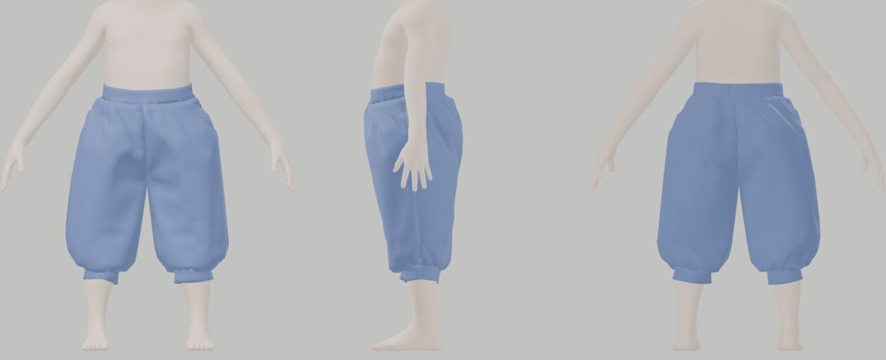

# FrankenTextiles

<div align="center">

[](#honest-status)
[](#oracles-and-pins)
[-2ea44f)](#bodies-anny-not-a-dress-form)
[](#architecture)
[](#workspace-and-budget)
[](LICENSE)

</div>

**FrankenTextiles makes sewing patterns that demonstrably sew together and fit a specific body, and writes
the files people and machines need to make them.**

Give it a garment idea, an existing pattern, or a pattern sheet an image model drew. Give it whatever you
know about the wearer: a few tape measurements, photos with a sheet of paper in frame, a short video, or just
age and height. It drafts or traces the pattern, checks every seam and every fit point on the flat pattern,
fits a realistic body model to the wearer, sews the pieces together around that body with a contact-correct
cloth solver, and exports print-at-home PDFs, DXF for cutting services, HPGL for plotters, cutter files and
embroidery files for the braid.

It is the mechanical core of the `fabric-pattern-creation-and-alteration` agent skill, rebuilt in Rust so it
is deterministic, testable against known answers, and runs in a browser with nothing to install.

---

## Honest status

**Status.** Every crate has code: `ftx-core` (deterministic maths, geometry kernels), `ftx-body` (the Anny
body model, poses, landmarks, tape fitting and nappy calibration), `ftx-pattern` (the pattern model,
validation, drafting, alterations and the material catalogue/fitting/thermal platform; parity applies to
the ported reference cases), `ftx-measure` (the measurement catalogue, priors, fusion, the round's gate, ChArUco/paper sheet
pose and scale, camera intrinsics, 3D section girths, multi-view triangulation, bundle adjustment, stillness
and video frame selection), `ftx-drape` (the garment mesh, start state, cloth solver with body contact,
friction, self-contact, moving-body pose interpolation, two-start spread, frozen-outfit reviews, qualification
bands, fold-up animation, metrics and flags), `ftx-export` (every deliverable and its checks), `ftx-trace`
(tracing PNG, JPEG and WebP pattern sheets, adaptive threshold, native review images, browser workshop),
`ftx-cli` (the `ftx` binary), `ftx-wasm` (the browser page) and `ftx-conformance` (oracle fixtures).

| Question | Answer |
|---|---|
| Is there a design? | **Yes**: [`COMPREHENSIVE_PLAN_FOR_THE_DESIGN_OF_FRANKENTEXTILES.md`](COMPREHENSIVE_PLAN_FOR_THE_DESIGN_OF_FRANKENTEXTILES.md) |
| Is the reference behaviour specified? | **Yes**: four behaviour specifications extracted from the Python reference by running it, one for the Anny forward model, and one for the material/thermal platform ([`docs/spec/`](docs/spec/)), with fixture cases. The Anny spec was checked by re-implementing the model in NumPy from the text alone (agrees to 2e-15 m) |
| Is there a Cargo workspace with code? | **Yes**: all ten crates (`ftx-core`, `ftx-body`, `ftx-pattern`, `ftx-measure`, `ftx-drape`, `ftx-export` with every deliverable and all 51 acceptance checks, `ftx-trace` with PNG/JPEG/WebP raster trace, adaptive threshold, annotate, scale-fit, round-0 audit and native review images, `ftx-cli`, `ftx-wasm` and `ftx-conformance`) are implemented and tested |
| Can I run it? | **Yes**: `ftx draft`, `ftx validate`, `ftx export`, `ftx check`, `ftx alter`, `ftx measure`, `ftx trace`, `ftx annotate`, `ftx scale-fit`, `ftx audit`, `ftx qualify`, `ftx report`, `ftx viewer`, `ftx render`, `ftx sim-points`, `ftx outfit`, `ftx materials` and `ftx round` run natively; `ftx drape PATTERN --measurements M --fit F --out DIR` fits an Anny body of the wearer's age and sex to their measurements, drapes the garment, and writes the fit flags and a self-contained 3D fold-up page; `ftx body` writes that body alone. All take `--json` (`ftx --help`). The fabric-pattern skill runs these through `ftx` when it is installed. In a browser: `tools/build_web.sh`, then serve `web/` (draft, checks, measurement gate, tracing workshop and every export in about a second; with the converted body model, the fold-up too) |
| Does the body model work? | **Yes, in Rust**: the Anny forward model matches the pinned Python package on 16 reference bodies (newborn to adult, extremes, local changes, two poses) to 1e-14 m, about 0.3–0.4 ms per body against 7 ms upstream. The drape poses (A-pose 35°/50°, arms up, seated, squat, with a ramp from rest and an optional nappy calibrated to a taped `seat_over_nappy` when present) match to 1e-15 m. The skin is checked for closed, outward-wound contact geometry. Fitting uses age, sex, stature, weight or BMI, and whichever of the **21** supported tape targets are supplied: stature; chest, waist, hip, thigh, knee, calf, ankle, upper-arm, wrist, neck-base and head girths; waist, crotch and knee heights; arm, back-neck-to-waist and shoulder lengths; across back; total crotch length; outseam. Targets are read the way a tape reads them (convex hulls of body sections, limbs across their own axes), by Levenberg–Marquardt in about two seconds, with priors that let Anny's scanned shape space explain the body before its hand-made blend shapes adjust it. Synthetic model-derived targets are recovered within 1.5 mm (`ftx-body/tests/fit_tape.rs`, requiring the converted model). Unmeasured values remain `MODEL_FIT`; synthetic recovery does not establish accuracy on a real person. A body fitted to stature alone was 62–75 mm too small round the chest, waist and hip of the 92 cm reference toddler |
| Does the drape solver exist? | **Yes, and it drapes a drafted garment on a realistic body**: orthotropic membrane, hinge bending and Newton on a sparse LDLᵀ pass their known-answer tests (anisotropy; a Peirce cantilever within 1.5 % of the exact elastica). Barrier contact on the thickness-offset gap with Coulomb friction passes its own: a ring on a cylinder holds below 2πμT and slides above it, a ring on a cone slides iff tan α > μ, and tight and loose tubes settle at the predicted strain and clearance. Results are bit-identical native and in wasm. The garment mesh and start state match the reference (all 42,003 triangles; pre-sew and relaxation to 1e-12 m), and the drafted bolero and trousers sew and drape on an Anny toddler fitted to the wearer's tape (14 and 40 CPU seconds on a laptop with cloth self-contact; pictures below) with no fit flag. In the browser they take about 21 and 60 seconds and come out bit-identical. Compression is as stiff as tension except in gather zones, as in the reference. An elastic casing is simulated as one: on the trousers an elastic of 0.85, 0.95 or 1.0 × the waist grips the toddler (its friction carries the garment) and one of 1.2 × does not, and the report says so. The metrics and flags match the reference's to the bit on recorded drapes, and the fold-up animation plays in a self-contained page. Cloth self-contact holds layers at Blender's 2 mm |
| Has anything been benchmarked? | **A bounded browser release workload**: 20 retained runs each, after three warmups, on an Apple M5 Ultra give bolero p50/p95 **16.66/17.43 s** and trousers **45.96/46.80 s**, with 2 mm self-contact and every Newton step converged. These are warm fold-click-to-result latencies on a shared desktop, not M4 native timings or a general speed comparison. Inputs, artifact hashes, spread and limits are in the [reality check](docs/reality-check-2026-10-20.md). Other historical timings above remain single observations; the plan's unmeasured numbers remain targets |

The plan is written to be falsifiable: it names kill gates that can stop the body port or the drape solver
early and fall back to the reference's tools.

The [2026-10-20 reality check](docs/reality-check-2026-10-20.md) distinguishes historical gate evidence
from current verification and remaining empirical work. Native drapes now refuse unconverged Newton
steps and report accepted-step residuals and instantaneous speeds under `numerical`. Gravity draping
requires three consecutive steps at at most 1 mm/s; failure adds a gating flag. The reference's
top-level `settled` remains its legacy window-drift metric. The historical native timings
above are not current benchmarks. The new browser release measurements use this stricter
boundary and the converted Anny asset. Neither numerical settling nor a clear simulation verdict
proves that a garment fits a person.

Native `drape` and `round --sim` use body contact by default; add `--self-contact-mm 2` to simulate
cloth layers against each other. The browser fold form enables that option initially. Ordinary runs
execute one sewing schedule. `--two-start-sew 18` optionally compares a second sewing duration at the
same placement; it reports path sensitivity, not a statistical error bar or proof of a unique equilibrium.
Accepted reports retain body/self contact counts, sampled active gaps and final barrier reactions in N.
`--elastic-hold-steps N` selects the final N gravity intervals for a casing-displacement report without
adding simulation steps. Pressure remains unavailable without a justified physical contact area; a quiet
window does not establish physical grip or fit. See the [drape contract](crates/ftx-drape/CONTRACT.md).

Photo/video body fitting requires prepared, calibrated frames and reviewed correspondences or masks.
The [decoded-frame selection](docs/video-frame-selection.md), [multi-frame fitting](docs/multi-frame-body-fit.md)
and [accepted-shape reuse](docs/reuse-body-fit.md) guides document those stages. An arbitrary phone clip
is not yet a complete capture-to-body input; an accepted image fit does not promote measurement readiness.

### Material substitutions and heat

Material observations, construction, finish and source conditions travel with each resolved selection.
The same selection supplies the consumers it can support; an absent mechanical or thermal measurement
stays absent. Start with the [catalog guide](docs/material-catalog.md) and
[piece-specific material assignments](docs/piece-materials.md).

- [Measured leather](docs/measured-leather.md): ten bovine leather sample groups distinguish tanning,
  finishes and neck/back locations, with measured dry/vapor resistance and thickness.
- [Potential evaporative transfer](docs/vapor-resistance.md): use source-qualified vapor resistance
  in a declared layer stack, retaining pressure drops and potential heat/water transfer. Actual sweat
  supply and garment comfort remain outside this calculation.
- [Transient exterior heat](docs/transient-exterior-heat.md): run source-qualified convection and
  material-following radiation on a layer stack, a saved drape or a complete motion history. Reports
  retain the exposed face temperature, separate signed heat contributions and reference-mass storage.
- [Material studies](docs/material-scenario-studies.md): compare substitutions through shared scenario
  execution and explicit objectives, retaining the material and geometry used by each result.
- [Material treatments](docs/material-treatments.md): apply source-qualified shrinkage or compensate
  cutting patterns in the grain frame, using explicit before/after material states. Five measured
  denim pairs are included; missing mechanical and process evidence remains visible.
- [Production sewing](docs/sewing-production.md): schedule operations across garment copies, share
  qualified setups, select recipes against batch totals and emit the actual ordered stitch program.

Try the self-contained synthetic heat example (its numbers demonstrate the solver, not a real fabric):

```sh
cargo run -p ftx-cli --bin ftx-materials -- thermal-transient \
  tests/fixtures/materials/synthetic-transient-exterior.json
```

---

## TL;DR

**The problem.** An AI image model will happily draw a convincing pattern sheet for a toddler's costume. The
reference implementation audited one: side seams 8 % apart, a sleeve cap shorter than its armhole (it cannot
be set in), printed dimensions contradicting each other by up to 57 %. A pattern has to be checked as
geometry, and then on a body, before anyone cuts cloth.

**What the reference already does.** The Python skill drafts measured patterns, walks every seam, checks
ease against the body, alters patterns, exports industry files with acceptance checks, and folds the pieces up
in Blender.

**What it cannot do, and why this project exists.**
- Its body is a stack of ellipses. The armpit sits 45 mm too high and the crotch had to be special-cased, so
  correct patterns looked wrong in 3D.
- Blender's cloth needs a collider inset (or every girth gains 4.4 cm), depends on the start state, jitters,
  and cannot say whether an elastic waistband holds.
- It needs Python, OpenCV and Blender installed.

**FrankenTextiles** replaces the body with a real parametric body model fitted to the wearer, replaces the
cloth with an incremental-potential solver with barrier contact and Coulomb friction, ports the rest
spec-first with conformance fixtures captured from the reference, and compiles to wasm.

---

## Bodies: Anny, not a dress form

<div align="center">

</div>

[Anny](https://github.com/naver/anny) (NAVER LABS Europe, arXiv 2511.03589) is a parametric body model built
from MakeHuman/MPFB2 assets that covers newborn to elderly, with height-for-age calibrated to WHO data. Its
code is Apache-2.0 and its assets CC0. The picture shows four bodies from it at average build: a girl of two
and a half (94 cm), a boy of six (132 cm), a man of thirty (190 cm) and a woman of thirty (176 cm). Six
phenotype parameters (gender, age, muscle, weight, height,
proportions) and 256 local shape changes, twenty of them tape-measure targets (bust, underbust, waist, hips,
neck, nape to waist, thigh, calf…), let it be fitted from age and height alone, from height, weight or BMI,
from a full set of tape measurements, or from photos and video with a sheet of paper for scale.

FrankenTextiles ports Anny's forward model to Rust (gate G1: within 0.05 mm of the upstream model), measures
it the way a tape does (a girth bridges hollows), fits it to the wearer, and reports what it could not match.
Everything it reads off the fitted body rather than measured is labelled `MODEL_FIT`.

---

## Draping that answers the questions that matter

<div align="center">


</div>

*The reference's fold-up (Blender, analytic dress form): pieces leave the pattern board, roll up, zip together
and drape. FrankenTextiles keeps the animation and the metrics and replaces both the body and the solver.*

<div align="center">


</div>

*The same drafted bolero and the zouave trousers, sewn and draped by FrankenTextiles on an Anny body of the
reference wearer's age fitted to fifteen of the wearer's tape measurements (2.5 years; each within 2.4 mm;
drape pose with straightened arms): seams welded, barrier contact with Coulomb
friction, 12 sewing and 36 draping steps of 1/24 s (`cargo run --release -p ftx-drape --example
drape_drafted -- OUT zouave_trousers-920`). Neither raises a fit flag; the trousers' waistband and cuffs
end within 7 mm of where they were drafted to sit. On a body fitted to stature alone (62–75 mm smaller
round the chest, waist and hip) the same trousers slid 63 mm down. The body is synthetic; no real child is
measured or shown in this repository.*

The drape solver (plan §11) minimises an incremental potential each time step: inertia, an orthotropic
membrane rotated to each piece's grainline, bending, a tension-only elastic, seams welded exactly, Incremental
Potential Contact on the gap minus the cloth's real thickness, and lagged Coulomb friction, with a projected
Newton solve and a line search capped by continuous collision detection. That makes questions answerable that
the Blender sim could not answer:
- **Does the elastic hold?** A ring on a cylinder holds iff the hanging weight is below `2πμT`; the solver
  reproduces that (KAT 4) and judges a waistband by it: the elastic's tension on the body against the
  garment's weight (KAT 7, the elastic ladder).
- **Is it tight?** No collider inset, so clearance and hoop strain are exact.
- **Is it settled?** Every Newton step must converge, and gravity draping requires three consecutive
  accepted endpoints at at most 1 mm/s. The legacy drift metric is reported separately. Optional paired
  sewing schedules expose sensitivity to sewing duration; perturbed-placement robustness remains unqualified.

Every metric and flag of the reference (seam closure, ring strain, contact, slip, hem balance, ride-up, band
positions) is kept with the same gating/advisory split.

---

## The four claims

| Claim | Meaning | What establishes it |
|---|---|---|
| **Parity** | A ported subsystem reproduces the reference | Fixtures captured from the pinned reference |
| **Physics** | The solver behaves like cloth where the answer is known | Known-answer tests |
| **Fit** | A garment fits a real person | A muslin or a dressed photo. Nothing computed does |
| **Performance** | A workload runs in a stated time | A benchmark with machine, inputs and spread |

They are never averaged into one number. A drape with no gating flags is a prediction, not a fit.

---

## Architecture

```text
 tape, photos, video, age/BMI ─► ftx-measure ─► fused measurements (value, σ, provenance)
                                      │                 │
                                      └──────► ftx-body ─► fitted body + landmarks + MODEL_FIT values
                                                   │
 idea / pattern JSON / sheet image ─► ftx-pattern, ftx-trace ─► pattern ─► flat validation
                                                   │                │
                                                   └──► ftx-drape ◄─┘ ─► drape report, frames, 3D viewer
                                                                     │
                                                                     └─► ftx-export ─► PDFs, SVG, DXF, HPGL,
                                                                                       cutter, DST, checks
```

`ftx round` runs the measurement gate, the flat validation, the drape and the exports, and writes one round
directory whose verdict names its basis. The browser page runs the same crates as wasm.

---

## Workspace and budget

| Crate | Responsibility | Planned lines |
|---|---|---:|
| `ftx-core` | Units, deterministic maths, curves, polygons, schemas, refusals | 8,000 |
| `ftx-pattern` | Pattern model, validation, alteration, drafting | 16,000 |
| `ftx-body` | Anny forward model, tape functionals, fitting, poses | 9,000 |
| `ftx-measure` | Catalogue, priors, fusion, readiness, photo scale, photogrammetry | 16,000 |
| `ftx-drape` | Garment scene, contact cloth solver, metrics and flags | 14,000 |
| `ftx-export` | SVG, PDF, DXF, HPGL, cutter, GarmentCode, DST, acceptance checks | 14,000 |
| `ftx-trace` | Tracing pattern sheets | 7,000 |
| `ftx-cli` | The `ftx` binary | 4,000 |
| `ftx-wasm` | Browser bindings | 3,000 |
| `ftx-conformance` | Oracle, known-answer and determinism tests | 9,000 |
| **Ceiling** (incl. 20,000 contingency) | | **120,000** |

This is the original planned budget, and the implementation exceeds it: the frozen `2bc8b402` audit
counted 262,470 Rust lines including tests and examples. The expanded material/thermal work in plan §25
does not silently waive the ceiling. A maintainer decision on scope, source budget and release slice
remains open as `ftx-onn.13`; tests and working features will not be removed merely to reduce the count.

`#![forbid(unsafe_code)]` everywhere. No Python, PyTorch, BLAS or C/C++ at runtime. Numerical code lifted
from [frankensim](https://github.com/Dicklesworthstone/frankensim) (sparse LDLᵀ, orthotropic membrane,
barrier function, deterministic elementary functions) carries a provenance header per file.

---

## Command surface

```bash
ftx draft zouave_bolero --measurements M.json --out DIR        # a measured draft (pattern.json + fit_spec.json)
ftx round WS --pattern DIR/pattern.json --measurements M.json --sim --export  # gate + validate + drape + exports
ftx qualify --ws WS                                            # three chest qualification bands (-20/0/+20 mm)
ftx body --measurements M.json --out DIR                       # fit Anny to tape measurements and write body.obj
ftx measure fit-body OBS.json --model MODEL.ftxbody --out accepted-fit.json  # prepared multi-frame observations
ftx drape P.json --measurements M.json --fit F.json --out DIR  # the cloth solver on its own
ftx export all P.json --out DIR                                # all files + 51 acceptance checks
ftx import garmentcode G.json --out NEW_DIR --annotations A.json # evaluated panels + optional sewing annotations
ftx trace sheet.png --out DIR                                  # trace a PNG/JPEG/WebP pattern sheet
```

Every command prints human text and, with `--json`, a stable JSON envelope. The agent skill calls `ftx`
subsystem by subsystem as each reaches parity.

### Import an evaluated GarmentCode pattern

`ftx import garmentcode INPUT.json --out NEW_DIR` converts evaluated panels and stitches into
`pattern.json`, with an `import.json` report and the original `source.garmentcode.json` bytes.
`--annotations A.json` supplies construction information using `fabric-garmentcode-annotations/1`;
the original annotations are retained, and an included fit contract is written to `fit_spec.json`.
The destination must be new. Successful conversion exits 0 and always reports `REVIEW_REQUIRED`.

The importer preserves line, quadratic and cubic geometry, converts declared units to millimetres,
and keeps every expanded panel as one physical piece. Optional annotations supply grain, seam
allowances, notches, roles, placement and explicit seam ratios; they cannot turn an already expanded
panel into a mirror pair or an on-fold piece. Review the missing-information report before ordinary
flat validation, draping and export checks. Conversion does not establish fit or recover pieces omitted
from a simulation shell. The same file-free API is available through `ftx-wasm`; there is no browser
import form yet. See the [pattern contract](crates/ftx-pattern/CONTRACT.md)
for the supported subset, annotation coordinates and refusal boundaries.

---

## Oracles and pins

| Reference | Pin | Role |
|---|---|---|
| The skill's Python implementation | revision `88e03965` (2026-10-12) | Parity fixtures for everything ported |
| Anny | `anny==0.6.1` | Parity fixtures for the body forward model; the converted model data |
| frankensim | commit per lifted file | Source of lifted numerics |

Fixtures are captured from the references and never regenerated from the port. A mismatch is a defect until
proven otherwise.

---

## Kill gates

1. **G1 Body**: Rust Anny within 0.05 mm of upstream; fitting recovers synthetic tape targets within 3 mm.
   *Passed 2026-10-12* (FEATURE_PARITY, body model).
2. **G2 Drape**: the known-answer tests pass (ring on a cylinder, ring on a cone, ease sweep, elastic ladder,
   armpit wedge, determinism) and real garments settle on fitted bodies within budget. If not, the Blender
   path stays. *Passed 2026-10-13* (FEATURE_PARITY, dynamics).
3. **G3 Port slice**: patterns, validation, drafting and exports pass their fixtures; the skill's round runs
   through `ftx`. *Passed 2026-10-13* (FEATURE_PARITY, CLI / rounds).
4. **G4 Browser**: the wasm page reaches parity and drapes a small garment. *Passed 2026-10-13*: the page's
   round equals the reference's on its 25 oracle cases, and the bolero and trousers drape in Chromium
   bit-identical to `ftx drape` (`tools/check_web.cjs`).
5. **G5 Gauntlet**: a convergent multi-round parity, physics and surface audit before 1.0.

---

## Privacy

The usual wearer is a young child. No real person's measurements, photos, videos or name are ever committed;
fixtures are synthetic or the public-prior reference wearer. Everything runs locally, and the browser page
uploads nothing.

---

## Scope boundaries

Not a CAD curve editor, not a fashion renderer, not a body-scanning product, not a general cloth library, and
not a replacement for a muslin. Image generation and Blender rendering stay in the agent skill.

---

## Repository layout

```text
COMPREHENSIVE_PLAN_FOR_THE_DESIGN_OF_FRANKENTEXTILES.md   the technical constitution
AGENTS.md                                                 the operating contract for agents
FEATURE_PARITY.md                                         present / partial / missing / excluded, with fixture IDs
docs/spec/                                                behaviour specifications extracted from the reference
docs/                                                     subsystem design notes (photo, video, drape, materials, trace)
docs/images/                                              README figures
crates/                                                   the ten workspace crates (ftx-core .. ftx-conformance)
web/                                                      self-contained browser workshop (ftx-wasm)
tools/oracle/                                             fixture capture against the pinned references
tools/body-model/                                         Anny pin and converter
tests/fixtures/oracle/                                    captured oracle fixtures
```

---

## Reading paths

- **What and why**: this README, then plan §1–3.
- **Implementing a port**: plan §8 or §12, then the matching `docs/spec/` file, then `FEATURE_PARITY.md`.
- **The body model**: plan §9.
- **The drape solver**: plan §11.
- **Measuring from photos and video**: plan §10.

---

## FAQ

**Why not keep Python?** The reference stays as the oracle until each subsystem is certified. Rust gives a
deterministic solver, a single binary for the skill, and a browser build without a 19 MB Python runtime.

**Why not SMPL?** Its licences are non-commercial, and SMIL covers infants, not the range here. Anny covers
newborn to elderly under Apache-2.0 code and CC0 assets.

**Why not a GPU cloth solver?** Garments here are a few thousand vertices; correctness (no interpenetration,
real friction, determinism) matters more than throughput, and a CPU solver also runs in wasm.

**Does a converged round mean the garment fits?** No. It means the pattern is consistent, meets its fit
contract on the flat, and sews together on the fitted body without gating flags. Make a muslin.

---

## License

MIT with the OpenAI/Anthropic rider. See [LICENSE](LICENSE).
