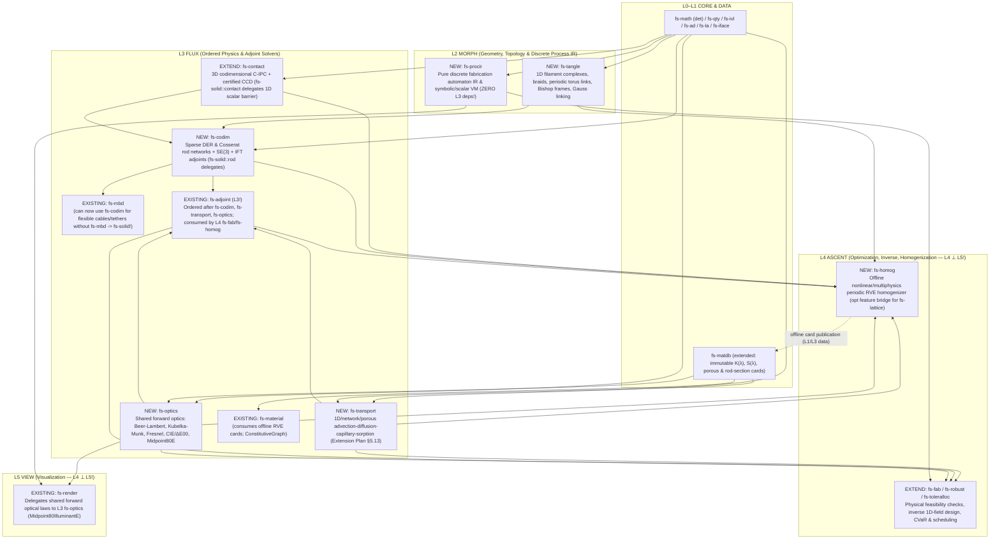
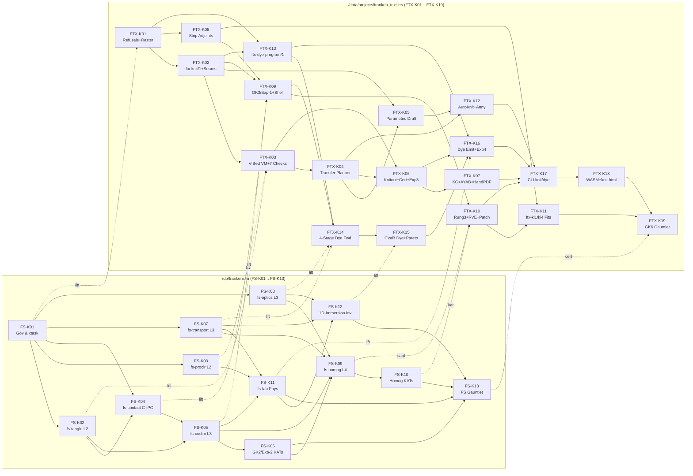

# Comprehensive Engineering Plan: Computational Knitting, General-Purpose Multiscale Filament Physics (`/dp/frankensim`), and Programmed Continuous Yarn Dyeing in FrankenTextiles

> **Status:** Final Steady-State Plan (Post-Round-4 Verified — 47 codebase-, math-, and hardware-verified revisions integrated across 4 independent review rounds)
> **Scope:** `/data/projects/franken_textiles` (commit `b5c26f29`) × `/dp/frankensim` (`/data/projects/frankensim` workspace snapshot)
> **Constitutional Authorities:** `franken_textiles/AGENTS.md`, `COMPREHENSIVE_PLAN_FOR_THE_DESIGN_OF_FRANKENTEXTILES.md`, `/dp/frankensim/AGENTS.md`, `/dp/frankensim/xtask`, and audited MOR claims `C001`–`C022` ([mor_knitting_analysis.md](file:///home/ubuntu/.gemini/antigravity-cli/brain/3602763c-f058-47ea-b7cf-3e24f585c072/mor_knitting_analysis.md)) & Idea Wizard portfolio ([idea_wizard_knitting.md](file:///home/ubuntu/.gemini/antigravity-cli/brain/3602763c-f058-47ea-b7cf-3e24f585c072/idea_wizard_knitting.md)).
> **Deliverable Discipline:** Read-only planning artifact. No source file, `.beads/` store, or git branch/worktree has been modified in either repository. Every bead blueprint in Part VI is self-contained and acyclic, ready for mechanical `br create` + `br dep add` conversion upon maintainer sign-off.

---

## Table of Contents

- **Part I — Executive Architecture, Two-Repo Strategy & Constitutional Invariants**
  - 1.1 Product Vision, User Journeys & Explicit Non-Goals
  - 1.2 The Four Claims & Honesty Constitution for Knitting & Dyeing
  - 1.3 Two-Repository Coupling Architecture: The Pure-Kernel Leaf Pattern
  - 1.4 `franken_textiles` 10-Crate Acyclic DAG & Four Narrow Seams
  - 1.5 Units, Coordinate Frames & Determinism Doctrine
- **Part II — General-Purpose Abstract Modules & Upgrades in `/dp/frankensim`**
  - 2.1 Governance Prerequisites (`fs-couple` Drift, `xtask` Fixtures, `moonshot-portfolio.json`)
  - 2.2 Layer-Legal Crate Atlas (`6 New + 1 Extension`) & Overlap Consolidation Map
  - 2.3 `fs-tangle` (L2 MORPH) — Embedded 1D Filament Complexes, Braids & Periodic Topology
  - 2.4 `fs-procir` (L2 MORPH) + L3/L4 `fs-fab` — Discrete Fabrication Process Automaton IR & VM
  - 2.5 `fs-contact` (L3 FLUX Extension) — 3D Codimensional C-IPC & Certified CCD
  - 2.6 `fs-codim` (L3 FLUX) — Sparse Differentiable DER & Cosserat Rod/Shell Networks
  - 2.7 `fs-transport` (L3 FLUX) — 1D/Network/Porous Advection–Diffusion–Capillary–Sorption
  - 2.8 `fs-optics` (L3 FLUX) + L1 `fs-matdb` — Differentiable Radiative & Spectral Appearance Laws
  - 2.9 `fs-homog` (L4 ASCENT) — Offline Nonlinear Multiphysics Periodic RVE Homogenizer
  - 2.10 Cross-Domain Transfer Matrix & Non-Knit Proof Guarantees
- **Part III — `franken_textiles` Computational Knitting Vertical**
  - 3.1 `ftx-knit/1` Stitch-Graph & Bed-Operation IR (`crates/ftx-pattern/src/knit/`)
  - 3.2 Virtual V-Bed Automaton Verifier & Physical Constraint Checker
  - 3.3 Anny 3D-to-Knit Shaping & Fully-Fashioned Drafting (`ShapingSurface` Seam)
  - 3.4 Multiscale Knit Physics in `ftx-drape` (Rungs 1, 2, 3 & `ftx-ki1`/`ftx-ki4` Closure)
  - 3.5 Multi-Tier Machine Backends & Unified Fail-Closed Certification (`ftx-export` + `ftx-core`)
- **Part IV — Programmed Continuous Yarn Dyeing & General 1D-Immersion Field Programming**
  - 4.1 First-Principles Error Budget: Drift, Boustrophedon Shear, Wicking & Loop Occlusion
  - 4.2 Four-Stage Differentiable Forward Operator & Adjoint/CVaR Inversion
  - 4.3 The Four Physical Dyeing Regimes & Automatic Pareto Regime Selector
  - 4.4 `ftx-dye-program/1` Machine Controller IR, Hazard Verifier & Uncertainty Receipt
  - 4.5 Cross-Domain Generalization: 1D-Immersion Field Programming in `/dp/frankensim`
- **Part V — CLI (`ftx`), WASM (`ftx-wasm`), Browser Workbench (`web/knit.html`) & Showcase**
  - 5.1 Deterministic CLI Subcommands & `--json` Envelopes
  - 5.2 WASM Bindings, Memory Budget & `WASM_INTERFACE_STAMP`
  - 5.3 Offline Local Browser Workbench (`web/knit.html`)
  - 5.4 Interactive Showcase Exhibits
- **Part VI — Kill Gates, Calibration Swatch Protocols, Phased Roadmap & Granular Bead DAG**
  - 6.1 Kill Gates (`GK1`–`GK6`) & Discriminating Experiments (`Exp-1`–`Exp-4`)
  - 6.2 Known-Answer Tests (KATs), Differential Tests & Determinism Lanes
  - 6.3 Phased Delivery Roadmap (Phases 0–4)
  - 6.4 Granular Self-Contained Bead Blueprints: `/dp/frankensim` (`FS-K01`–`FS-K13`)
  - 6.5 Granular Self-Contained Bead Blueprints: `franken_textiles` (`FTX-K01`–`FTX-K19`)
  - 6.6 Unified Cross-Repo Acyclic Dependency DAG & Critical Path
- **Appendix — Multi-Round Plan Review & Refinement Ledger**

---

# Part I — Executive Architecture, Two-Repo Strategy & Constitutional Invariants

## 1.1 Product Vision, User Journeys & Explicit Non-Goals

FrankenTextiles already delivers end-to-end mechanical reliability for cut-and-sew woven and jersey garments: parametric drafting, Anny body fitting (newborn through adult), contact-correct cloth draping, measurement readiness, and verified manufacturing outputs (`SVG`, tiled/projector `PDF`, `DXF`, `HPGL`, `DST`, cutting/sewing programs). Knitting is not a bolt-on export format—it is a fundamentally different fabrication paradigm where **structure, 3D geometry, anisotropic elasticity, and visual patterning are co-constructed loop by loop along a continuous 1D filament**.

This plan integrates four mutually reinforcing capabilities while raising the general mathematical foundation of `/dp/frankensim`:

1. **Computational Knitting Patterns & Anny 3D-to-Knit Shaping:** Generate verified knitted garments (flat fully-fashioned panels, seamless tubular/whole-garment shells, ribbed cuffs/neckbands, short-row heels/busts/shoulders, cables/lace) directly from fitted Anny toddler/adult body surfaces or structured pattern briefs, outputting both machine-executable knit programs and human hand-knitting charts.
2. **Automated Knitting Machine Control with Fail-Closed Safety:** Compile verified stitch graphs into bed-level carriage, transfer, racking, carrier, and take-down instructions for open-spec/open-backend targets (`Knitout v2`, CMU `knitout-backend-kniterate` `.kc` dialect, semi-automated `Brother AYAB`) and clean vendor-handoff manifests (`Shima Seiki`, `Stoll`), catching all 7 destructive real-machine crash modes before emitting bytes, and locking outputs under a unified `ftx-machine-cert/1` envelope with `hardware_execution_authorized: false`.
3. **General-Purpose Multiscale Filament, Contact, Transport, Optics & Homogenization Engines in `/dp/frankensim`:** Build six genuinely domain-agnostic Rust crates (`fs-tangle`, `fs-procir`, `fs-codim`, `fs-transport`, `fs-optics`, `fs-homog`) plus a 3D codimensional C-IPC extension to `fs-contact` that solve wire ropes, vascular stents, braided aerospace preforms, surgical sutures, wire harnesses, porous chromatography/RTM resin infusion, industrial paint/coatings, and automated fiber placement just as naturally as yarn and knits—then lift only their pure zero-unsafe numerical kernels into `franken_textiles`.
4. **Physically Honest Programmed Continuous Yarn Dyeing:** Model the complete physics from 1D continuous dye application along yarn arc length $s$ (capillary wicking, differential primary chromatography $R_f$, wet tenacity/shrinkage, thermal cure dwell) through 3D loop topology and *dressed wearing stretch* on an Anny body to perceived CIELAB color, solving the constrained inverse problem across four physically grounded regimes (1D stripes/ombré, circular planned pooling, bounded optical-fiducial closed-loop, and inline dancer-arm dye-at-feeder) alongside a Pareto trade advisor comparing single-strand dyeing against multi-carrier jacquard and intarsia.

### Concrete End-User Journeys

- **Journey A — Parent/Maker Knitting a Fitted Toddler Sweater on Kniterate or by Hand:**
  1. Fit an Anny body locally from tape/photo measurements (existing `ftx body fit`, zero cloud upload).
  2. Emit a stepped calibration swatch program (e.g., `ftx knit swatch --machine generic-vbed-12e --yarn zagreb/sportswear-2022/y2-yarn`, matching Zagreb's 12E 68.6 tex wool, OR `--machine kniterate-7e` with a 7E-tex catalog yarn validated against `MachineProfile.recommended_tex_range`) with `CalibrationSwatchOnly` certification; knit, wash/block, and measure real courses/cm, wales/cm, loop length $\ell_0$, and systematic feed drift $\epsilon$.
  3. Record the `KnitSwatchQualification` JSON locally, then run `ftx knit draft` to shape a fully-fashioned or tubular raglan pullover directly over the Anny body surface, drape it with Rung 2 homogenized knit physics (`ftx drape`), inspect fit/ease + homogenization honesty flags (`selvedge`, `tight_curvature`, `cable_aperiodic`), and emit verified `.kc` + `ftx-machine-cert/1` (or a printable hand-knitting PDF/SVG chart with gauge disclosure).
- **Journey B — Programmed Color-Patterned Knit (Honest Regime Selection):**
  1. Supply a target artwork PNG (`TargetRaster`) and a qualified garment knit graph + dressed drape deformation field.
  2. Run `ftx dye plan` to evaluate the exact error budget (cumulative arc-length drift $N\epsilon$, $2\times$ flatbed boustrophedon comb-tearing, capillary wicking floor $\sigma_{\text{wick}}$, dressed aspect distortion, skin grin-through) and compute the Pareto frontier across Regimes I-A (1D stripes/ombré), I-B (circular planned pooling), II (hardware-gated fiducial), III (inline dancer-arm piezo), and IV (jacquard/intarsia).
  3. Inspect the simulated *dressed* appearance preview (including worst-case CVaR drift realizations and unreproducible high-frequency residual map) in `web/knit.html` before dyeing a single meter of yarn, then export a verified `ftx-dye-program/1` + machine certificate enforcing wet-tenacity, Capstan drag, $v_{\min}>0$ anti-scorch floor, cure dwell, and child saliva/sweat fastness.
- **Journey C — Cross-Domain Engineer Using `/dp/frankensim`:**
  1. Model a 1+6 helical steel wire rope (`fs-tangle` + `fs-codim` + `fs-contact` + `fs-homog`) or a nitinol braided vascular stent (`2D tubular-helical` periodicity + superelastic `RodSectionLaw`), or optimize an inline optical coating line (`fs-transport` + `fs-optics` + `fs-procir` + `fs-adjoint`) using the exact same crates—with zero textile vocabulary anywhere in `/dp/frankensim`.

### Explicit Non-Goals (Scope Guardrails)

- **Not a live CNC / PLC / motor-controller driver:** Neither repo connects over USB/serial/Ethernet to drive live knitting carriages, piezo printheads, or dye pumps. Every emitted program carries `hardware_execution_authorized: false`.
- **Not an unverified proprietary vendor binary crack:** We will NEVER reverse-engineer or directly emit opaque Shima Seiki `.dat` or Stoll SINTRAL vendor machine executables.
- **Not a full-garment yarn-level real-time fashion renderer:** Full-garment Rung 1 simulation ($8.4\times10^5\text{–}4.9\times10^7$ DOFs) is mathematically infeasible under CPU/WASM budgets (`C009`); Rung 1 runs strictly at RVE (1–16 stitches) and bounded local post-drape audit patch scale.
- **Not a magic "open-loop flatbed photo-knitter":** Where systematic drift or dip-bath capillary wicking makes crisp 2D pixels physically impossible (`C014`, `C015`), the software MUST refuse the claim and route to a physically viable regime.
- **Not a replacement for physical calibration swatches or muslins:** Every RVE-derived constitutive card is `Evidence::Estimate` / `MODEL_FIT` until validated on physical coupons, and fit is established only on a physical wearer.

---

## 1.2 The Four Claims & Honesty Constitution for Knitting & Dyeing

Every data structure, CLI output, browser panel, and `ftx-machine-cert/1` receipt MUST keep the Four Claims strictly separate:

| Claim Axis | Knitting & Yarn-Dyeing Meaning | Required Evidence | Explicitly Forbidden Conflation |
|---|---|---|---|
| **Parity** | `Knitout v2` syntax/semantics match CMU `knitout-2` spec; lifted `/dp/frankensim` `kernel/` reproduces golden hashes across x86_64, aarch64, and `wasm32` | Golden fixtures, read-back VM round-trips, native/WASM SHA-256 digests | Never call syntax parity "machine safety" |
| **Physics** | `fs-codim` + `fs-contact` C-IPC, `fs-transport`, `fs-optics`, and `ftx-drape` knit shells reproduce analytical KATs (Poincloux elastica, Costello wire rope, Capstan, Washburn, Kubelka-Munk) | Known-answer test suite (`ftx-conformance` + `frankensim` Gauntlet G0–G4) | Never call passing KATs or RVE priors "measured fabric data" or "fit" |
| **Fit & Visual Realization** | A knitted garment fits a specific person AND a dyed yarn knits to the intended color/registration | Physical knitted swatch/muslin + washed/worn evaluation (`KnitSwatchQualification`, `YarnDyeingQualification`) | Never promote `Evidence::Estimate` / `MODEL_FIT` RVE cards or simulated dye previews to empirical fit |
| **Performance** | An RVE solve, garment drape, or dye-inversion optimization completes in stated time/memory on stated hardware | Fingerprinted benchmarks (`Exp-1`, `ftx-drape` bench) with spread | Zero unbenchmarked speed promises in code, docs, or CLI |

**Child-Wearer Safety & Privacy Mandates (from `AGENTS.md`):**
- Zero real person/child measurements, names, or photos in fixtures, tests, examples, or commits.
- `WearerAgeClass` (`InfantToddler | Child | Adult`) MUST be **explicitly required** on every `KnitPatternDoc` and `DyeProgramDoc` (never implementing `Default` to `Adult`; missing age class fails closed with `RefusalCode::InvalidDocument`).
- **Strangulation, entrapment & float guards:** Long un-tacked floats MUST be checked over `max(needle_pitch_mm, blocked_wale_pitch_mm)` (default **12 mm** `InfantToddler`, **20 mm** `Child`, **30 mm** `Adult`); `InfantToddler` garments additionally cap unanchored interior cut tails (`<= 20 mm` or anchored tuck/weave-in) and contiguous open lace/eyelet apertures (`<= 6.0 mm` finger entrapment), and `InfantToddler | Child` garments refuse hood/neck drawstring loops (`EN 14682`).
- Continuous yarn-dyeing recipes for wearable `InfantToddler | Child` garments MUST carry explicit `washing_off_validated: true`, sourced wash fastness (`ISO 105-C06`), AND saliva/perspiration fastness (`DIN 53160` / `ISO 105-E04`) — refusing production export fail-closed whenever `UNCERTAIN`. Test swatches from `ftx dye swatch` (`Exp-4`) stamp `"wearable_certified": false` and `"not_for_garment_wear": true`.
- Zero fabricated default material constants: yarn wet tenacity loss, hot-zone $T_g$, Washburn $K$, primary $R_f$, and yarn-yarn friction $\mu$ stay `UNCERTAIN` (causing fail-closed refusal on production certification) until supplied with an explicit provenance source or empirical swatch measurement.

---

## 1.3 Two-Repository Coupling Architecture: The Pure-Kernel Leaf Pattern

### Why Direct Cargo Coupling Is Rejected (`C006`)

Making `franken_textiles` depend directly on `/dp/frankensim` via `path = "../frankensim/crates/..."` fails **five independent hard invariants** verified directly in both workspaces:

1. **Lift-with-provenance policy (`franken_textiles/AGENTS.md`):** Explicitly declares *"Sibling Franken projects are resources, not dependencies: lift files with provenance, do not depend on the workspace."*
2. **Zero-unsafe supply-chain guarantee:** `franken_textiles` enforces `[workspace.lints.rust] unsafe_code = "forbid"` as a product-wide supply-chain guarantee. `/dp/frankensim` carries **26 registered `#![allow(unsafe_code)]` capsules** (`unsafe-capsules.json`), which Cargo would silently admit through external path dependencies.
3. **Pinned 7-crate dependency allowlist & WASM budget:** `franken_textiles` permits only 7 external crates (`serde`, `serde_json`, `spade`, `miniz_oxide`, `wasm-bindgen`, `rayon`, `wasm-bindgen-rayon`). `/dp/frankensim/Cargo.toml` patches relative sibling `asupersync = { path = "../asupersync" }` plus its constellation (61 crates wired into `fs-wasm/Cargo.toml`), which would blow up `franken_textiles`'s already-22.1 MB (7.0 MB gzipped, `Cargo.toml:95`) standalone `ftx-wasm` browser bundle.
4. **Nightly `generic_const_exprs` lock-in:** Although both repos currently pin `nightly-2026-08-31`, `fs-qty/src/lib.rs:20-21` enables `#![feature(generic_const_exprs)]` + `#![allow(incomplete_features)]`, tying any dependent crate to an unstable compiler feature.
5. **Incompatible domain envelopes:** FrankenSim uses `Qty<D>` units, `Cx` cancellation/structured concurrency, and `fs-evidence` receipts; `franken_textiles` uses explicit mm/m conversion boundaries, structured `Refusal` codes with ranked repairs, and `fabric-*/1` schemas.

### The Solution: Pure-Kernel Leaf Pattern (`C007`)

Generalizing the proven workflow already used for the 23 files lifted from `frankensim` into `franken_textiles` (`det.rs`, `fs-visco`, `bvh.rs`), **every new numerical or algorithmic crate in `/dp/frankensim` shared with `franken_textiles`** MUST be structured as a two-layer sandwich:

```text
crates/fs-<name>/
├── CONTRACT.md                  # 10-section FrankenSim contract
├── Cargo.toml                   # Layer-legal FrankenSim deps
└── src/
    ├── lib.rs                   # Outer FrankenSim facade: Qty<D>, Cx, fs-evidence, fs-matdb, fs-ad hooks
    └── kernel/                  # <--- LIFTED LEAF MODULE (zero FrankenSim framework deps!)
        ├── mod.rs               # #![forbid(unsafe_code)], pure f64 SI flat slices, deterministic math
        ├── det_math.rs          # Trait/shim binding to fs_math::det (in frankensim) or ftx_core::det (in ftx)
        └── golden_vectors.rs    # Deterministic test vectors + canonical SHA-256 output digest
```

**Mandatory Invariants of Every `src/kernel/` Submodule (enforced in `/dp/frankensim` `xtask` CI):**

1. `#![forbid(unsafe_code)]` at the top of `src/kernel/mod.rs` (even if an unrelated FrankenSim crate has an unsafe capsule).
2. **Zero FrankenSim framework or cross-crate imports inside `src/kernel/`:** No `fs_qty`, no `asupersync::Cx`, no `fs_evidence`, no `fs_matdb`, no cross-crate `fs_*` types inside `src/kernel/` (any shared POD such as `PeriodicDomain` is defined locally in `src/kernel/` with lossless `From` conversion only in the outer `src/lib.rs` facade!), and no `std::collections::HashMap` iteration affecting order. Inputs/outputs are plain `f64` (strict SI: m, kg, s, N, rad, W, nm), `usize`, `&[f64]`, `&mut [f64]`, small `#[repr(C)]` POD structs, and an optional budget/cancellation callback `FnMut(StepTelemetry) -> ControlFlow<()>`.
3. **Deterministic elementary functions (`C013`):** Every new shared crate is enrolled in `LIBM_DOCTRINE_CRATES` (and pre-existing shared crates like `fs-contact` pass a kernel-scoped `check-kernel-libm` while migrating legacy non-kernel files), forbidding platform `f64::{sin,cos,atan2,ln,exp,powf,cbrt}` inside `kernel/`. Every transcendental goes through the `DetMath` trait/shim (`fs_math::det` in FrankenSim; `ftx_core::det` in `franken_textiles`). Because `fs_math::det` currently lacks `cbrt` and `ftx_core::det` (`det.rs:10-14`) omits `dd`/`eft`/`pow`/`erf`/`erfc`, Phase 0 (`FS-K01`, `FTX-K01`) adds a native deterministic IEEE-seed + 2-step Halley `det::cbrt` to **both** repos and lifts `fs-math/src/{dd.rs, eft.rs}` + `pow`/`erf`/`erfc` into `ftx_core::det`!
4. **Zero `f64::mul_add` in hot loops & zero `f64::powi(|n| > 3)` (`C013`):** Direct profiling in `ftx-drape/CONTRACT.md:835-839` proved software `fma` (`mul_add`) consumed **68% of WASM runtime** (+7% `scalbn`), cutting bolero from 62 s to 14.7 s and trousers from 454 s to 53 s when replaced by plain `a * b + c`. Hot factorization/assembly loops in `src/kernel/` MUST use plain `*` and `+` with deterministic summation order and pass `xtask check-powi` and `check-kernel-no-fma` (which scans `src/kernel/**/*.rs` only, permitting internal FMA range reduction inside `det::*` itself and leaving `fs-sparse/src/fma/` untouched).
5. **Dual-side golden-hash parity:** Each `kernel/` ships a self-contained deterministic test vector fixture whose output state hashes to a recorded `SHA-256` digest. When lifted into `franken_textiles` (with the standard provenance header naming upstream path, revision, and date), `ftx-conformance` runs the *exact same* golden vector on both native and `wasm32-unknown-unknown` and asserts bit-for-bit digest equality!

**Why this pattern beats alternatives:** Maintaining hand-ported forks drifts within months; direct Cargo coupling breaks five constitutional invariants. The Pure-Kernel Leaf Pattern reduces each lift or upstream sync to copying `src/kernel/` verbatim, plugging in the 10-line `DetMath` shim, and verifying one SHA-256 digest—giving zero-drift sharing with zero dependency pollution.

---

## 1.4 `franken_textiles` 10-Crate Acyclic DAG & Four Narrow Seams

### Why We Retain 10 Crates by Default (`C001`–`C003`)

`franken_textiles/AGENTS.md` mandates: *"Ten crates. No new crate without explicit user approval."* Direct manifest inspection confirms the strict DAG:

```text
ftx-core  (serde, serde_json)
  ├── ftx-pattern   (ftx-core, serde, serde_json)              [NO spade, NO body, NO drape]
  ├── ftx-body      (ftx-core, serde, serde_json)
  └── ftx-measure   (ftx-core, serde, serde_json)              [reaches body via BodyModel trait]
         │
         ├── ftx-drape   (ftx-core, ftx-pattern, ftx-body, serde, serde_json, miniz_oxide, spade, opt rayon)
         ├── ftx-export  (ftx-core, ftx-pattern, serde, serde_json, miniz_oxide)   [NO drape, NO trace]
         └── ftx-trace   (ftx-core, ftx-pattern, serde, serde_json, miniz_oxide)   [NO drape, NO export]
                │
                └── ftx-cli, ftx-wasm, ftx-conformance (all workspace crates)
```

Prematurely splitting a vertical `ftx-knit` god-crate would both violate `AGENTS.md` without approval and duplicate material catalogs, refusals, and body interfaces. Conversely, naively wiring knitting and dyeing inside the 10 crates would hit **four exact cross-DAG walls**:
1. 3D-to-knit shaping needs fitted Anny body geometry inside `ftx-pattern`, yet `ftx-pattern` cannot depend on `ftx-body`.
2. Inverse length-wise yarn dyeing needs decoded target artwork PNGs inside `ftx-drape`, yet `ftx-drape` cannot depend on `ftx-trace`.
3. Knitting and dyeing IRs must be produced by drafting/planning (`ftx-pattern`), simulated/optimized (`ftx-drape`), and verified/emitted (`ftx-export`).
4. Knitting and dyeing emitters in `ftx-export` MUST gate on and hash-link drape-derived uncertainty/honesty/drift reports computed by `ftx-drape`, yet `ftx-export` cannot depend on `ftx-drape` (`AUD01` Conflict `D003`).

### The Four Narrow Acyclic Seams (`C002`)

We solve all four cleanly using the exact three decoupling idioms already proven in the codebase (`aruco` hoisted data in `ftx-core`, IoC traits `DraftBody`/`BodyMeasure`/`BodyModel`, caller-injected closure `material_study::evaluate_with`) plus pure receipt schemas in `ftx-pattern`:

| Seam | Lives In | Consumed / Implemented By | Exact Contract & Boundary Discipline |
|---|---|---|---|
| **Seam 1: `ShapingSurface`** | `crates/ftx-pattern/src/knit/surface.rs` | Implemented by `ftx-body` adapter (or constructed from closed manifold triangle mesh + anatomical landmark ring annotations in `ftx-cli`/`ftx-wasm`) | Pure trait + immutable value mesh (`vertices_m: Vec<[f64; 3]>`, `triangles: Vec<[u32; 3]>`, `landmark_rings`, geodesic/heat-field queries). `ftx-pattern` remains **free of `ftx-body` and `spade`**; any mesh remeshing happens upstream in `ftx-body` or caller adapter. |
| **Seam 2: `TargetRaster`** | `crates/ftx-core/src/raster.rs` | Produced by `ftx-trace` PNG/JPEG/WebP decoders; consumed by `ftx-drape` dye optimizer & `ftx-export` chart preview | Zero-dependency, domain-neutral pixel-grid value type (`width`, `height`, `color_space: ColorSpaceTag`, `linear_rgb_or_srgb: Vec<[f32; 4]>`, `physical_size_mm: Option<[f64; 2]>`, `sha256`). Contains **zero** decoders and **zero** dye chemistry, staying 100% faithful to `ftx-core/CONTRACT.md`. |
| **Seam 3: Pure Versioned IRs** | `crates/ftx-pattern/src/knit/ir.rs` & `crates/ftx-pattern/src/dye/ir.rs` | Authored by `ftx-pattern`; simulated/optimized by `ftx-drape`; read-back verified & exported by `ftx-export` | Pure serde-canonical schemas `ftx-knit/1` (stitch graph + bed ops + gauge/yarn refs) and `ftx-dye-program/1` (1D arc-length dye profile + regime + machine limits). Includes deterministic canonical JSON + SHA-256 digest. |
| **Seam 4: Pure Drape-Uncertainty & Qualification Receipts** | `crates/ftx-pattern/src/knit/receipt.rs` & `crates/ftx-pattern/src/dye/receipt.rs` | Populated and SHA-256-sealed by `ftx-drape` (and physical calibration records); hash-verified fail-closed by `ftx-export` | Pure value schemas: `KnitSwatchQualification`, `YarnDyeingQualification`, `KnitDrapeUncertaintyReceipt` (carrying `C011`'s 5 homogenization honesty flags), and `DyePlanUncertaintyReceipt` (drift ledger, topology multiplier, $F_{\min}$, residual energy, grin-through map). Lets `ftx-export` enforce drape gates with **zero** `ftx-export -> ftx-drape` dependency. |

### Explicit Escalation Trigger for an Optional 11th Crate (`ftx-knit`)

All knitting IR/VM/shaping modules inside `crates/ftx-pattern/src/knit/` and `crates/ftx-pattern/src/dye/` MUST have zero circular references back to woven drafting modules, importing only `ftx_core` and `ftx_pattern::materials`. If and only if (a) `cargo check -p ftx-trace` incremental rebuild time regresses noticeably due to knitting edits inside `ftx-pattern`, (b) standalone publication of `ftx-knit` is desired, or (c) the maintainer explicitly approves an 11th crate, extraction is a clean, mechanical cut into:

```text
{ftx-core, ftx-pattern} <- ftx-knit <- {ftx-drape, ftx-export, ftx-cli, ftx-wasm, ftx-conformance}
```
Notice `ftx-trace` does NOT depend on `ftx-knit`, completely isolating raster tracing compile times!

---

## 1.5 Units, Coordinate Frames & Determinism Doctrine

- **2D Pattern & Stitch-Graph Space (`ftx-pattern`, `ftx-export`):** Millimetres (`mm`), right-handed 2D ($+y$ up = knitting course growth direction, $+x$ right = wearer's right / needle index increasing left-to-right on technical face, public technical face facing viewer, CCW boundary loops). Yarn arc length $s$ in `mm` in `ftx-dye-program/1` (converted once to `m` at the `ftx-drape` boundary).
- **3D Body, Rod, Shell & Drape Space (`ftx-body`, `ftx-drape`, all `/dp/frankensim` `kernel/`s):** Strict SI (`m`, `kg`, `s`, `N`, `Pa`, `rad`, `K`, `W`, wavelengths in `m` or explicitly tagged `nm` at optical catalog boundaries), 3D right-handed $+z$ up, wearer facing $-y$. Exactly **one conversion boundary** (`mm <-> m`) at the `ftx-pattern <-> ftx-drape` seam.
- **V-Bed Machine Coordinate Frame (`ftx-knit/1`, `fs-procir`):** Integer needle index $i \in \mathbb{Z}$ increasing left-to-right; bed $\in \{\text{Front}, \text{Back}, \text{FrontSlider}, \text{BackSlider}\}$ (sliders hold/transfer/drop/miss only — never `Knit`/`Tuck`/`Split`!); exact integer **quarter-pitch racking** `quarter_pitches: i32` where back bed needle $i$ aligns with front bed needle $i + r/4$ (supporting Shima `0.25`/`0.5`/`1.0` pitches losslessly while `kniterate-7e` enforces `quarter_pitches % 4 == 0` within `[-16, +16]`); needle pitch $p$ in `mm` ($p = 25.4 / E\text{ mm}$); bed gap $g$ in `mm`.
- **Canonical Determinism Rules:**
  - Fixed-order assembly (sorted `(bed, needle)` / `(edge_a, edge_b)` / `(vertex_id)` keys; `BTreeMap`/`BTreeSet` or sorted `Vec`, never `HashMap` iteration order).
  - All elementary functions in numerical kernels routed through `det::*` (`fs_math::det` / `ftx_core::det`).
  - No `f64::mul_add` in hot loops (prevents 68% WASM `fma` slowdown and platform FMA contraction differences).
  - All JSON receipts sealed via shared `ftx_core::receipt::canonical_json_sha256` (`serde_json::to_value` BTreeMap key order, recursively normalizing `-0.0 -> 0.0` and rejecting `NaN`/`Inf` fail-closed, matching `workholding.rs:150-156`).

---

# Part II — General-Purpose Abstract Modules & Upgrades in `/dp/frankensim`

> **Design Principle:** `/dp/frankensim` is a general multi-physics engineering simulation & optimization platform. **Zero textile, knitting, stitch, needle, or garment terminology is permitted in any `/dp/frankensim` crate name, trait, or public API.** Every crate below solves broad classes of continuum, discrete-topology, transport, optical, and fabrication-process problems—with computational knitting and yarn dyeing acting as demanding validation domains alongside wire ropes, vascular stents, composite preforms, sutures, wire harnesses, porous chromatography/RTM, and optical coatings.

## 2.1 Governance Prerequisites (`fs-couple` Drift, `xtask` Fixtures, `consolidation-review.json`, `moonshot-portfolio.json`)

Code audit (`AUD01-C004`, `AUD01-C005`, `D006`, plus Round-1 `xtask` verification) exposed **five** concrete `/dp/frankensim` governance prerequisites that MUST be resolved atomically in Phase 0 (`FS-K01`) so `xtask check-all` stays green:

1. **Mandatory Remediation of Live `fs-couple` Manifest Drift (Before L3 Contact/Codim Work):**
   - Currently `crates/fs-couple/Cargo.toml:14-44` depends on 16 undeclared crates including forbidden `fs-tribo` (`FORBIDDEN_POLICY_EDGES`) plus `fs-material`, `fs-dcontact`, `fs-duct`, `fs-modal`, `fs-nlmodal`, `fs-phs`, `fs-plate`, `fs-vfit`, and carries `[dev-dependencies]` on `fs-contact` and `fs-solid`—directly contradicting `crates/fs-couple/CONTRACT.md:12` (*"No domain solver is a dependency"*).
   - Meanwhile `xtask/src/manifest_fixture.rs:25-88` (`REQUIRED_POLICY_EDGES`) mandates `fs-contact -> fs-couple`. Leaving `fs-couple`'s illegal edges merely "fenced" guarantees a `same_layer_topological_order` inversion or Cargo cycle as soon as `fs-contact` or `fs-solid` wires cleanly!
   - **Rule:** In Phase 0 (`FS-K01`, with maintainer approval), strip illegal domain-solver edges (`fs-tribo`, `fs-material`, etc.) from `crates/fs-couple/Cargo.toml` by factoring embedded acoustic coupling adapters into an L3 engine crate or feature-gated E2E harness, and keep new L3 crates (`fs-codim`, `fs-transport`, `fs-optics`) depending only on `fs-iface` + `fs-qty` (+ legal L0–L2 / ordered-L3 peers).
2. **Atomic Update of `proposed-manifest-fixture.json`, `xtask/src/manifest_fixture.rs` & `same_layer_topological_order`:**
   - `xtask/src/manifest_fixture.rs:893-989` & `1194-1314` hardcode `EXPECTED_PROPOSED_PACKAGES` (15 crates), `AUDITED_SOURCE_COMMIT`, `source_plan`, `bead_id`, `workspace_ids == {"root", "fs-wasm"}`, and reject **any** undeclared observed edge on any listed crate!
   - Therefore `FS-K01` MUST: register the 6 new crates (`fs-tangle`, `fs-procir`, `fs-codim`, `fs-transport`, `fs-optics`, `fs-homog`) in `EXPECTED_PROPOSED_PACKAGES` + `proposed-manifest-fixture.json` (`"presence": "proposed"`) with `"fs-homog"` and `"fs-procir"` added to `minimal_compile_roots` (`manifest_fixture.rs:837-876` requires `minimal_compile_roots ⊆ proposed` reaching every `proposed` crate!), reconcile `fs-contact` (`"presence": "proposed"` $\to$ `"required"`, declaring its live Cargo edges `fs-blake3`, `fs-exec`, `fs-geom`, `fs-la`, `fs-material` alongside `"state": "proposed"` `fs-math`, `fs-tangle`, `fs-couple`, `fs-iface`, `fs-solver`), declare new edges on listed fixture crates (`fs-solid -> {fs-contact, fs-codim}`, `fs-mbd -> fs-codim`) while leaving non-fixture crates (`fs-render`, `fs-fab`, `fs-lattice`) governed by `xtask check-layers`/`check-deps` (or enumerating all their existing edges if added), regenerate `frankensim-source-manifest{.json,.spdx.json}` (`xtask/src/main.rs:8712`), and specify exact `same_layer_topological_order` (`proposed-manifest-fixture.json:402-426`):
     - **L2:** `fs-tangle`, `fs-procir`;
     - **L3:** `fs-couple < fs-solver < fs-material < fs-tribo < fs-contact < fs-codim < fs-mbd < fs-solid` and `fs-transport, fs-optics < fs-adjoint` (**note: live `crates/fs-adjoint/Cargo.toml:10-11` is `L3 FLUX`, NOT L4!**);
     - **L4:** `fs-homog < fs-lattice < fs-fab`.
3. **Valid `consolidation-review.json` Dispositions (NO invented `"facade-delegate"` enum!):**
   - Live `xtask/src/consolidation.rs:35-48` accepts ONLY 5 disposition strings (`"CONSOLIDATE"`, `"FREEZE"`, `"KEEP"`, `"REPAIR-OR-QUARANTINE"`, `"RETIRE"`), tracks ONLY crates unreached by supported workflow `roots`, and rejects parking already-reached crates (`consolidation.rs:356`).
   - **Rule:** Register new unreached crates (`fs-tangle..fs-homog`) with valid `"KEEP"` dispositions citing `FS-K13` E2E root wiring (`crates/fs-codim-e2e/` or `fs-flagship-e2e`), while leaving already-reached `fs-render`, `fs-solid`, and `fs-lattice` unparked as live delegating facades (zero files deleted, `AGENTS.md` Rule 1).
4. **Full `xtask check-all` Policy Coverage (`main.rs:8694-8756`):**
   - Respect ratcheted `moonshot-portfolio.json` (`status_quo_cap = 5`, keeping all 6+1 crates as core platform capabilities / Extension Plan §5.13 realizations, not unbudgeted moonshots).
   - Update `schema-policy.json` (strict public schema accretion check), `doc-facts-inventory.json` / `README.md` (`check-docs`, `check-claims`), `check-maturity`, `check-critical-path`, hand-rolled TOML formatting rules (`main.rs:244-349`), and `check-terminology` (zero banned legacy branch terminology in any new `/dp/frankensim` file).
5. **Determinism Gates (`LIBM_DOCTRINE_CRATES` + `check-kernel-libm` + `check-kernel-no-fma`):**
   - Because `check-libm` (`xtask/src/main.rs:1123-1179`) scans *entire* crates, enroll all 6 brand-new crates (`fs-tangle`, `fs-procir`, `fs-codim`, `fs-transport`, `fs-optics`, `fs-homog`) in `LIBM_DOCTRINE_CRATES` from commit one, add a kernel-scoped `check-kernel-libm` for pre-existing `fs-contact/src/kernel/**` and `fs-fab/src/kernel/**` (while migrating legacy `fs-contact/src/{normal_patch,tangential,interface_binding}`), and add `check-kernel-no-fma` scanning `src/kernel/**/*.rs` only (allowing internal FMA range reduction inside `det::*` and untouched `fs-sparse/src/fma/`).

---

## 2.2 Layer-Legal Crate Atlas (`6 New + 1 Extension`) & Overlap Consolidation Map

Every placement below strictly obeys `/dp/frankensim`'s `xtask/src/main.rs:149-165` DAG (`L0 -> L1 -> L2 -> L3 -> L4`, `L0..L3 -> L5`, **`L4 ⊥ L5`**, and `FORBIDDEN_POLICY_EDGES` including `fs-mbd !-> fs-solid` and `fs-couple !-> fs-tribo`):



### Overlap Consolidation Table (Zero-Deletion Delegation Strategy, `D006`)

| New / Extended Crate | Live Overlap in `/dp/frankensim` | Exact Non-Destructive Delegation & `xtask` Disposition |
|---|---|---|
| `fs-optics` (L3) | `fs-render` (L5) implements Beer–Lambert, Cauchy, Fresnel, Snell, GGX, CIE 1931 (`QUAD_BINS = 80` 5 nm midpoint bins + Illuminant E in `fs-render/src/spectral.rs:19-33`), Jakob–Hanika | Move canonical pure-math forward optical laws into `fs-optics::kernel` (L3) preserving `SpectralGrid::Midpoint80IlluminantE` for bit-identical `fs-render` goldens; `fs-render` (L5) depends on `fs-optics` and delegates while keeping raytracing/shading at L5. Register `fs-optics` as `"KEEP"` in `consolidation-review.json` until E2E root wiring; leave reached `fs-render` unparked. |
| `fs-contact` (L3 ext) | `fs-solid/src/contact.rs:1-90` implements a **2D planar CutFEM nodal SDF 1D scalar `Barrier { kappa, dhat }`** using platform `.ln()` (`lines 75, 88, 102`) | Place canonical deterministic 1D scalar barrier (`value/d1/d2` via `det::ln`) + 3D codimensional C-IPC/CCD kernel in `fs-contact::kernel::codim_ipc`; `fs-solid/src/contact.rs` delegates its 1D scalar `Barrier` evaluation to `fs-contact` while keeping `ConstraintBarrierReceipt` strictly separate from physical `NormalPatch` (`fs-contact/CONTRACT.md:52-54`). |
| `fs-codim` (L3) | `fs-solid/src/rod.rs:1-100` implements a small Cosserat rod using `fs_time::lie` (`[w, x, y, z]`), dead body-frame `TipLoad { force, moment }`, and platform `atan2` (`line 68`) | Build full sparse analytic-tangent DER + Cosserat rod network solver in `fs-codim` ordered `fs-contact < fs-codim < fs-mbd < fs-solid`; `fs-solid::rod` delegates via a thin `[w,x,y,z]` + `TipLoad.moment` compatibility adapter (zero file deletion, all `fs-solid` tests green). |
| `fs-homog` (L4) | `fs-lattice` (L4, live in `fs-wasm/Cargo.toml:61` and `fs-metamat-e2e`) implements **2D CutFEM continuum `HoleArray`** periodic unit-cell homogenization (`crates/fs-lattice/src/lib.rs:4-14`, NOT 3D trusses) | Keep `fs-lattice` standalone in default `fs-wasm` builds (so `fs-wasm` does NOT unconditionally pull all 6 new crates!), and provide an optional feature-gated `fs-lattice -> fs-homog` 2D homogenization delegation path verified against `fs-lattice/src/homogenize.rs` (`KAT-H3`). |
| `fs-transport` (L3) | Disjoint from `fs-conduction` (pure thermal), `fs-airflow` (HVAC/duct), `fs-lbm` (bulk 2D/3D fluid) | Realizes Extension Plan §5.13 directly for 1D/network/porous advection–diffusion–capillary–sorption flow with zero duplication. |

---

## 2.3 `fs-tangle` (L2 MORPH) — Embedded 1D Filament Complexes, Braids & Periodic Topology

**Why it exists (and why L2):** Interlaced 1D structures—knitted loops, helical wire ropes, braided stents, biaxial/triaxial composite preforms, surgical knots, and aerospace wire harnesses—share identical geometric-topological primitives: arc-length parameterized space curves, crossing diagrams, linking/writhe invariants, parallel-transport Bishop frames, and periodic torus/cylinder lifts. Placing `fs-tangle` at **L2 MORPH** (depending only on `fs-math`, `fs-ivl`, `fs-qty`) allows L3 physics (`fs-codim`, `fs-contact`), L4 homogenizers (`fs-homog`), and L5 visualizers (`fs-render`) to share one exact topological truth source.

### Core Pure-Kernel Leaf API (`crates/fs-tangle/src/kernel/mod.rs`)

```rust
#![forbid(unsafe_code)]

/// Periodicity domain of an embedded 1D filament complex.
#[derive(Clone, Debug, PartialEq)]
pub enum Periodicity {
    /// Non-periodic open/closed curves in R^3 (sutures, wire harnesses, finite patches).
    Bounded,
    /// 1D helical translational + twist periodicity along axis e_z (wire ropes, multi-ply yarns).
    Helical1D { pitch_m: f64, twist_rad_per_period: f64 },
    /// 2D planar Bravais lattice in (a1, a2) with free out-of-plane z (knitted/woven sheets).
    Planar2D { a1_m: [f64; 3], a2_m: [f64; 3] },
    /// 2D cylindrical/tubular helical periodicity (braided stents, tubular knits, hoses).
    TubularHelical2D { radius_m: f64, axial_pitch_m: f64, circumferential_copies: u32 },
    /// 3D Bravais lattice (3D interlock weaves, truss/filament metamaterials).
    Lattice3D { basis_m: [[f64; 3]; 3] },
}

/// Canonical 1D embedded filament complex (curve-network + periodic image shifts).
#[derive(Clone, Debug)]
pub struct FilamentComplex {
    pub periodicity: Periodicity,
    /// Flat node coordinates [x0, y0, z0, ...] in metres (SI).
    pub positions_m: Vec<f64>,
    /// Material twist angles theta_e per directed segment (rad), relative to Bishop frame.
    pub segment_twist_rad: Vec<f64>,
    /// Directed polyline segments: (start_node, end_node, periodic_image_shift [i, j, k], filament_id).
    pub segments: Vec<FilamentSegment>,
    /// Optional explicit topological crossing certificates (under/over + signed handedness).
    pub crossings: Vec<CrossingSpec>,
    /// Cross-sectional radius per segment (m) for initial collision-free embedding check.
    pub radii_m: Vec<f64>,
}

/// Certified topological invariants computed using interval-bounded Gauss integrals.
#[derive(Clone, Debug)]
pub struct TopologyCertificate {
    /// Pairwise Gauss linking numbers (exact integers when intervals isolate within ±0.25).
    pub pairwise_linking: Vec<(u32, u32, i32)>,
    /// Total writhe per closed/periodic filament loop.
    pub writhe: Vec<f64>,
    /// Minimum pairwise clearance min(dist(seg_a, seg_b) - (r_a + r_b)) in metres.
    pub min_clearance_m: f64,
    /// True iff no segment pairs intersect or violate prescribed crossing signs.
    pub isotopy_valid: bool,
}

/// Core deterministic kernel entry points.
pub fn compute_bishop_frames(complex: &FilamentComplex, out_u: &mut [[f64; 3]]) -> Result<(), KernelErr>;
pub fn certify_topology(complex: &FilamentComplex) -> Result<TopologyCertificate, KernelErr>;
pub fn relax_collision_free_embedding(
    complex: &mut FilamentComplex,
    target_clearance_m: f64,
    max_iters: usize,
) -> Result<TopologyCertificate, KernelErr>;
```

**Why interval-certified Gauss linking matters:** When initializing a knitted stitch RVE or braided stent from a symbolic graph (`Knit`, `Purl`, `Cable`, `2-over-2 braid`), a slightly misplaced spline vertex can silently invert an over/under crossing—turning a knitted loop into an unknotted ring or locking a phantom knot into a wire rope! By using `fs-ivl` (or deterministic certified segment-segment distance bounds in `kernel/`) to certify pairwise linking integers and exact crossing signs *before* launching `fs-codim` physics, topological corruption fails closed at millisecond cost.

---

## 2.4 `fs-procir` (L2 MORPH) + L3/L4 `fs-fab` — Discrete Fabrication Process Automaton IR & VM

**Why L2 + L3/L4 split is essential (`D001`):** `xtask/src/main.rs:158` strictly forbids `L2 -> L3`. Putting the discrete machine automaton at **L2 (`fs-procir`)** means L3 solvers, L4 optimizers (`fs-fab`), and L5 visualizers (`fs-render`) can all inspect fabrication instructions, while physical mechanics checks (yarn tensile breaking strain, wet tenacity, thermal cure dwell) execute cleanly at **L3/L4** without violating the layer DAG.

### General Abstraction Beyond Knitting

Every sequential multi-actuator fabrication process—V-bed knitting, filament winding, automated fiber placement (AFP), multi-axis CNC toolpaths, robotic wire-harness routing, and continuous roll-to-roll yarn dyeing—is a **resource-constrained state-transition program** over:
- **Discrete Resource Slots** (e.g., needle hooks, bobbin creels, AFP tows, bath tanks, fixture clamps), each holding a bounded multiset/stack of material tokens (`max_occupancy`);
- **Mobile Actuators / Carriers** sharing kinematic rails/axes with exclusion envelopes (`min_clearance_slots`, directional parking/collision constraints);
- **State-Transition Operations** with deterministic preconditions, postconditions, and symbolic scalar bounds (span length, racking offset, feed rate floor `v_min > 0`, dwell floor `tau_min > 0`).

### Core Pure-Kernel Leaf API (`crates/fs-procir/src/kernel/mod.rs`)

```rust
#![forbid(unsafe_code)]

#[derive(Clone, Debug)]
pub struct MachineTopologySpec {
    pub spec_sha256: [u8; 32],
    pub slot_banks: Vec<SlotBankSpec>,      // e.g. Front/Back beds, or AFP tow heads, or dye stations
    pub actuator_rails: Vec<RailSpec>,      // collision-checked carriage/carrier/gantry rails
    pub scalar_limits: Vec<ScalarBoundSpec>,// e.g. max_racking_slots, max_float_slots, v_min_m_s
}

#[derive(Clone, Debug)]
pub struct ProcessProgram {
    pub schema_version: u32,
    pub machine_spec_sha256: [u8; 32],
    pub ops: Vec<ProcessOp>,
}

/// Deterministic discrete-automaton virtual machine verifying structural feasibility.
pub trait AutomatonSemantics {
    type State: Clone;
    type Violation: Clone;
    fn init_state(&self, spec: &MachineTopologySpec) -> Self::State;
    fn step(&self, state: &mut Self::State, op: &ProcessOp, step_idx: usize) -> Result<(), Self::Violation>;
    fn finalize(&self, state: &Self::State) -> Vec<Self::Violation>;
}

/// Read-back verification verdict emitted by L2 VM before L3/L4 physical checks.
#[derive(Clone, Debug)]
pub struct DiscreteVmReceipt {
    pub program_sha256: [u8; 32],
    pub machine_spec_sha256: [u8; 32],
    pub steps_executed: usize,
    pub peak_slot_occupancy: u32,
    pub max_span_slots: u32,
    pub violations: Vec<StructuredViolation>,
    pub feasible: bool,
}
```

**L3/L4 Physical Feasibility Extension (`fs-fab` / `fs-machine`):** Consumes `ProcessProgram` (from L2 `fs-procir`) + material cards (from L1 `fs-matdb` / L3 `fs-material`) + `fs-codim`/`fs-transport` kernels to evaluate physical constraints: geometric diagonal span strain $\varepsilon_{\text{span}} = \frac{\sqrt{g^2 + (rp)^2} - \ell_{\text{slack}}}{\ell_{\text{ref}}}$ vs breaking elongation, Euler–Eytelwein Capstan tension cascade $T_{k+1} = T_k e^{\mu_k \theta_k}$, wet-tenacity survival margin, and thermal-dwell / $v\to 0$ scorch limits.

---

## 2.5 `fs-contact` (L3 FLUX Extension) — 3D Codimensional C-IPC & Certified CCD

**Why extend `fs-contact` instead of creating `fs-ipc` (`C005`, `D006`):** `fs-contact` already owns contact mechanics at L3 with an explicit architectural invariant (`fs-contact/CONTRACT.md:52-54`) separating mathematical non-penetration barriers (`ConstraintBarrierReceipt`) from physical normal compliance (`NormalPatch`). Creating a parallel `fs-ipc` crate would duplicate BVH broadphase, CCD, and friction laws and fail `xtask check-consolidation`.

### What the Extension Adds (`crates/fs-contact/src/kernel/codim_ipc.rs`)

1. **Certified Exact Codimensional CCD & Topological Self-Contact Exclusion (Point–Triangle, Edge–Edge, Point–Edge, Point–Point):**
   - Tight-inclusion interval root-finder (`Wang et al. 2021` conservative bisection using pure IEEE-754 interval arithmetic, zero platform `libm`), returning a guaranteed penetration-free maximum step fraction $\alpha_{\max} \in (0, 1]$ for moving finite-thickness segments of radius $r_a, r_b$ (minimum clearance $d_{\min} = r_a + r_b$).
   - **Self-contact topological exclusion horizon:** Excludes ONLY intra-filament pairs along the same `filament_id` chain whose topological geodesic rest arc length satisfies $s_{\text{arc}} \le \pi(r_a + r_b)$ (NEVER across distinct filaments or opposite loop crossings by raw Euclidean chord!). Any non-excluded start pair with initial clearance $0 < d_0 - d_{\text{offset}} < \hat{d}$ uses reduced per-pair offset $d_{\text{offset,pair}} = \min(d_{\text{offset}}, 0.5\,d_0)$ (matching `ftx-drape/src/contact.rs:1190`, failing closed if $d_0 \le 0$).
   - **Mollified Edge–Edge C-IPC Potential (`Li, Kaufman & Jiang 2021`):** Handles parallel and near-parallel filament crossings via rest-scaled $\bar{m} = 10^{-3}\|\mathbf{e}_{a,0}\|^2\|\mathbf{e}_{b,0}\|^2$ and $C^2$ cubic mollifier $m(u) = \min(1,\, 3u - 3u^2 + u^3)$ with $u = \|\mathbf{e}_a \times \mathbf{e}_b\|^2 / \bar{m}$ (retaining $O(\theta^2)$ behavior as $\theta \to 0$ with $m'(1)=m''(1)=0$) multiplying the **diverging gap barrier** ($g = d - d_{\text{offset}}$, matching `fs-solid/src/contact.rs:29,75` and `ftx-drape/src/contact.rs:40,1064`):
     $$b(g; \hat{d}) = -\kappa (g - \hat{d})^2 \ln\!\left(\frac{g}{\hat{d}}\right) \quad \text{for } 0 < g < \hat{d}, \qquad b = 0 \text{ for } g \ge \hat{d}, \qquad b = +\infty \text{ for } g \le 0$$
     evaluated strictly via `det::ln` (also supplying the deterministic 1D scalar `Barrier { kappa, dhat }` `value/d1/d2` helper delegated from `fs-solid/src/contact.rs:1-90`, eliminating its platform `.ln()` bug, `C013`).
2. **Exact Analytical Gradient, Hessian & SPD Projection:**
   - Closed-form $12\times 12$ local EE / PT gradient and Hessian with deterministic $12\times 12$ Jacobi eigendecomposition projecting negative eigenvalues to $0$ (ensuring strict descent in symmetric sparse LDLT without nondeterministic BLAS/LAPACK calls).
3. **Pluggable `NormalContactLaw` & `TangentialFrictionLaw` with Outer Lagged Fixed-Point Contract (`C012`):**
   - Keeps the C-IPC barrier strictly as a geometric hard-core non-penetration safety floor (`ConstraintBarrierReceipt`) while allowing an additive physical soft-core normal compliance law (`NormalContactLaw`: Hertzian for steel wires, exponential transverse compression for porous spun yarn bundles, flattening ribbon contact for moderate-aspect dry composite tows).
   - Pluggable `TangentialFrictionLaw`: smooth IPC lagged-tangent Coulomb/Stribeck friction (default), directional anisotropic scale friction ($\mu_+ \neq \mu_-$ along tangent $\mathbf{t}_a$, e.g. Merino wool scales!), and fretting micro-slip (steel wire ropes). Because Stribeck ($\mu(v)$) and directional friction break Jacobian symmetry and lack a scalar potential, the solver enforces an explicit **outer lagged fixed-point contract**: freeze $(\lambda_n^{(k)}, \mathbf{T}^{(k)}, \mu_{\text{eff}}^{(k)})$ per conservative symmetric inner Newton–LDLT solve, iterating outer updates until $\|\Delta \lambda_f\|_\infty < \text{tol}_f$ (with an explicit outer iteration cap and residual report).
4. **Self-Contained Periodic-Image Broadphase (`PeriodicDomain` POD):** Built-in deterministic spatial hash / LBVH defining its own self-contained `PeriodicDomain` POD inside `src/kernel/periodic_bvh.rs` (zero cross-crate `fs-tangle` import inside `src/kernel/`; lossless `From<&fs_tangle::kernel::Periodicity>` lives only in `fs-contact/src/lib.rs`!). Handles non-orthogonal sheared `Planar2D` cells via fractional lattice coordinates $\mathbf{B}^{-1}\mathbf{x}$ with $3^2$ cell neighbor search, `TubularHelical2D` screw symmetry $\mathbf{R}(k\Delta\theta)\mathbf{x} + k\Delta z \mathbf{e}_z$, and explicit multi-cell AABB tiling when segment spans exceed $L/2$.

---

## 2.6 `fs-codim` (L3 FLUX) — Sparse Differentiable DER & Cosserat Rod Networks

**Why a dedicated L3 `fs-codim` ordered `fs-contact < fs-codim < fs-mbd < fs-solid` (`C005`):**
- Existing `fs-solid/src/rod.rs:1-100` is a small prototype inside `fs-solid` (using `fs_time::lie` `[w, x, y, z]`, dead body-frame `TipLoad { force, moment }`, and platform `atan2`, `C013`). Because `proposed-manifest-fixture.json` explicitly forbids `fs-mbd -> fs-solid`, placing `fs-codim` cleanly between `fs-contact` and `fs-mbd` unlocks flexible cables, tethers, wire harnesses, sutures, stents, and yarns for *both* `fs-mbd` and `fs-homog`—while `fs-solid::rod` delegates to `fs-codim` via a `[w,x,y,z]` + `TipLoad.moment` compatibility adapter (`D006`).
- **Explicit v1 Scope Honesty:** `fs-codim` v1 covers **1D rod networks** (DER + Cosserat + rigid/elastic junctions); continuum shells stay in `ftx-drape` / `fs-plate` / `fs-solid` (no phantom shell module promised inside `fs-codim` v1).

### Mathematical Formulation (`crates/fs-codim/src/kernel/mod.rs`)

- **Dual Kinematics & Branching Junctions Under One Sparse CSR Assembler:**
  1. **4-DOF Discrete Elastic Rod (DER, Bergou et al. 2008/2010):** Centerline node positions $\mathbf{x}_i \in \mathbb{R}^3$ + per-edge scalar material twist angle $\theta_e \in \mathbb{R}$ referenced to parallel-transported Bishop frames (minimum DOF count: ~56–64 DOFs per knitted stitch!).
  2. **6-DOF Cosserat Rod (Antman / Simo–Reissner):** Node positions $\mathbf{x}_i \in \mathbb{R}^3$ + nodal `SO(3)` quaternions $\mathbf{q}_i$ (`[w, x, y, z]` matching `fs_time::lie`) with exact exponential-map Lie-algebra incremental updates $\delta\boldsymbol{\phi}_i \in \mathfrak{so}(3)$ via `det::sin`/`det::cos`.
  3. **Explicit `JunctionNode` for Degree $\neq 2$ Vertices & `fs-mbd` Rigid Clamps:** Because Bishop-frame twist holonomy is only defined across degree-2 chains, any branching vertex (braid splices, wire harnesses, multi-ply knots, rigid payload clamps) attaches a 6-DOF `SO(3)` `JunctionNode { q_wxyz: [f64; 4], attached_edges }` coupling incident DER/Cosserat edges cleanly via local mitered frame constraints!
- **Pure-Functional `RodSectionLaw` Trait (Trial-Safe History, `C012`):**
  ```rust
  pub trait RodSectionLaw {
      /// Pure evaluation: NEVER mutates `committed` history during rejected Newton line-search trials!
      /// Returns local forces/moments, exact 6x6 (or 4x4 DER) consistent tangent, and candidate next history.
      fn evaluate_section(
          &self,
          axial_strain: f64,
          shear_strain: [f64; 2],
          curvature_m_inv: [f64; 2],
          twist_rad_m: f64,
          committed: &SectionHistory,
      ) -> (SectionStressTangent, SectionHistory);
  }
  ```
  Ships 4 built-in laws: `LinearElasticIsotropic`, `NonlinearYarnBundle`, `SuperelasticSma`, and `ElastoplasticYield` (history is committed ONLY after Newton + CCD step acceptance!).
- **Exact Analytical Tangent & Pure-Kernel Full-Symmetric CSR Sparse LDLT / PCG Solver:**
  - Exact analytical bending + twisting + stretching Hessians assembled in sorted **full structurally symmetric CSR** order (both upper and lower triangles stored with sorted column indices per row, matching BOTH `fs-sparse/src/direct.rs:449-457` and `ftx-drape/src/sparse/direct.rs:471`, enforcing `StructurallyAsymmetric` rejection prior to AMD ordering!), solved by a `#![forbid(unsafe_code)]`, zero-`mul_add` `kernel/sparse_ldlt.rs` over AMD-permuted full CSR (never pulling `fs-sparse/src/fma/` unsafe capsules!), with Jacobi/block-Jacobi PCG fallback for larger assemblies.
  - **Non-Conservative Follower-Moment Compatibility (`fs-solid::rod`):** When dead body-frame follower moments (`TipLoad.moment != 0`, `fs-solid/src/rod.rs:192-196,242,248`) are active in the `fs-solid::rod` adapter, assemble the exact left-trivialized skew Lie-bracket tangent $\frac{1}{2}[\mathbf{M}_{\text{body}}]_\times$ and solve via residual-norm merit backtracking + small asymmetric LU/GMRES (keeping symmetric CSR LDLT + energy line search for all conservative rod networks!).
  - **Implicit Function Theorem (IFT) Adjoints (Elastic-Only Guard):** Given converged **path-independent conservative** equilibrium $\mathbf{g}(\mathbf{q}^*, \mathbf{p}) = \mathbf{0}$, solves $\mathbf{H}^T \boldsymbol{\lambda} = -\nabla_{\mathbf{q}} J$ reusing the already-factored CSR LDLT matrix. Whenever irreversible history (`SuperelasticSma`, `ElastoplasticYield`, or lagged stick-slip friction) is active, single-solve IFT is **explicitly refused** (`Err(IrreversibleHistoryRequiresCheckpointAdjoint)`), requiring checkpointed reverse-trajectory differentiation!
- **Explicit v1 Scope Boundary (`C012`):** **No fixed Eulerian slip-nodes** inside v1 C-IPC; filament sliding occurs physically via smooth Lagrangian contact + `TangentialFrictionLaw`.

---

## 2.7 `fs-transport` (L3 FLUX) — 1D/Network/Porous Advection–Diffusion–Capillary–Sorption

**Why it exists (and fulfills Extension Plan §5.13):** `/dp/frankensim` has thermal conduction (`fs-conduction`), HVAC duct flow (`fs-airflow`), and bulk LBM (`fs-lbm`), leaving a complete gap for **1D/network/porous multi-species mass & unsaturated liquid transport**. That exact PDE family governs:
- Continuous yarn capillary wicking, multi-primary chromatographic dye separation ($R_f$), chemical sorption/fixation kinetics, and convective drying/evaporation;
- Liquid Composite Molding / Resin Transfer Molding (RTM) dual-scale tow impregnation;
- Liquid chromatography columns, microfluidic paper diagnostics, electrochemical porous separators, and roll-to-roll thin-film coating lines.

### Governing Equations & Pure-Kernel Leaf (`crates/fs-transport/src/kernel/mod.rs`)

On a general 1D arc-length / porous graph network $s \in [0, L]$ (or connected 1D edge graph with cross-sectional area $A(s)$ and porosity $\phi(s)$):

1. **Unsaturated Liquid Saturation $\theta(s, t) \in [0, \theta_{\text{sat}}]$ (Degenerate Power-Law Capillary/Richards + Evaporation):**
   $$\frac{\partial (\phi \theta)}{\partial t} + \frac{\partial}{\partial s}\!\left(v_{\text{adv}}(s, t) \phi \theta - D_{\text{cap}}(\theta, T) \frac{\partial (\phi \theta)}{\partial s}\right) = \dot{q}_{\text{inj}}(s, t) - \dot{q}_{\text{evap}}(\theta, T, \text{RH}), \qquad D_{\text{cap}}(\theta, T) = D_0(T)\max\!\left(\frac{\theta}{\theta_{\text{sat}}},\, 0\right)^m \; (m \ge 1)$$
   - *Why degenerate Brooks–Corey / power-law $D_{\text{cap}}(\theta)$ ($m \ge 1$):* Constant diffusivity produces unphysical infinite-speed Gaussian tails, whereas $m \ge 1$ creates a sharp wetting front reproducing exact Lucas–Washburn $x(t) = K\sqrt{t}$ (`KAT-TRANS-1`) in the infinite-reservoir limit AND finite-drop volume-depletion + evaporation arrest in heated piezo DOD (`C015`). Solved via upwind/lumped-mass M-matrix implicit Picard/Newton steps with zero-flux Neumann ends and Kirchhoff flux conservation at 1D network junctions.
2. **Conserved-Mass Multi-Species Solute Transport & Competitive Sorption ($M_k = \phi\theta c_k \ge 0$, $c_k^{\text{fix}} \ge 0$ for $k=1\dots M$):**
   $$\frac{\partial M_k}{\partial t} + \frac{\partial}{\partial s}\!\left(R_{f,k}\, v_{\text{liq}}(\theta)\, M_k - D_k \phi\theta \frac{\partial (M_k / \phi\theta_{\text{reg}})}{\partial s}\right) = \dot{m}_{k,\text{inj}}(s,t) - k_{\text{fix},k}(T)\,\chi_{\text{mob}}(\theta)\,M_k\,\frac{S_{\max} - \sum_j c_j^{\text{fix}}}{S_{\max}}$$
   where the interstitial liquid velocity **explicitly includes Darcy capillary wicking flux**:
   $$v_{\text{liq}}(\theta) = \frac{v_{\text{adv}}\phi\theta - D_{\text{cap}}(\theta, T)\,\partial_s(\phi\theta)}{\max(\phi\theta,\, \epsilon_\theta)}$$
   and $\chi_{\text{mob}}(\theta) \in [0, 1]$ is a smooth $C^2$ percolation mobility cutoff vanishing below irreducible saturation $\theta_{\text{irr}}$.
   - *Why conserved-mass $M_k$ instead of concentration $c_k$:* Solving directly for $c_k$ produces a singular $0 \cdot c_k^{n+1} = 0$ system in dry cells ($\theta = 0$) and diverges $c_k = M_k/(\phi\theta) \to \infty$ upon evaporation! Solving in conserved mass $M_k \ge 0$ with upwind M-matrix advection + exact analytic exponential integration for multi-species competitive fixation ($0 \le \sum_j c_j^{\text{fix}} \le S_{\max}$) is unconditionally well-posed and positivity-preserving everywhere, including dry fronts and complete evaporation.
   - *Carrier-coupling & exact discrete adjoint:* Exposes an explicit `CarrierCouplingMode` (`ConstantVolumeCarrier` vs `DoseCoupledDropVolume` where $\dot{q}_{\text{inj}} = \sum_k \alpha_k u_k$), with exact discrete reverse-mode adjoint ($\mathcal{K}_{\text{wick}}^T$) backpropagating through saved $(\theta^n, M_k^n, c_k^{\text{fix},n})$ checkpoints (including $D_{\text{cap}}(\theta^n), v_{\text{liq}}(\theta^n)$ Picard steps when `DoseCoupledDropVolume` is active) in $O(N_{\text{cells}} \cdot N_{\text{steps}})$!
3. **Thermal & Mechanical Hazard Coupling Hooks:** Tracks local temperature $T(s,t)$ (for cure fixation Arrhenius rate $k_{\text{fix}}(T)$ and thermoplastic $T_g$ creep threshold) and moisture saturation $\theta(s,t)$ (for wet-tenacity degradation and hygral drying shrinkage $\varepsilon_{\text{shrink}}(\theta)$).

---

## 2.8 `fs-optics` (L3 FLUX) + L1 `fs-matdb` — Differentiable Radiative & Spectral Appearance Laws

**Why L3 and NOT L5 (`C005`, `X005`):** `/dp/frankensim`'s `xtask` strictly forbids `L4 -> L5` (`L4 ⊥ L5`). Putting optical appearance laws in L5 `fs-render` makes it **architecturally impossible** for L3 `fs-adjoint` and L4 optimizers (`fs-fab`, `fs-homog`) to differentiate perceived color ($\Delta E_{00}$) with respect to dye concentration, pigment loading, or coating thickness! Furthermore, `fs-render` *already* contains Beer–Lambert, Cauchy dispersion, Fresnel, Snell, CIE 1931 (`QUAD_BINS = 80` midpoint bins + Illuminant E + Bradford adaptation `xyz_e_to_d65` in `fs-render/src/spectral.rs:19-33,100-140`), and Jakob–Hanika spectral uplift (`fs-render/CONTRACT.md:29-41`). Moving those pure physical laws into **L3 `fs-optics`**—and adding Kubelka–Munk/Saunderson, fiber scattering, and CIEDE2000—eliminates duplication and lets L3 `fs-adjoint`, L4 inverse optimizers, and L5 `fs-render` consume one canonical differentiable optical physics engine!

### Core Capabilities (`crates/fs-optics/src/kernel/mod.rs`)

- **Spectral Grids & Radiometric Units:** Strict radiometric SI (wavelengths $\lambda_j \in [380, 780]\text{ nm}$ stored in metres, dimensionless reflectance/transmittance/absorption ratios—never requiring `cd` in `fs-qty`). Supports three explicit `SpectralGrid` enums:
  - `Midpoint80IlluminantE` (80 midpoint bins at 5 nm spacing, equal-energy Illuminant E + Bradford `xyz_e_to_d65` — preserves **bit-exact** compatibility with frozen `fs-render/src/spectral.rs:19-33,100-140` image goldens!),
  - `Nodes81` (81 fencepost nodes, 5 nm) and `Nodes31` (31 nodes, 10 nm) with native D65 / D50 / F2 illuminants going straight from D65 XYZ $\to$ D65 $L^*a^*b^*$ (no Illuminant-E adaptation detour!).
- **Singularity-Free Kubelka–Munk + Saunderson Surface Correction:**
  - Multi-colorant linear mixing of absorption $K(\lambda)$ and scattering $S(\lambda)$ (enforcing $K_{\text{sub}}(\lambda) > 0, S_{\text{sub}}(\lambda) > 0$ in `fs-matdb` to avoid $\frac{dR_\infty}{d(K/S)} \sim -(2x)^{-1/2} \to -\infty$ at $x=0$!):
    $$K_{\text{mix}}(\lambda) = K_{\text{sub}}(\lambda) + \sum_{m=1}^{M} c_m^{\text{fix}}\,k_m(\lambda), \qquad S_{\text{mix}}(\lambda) = S_{\text{sub}}(\lambda) + \sum_{m=1}^{M} c_m^{\text{fix}}\,s_m(\lambda)$$
  - Cancellation-free rationalized infinite-thickness reflectance $R_\infty(\lambda) = \big(1 + x + \sqrt{x(x+2)}\big)^{-1}$ ($x = K/S$, avoiding catastrophic cancellation at large $x$), two-branch overflow/0÷0-free finite-thickness reflectance over backing $R_g$ ($a = 1 + x$, $b = \sqrt{x(x+2)}$, $u = b S h$):
    $$R(h) = \begin{cases} \dfrac{R_g\cosh u + (1 - a R_g)\,S h\,\operatorname{sinhc}(u)}{\cosh u + (a - R_g)\,S h\,\operatorname{sinhc}(u)} & u \le 1, \\[8pt] \dfrac{b R_g + (1 - a R_g)\tanh u}{b + (a - R_g)\tanh u} & u > 1 \end{cases}$$
    ($\operatorname{sinhc}(u) = 1 + u^2/6 + u^4/120$ for $u \le 10^{-3}$), and Saunderson correction $R_{\text{meas}} = k_1 + \frac{(1-k_1)(1-k_2)R}{1-k_2 R}$.
- **Directional Fiber & Sub-Pixel Spatial Mixing:**
  - Dual-lobe Marschner/Kajiya–Kay fiber glint + diffuse Kubelka–Munk body reflectance computed **per yarn segment into linear CIE XYZ** prior to spatial/pore blending with backing/skin reflectance (`f_pore(F_drape) * XYZ_skin`).
- **Exact AND Singularity-Free Differentiable Colorimetry (`colorimetry.rs`):**
  - CIE XYZ $\to$ CIE $L^*a^*b^*$ enforcing the standard $C^1$ linear branch $f(t) = \frac{1}{3}(29/6)^2 t + 4/29$ for $t \le (6/29)^3$ and native Halley `det::cbrt` for $t > (6/29)^3$.
  - Ships BOTH `ciede2000_exact` (exact Sharma et al. 2005 for `KAT-OPT-1` & receipts) AND **$C^\infty$-smooth `ciede2000_sq_smooth(lab1, lab2, eps_c)`** ($\varepsilon_C = 10^{-4}$) for gradient optimization—eliminating the $1/\sqrt{C_1'} \to \infty$ singularity at neutral/undyed white yarn ($a^*=b^*=0$!) via regularized $C_{i,\varepsilon}' = \sqrt{a_i'^2 + b_i^{*2} + \varepsilon_C^2}$, trig-free $\Delta H_\varepsilon^2 = 2(C_{1,\varepsilon}'C_{2,\varepsilon}' - a_1'a_2' - b_1^*b_2^* - \varepsilon_C^2)$, and unit-vector regularized mean hue $\bar{h}'$ (with $180^\circ$-orthogonal fallback), verified to $<10^{-7}$ against central FD!
- **L1 `fs-matdb` Spectral Table Extension:** Stores immutable, provenance-tagged substrate & colorant $K(\lambda), S(\lambda)$ basis tables ($K_{\text{sub}}, S_{\text{sub}} > 0$; unmeasured dyes remain `UNCERTAIN`).

---

## 2.9 `fs-homog` (L4 ASCENT) — Offline Nonlinear Multiphysics Periodic RVE Homogenizer

**Why offline L4 with feature-gated `fs-lattice` bridge (`C005`, `D002`, `D006`):** `xtask` forbids `L3 -> L4`, so L3 continuum shells cannot invoke L4 homogenization inside Newton iterations. Instead, `fs-homog` sits cleanly at **L4 ASCENT**, orchestrating L2 `fs-tangle` + L3 `fs-codim` + L3 `fs-contact` + L3 `fs-transport` + L3 `fs-optics` offline to sweep a periodic Representative Volume Element (RVE) over strain/curvature/temperature/moisture space and publish compact, certified **L1 `fs-matdb` / L3 `fs-material` / `fs-optics` surrogate cards**! Live `fs-lattice` (which implements **2D CutFEM continuum `HoleArray`** periodic homogenization in `crates/fs-lattice/src/lib.rs:4-14` and is wired into `fs-wasm/Cargo.toml:61`) stays standalone in default `fs-wasm` builds (preventing unconditional WASM bloat) while exposing an optional feature-gated delegation bridge to `fs-homog`.

### Homogenization Protocol & Certificates (`crates/fs-homog/src/lib.rs`)

1. **Unified Periodic Boundary Conditions Across 4 Geometries — Exact $SE(3)$ Curved Bending BCs (`C012`):**
   - `Helical1D` (wire ropes, plied yarns): macro-loading $(\varepsilon_{zz}, \kappa_z) \mapsto (F_z, M_z)$ axial-torsional stiffness matrix.
   - `Planar2D` (knits, weaves, metamaterial sheets):
     - *In-plane membrane sweeps:* Flat Bravais periodic translations $\mathbf{x}(\mathbf{X} + \mathbf{a}_\alpha) = \mathbf{x}(\mathbf{X}) + \bar{\mathbf{F}}\mathbf{a}_\alpha$ yielding coupled $W_{\text{mem}}(E_{11}, E_{22}, \gamma_{12}^2)$ + pore-opening visibility $f_{\text{pore}}(\mathbf{E})$ + effective reflectance.
     - *Out-of-plane bending sweeps ($\bar{\kappa} \neq 0$):* For developable cylindrical bending directions $\mathbf{d}(\theta)$ ($\theta \in \{0, \pi/2, \pm\pi/4\}$, extracting $D_{12}$ from transverse axial reaction moment $M_{22}/\bar{\kappa}$), with rotation axis $\mathbf{a}_{\text{rot}} = \mathbf{e}_z \times \mathbf{d}$ and cell turn $\Delta\phi = \bar{\kappa}\lambda_d L_d$, impose the **cancellation-free $SE(3)$ cylindrical screw periodic map** (well-conditioned all the way to $\bar{\kappa} \to 0$!):
       $$\mathbf{x}^{(n)} = \mathbf{R}_{\mathbf{a}_{\text{rot}}}(\Delta\phi)\,\mathbf{x} + \lambda_d L_d\!\left(\operatorname{sinc}(\Delta\phi)\,\mathbf{d} - \frac{\Delta\phi}{2}\operatorname{sinc}^2(\Delta\phi/2)\,\mathbf{e}_z\right) + \Delta z_{\text{ax}}\mathbf{a}_{\text{rot}}$$
       (evaluating $\operatorname{sinc}(z) = 1 - z^2/6 + z^4/120$ for $|z| \le 10^{-4}$), rotating ghost Bishop/Cosserat frames and C-IPC contact forces/Hessians by $\mathbf{R}_{\mathbf{a}_{\text{rot}}}(\Delta\phi)$, and pinning **Voronoi-arc-weighted mean radial mid-surface offset** $\sum_i w_i(\mathbf{x}_i \cdot \mathbf{e}_z) = 0$ ($w_i = \frac{1}{2}\sum_{e\ni i}\ell_{e,0} / \sum_j w_j$) via 1 scalar Lagrange multiplier (preventing radial dilation from undoing prescribed $\bar{\lambda}_d$ without locking the neutral axis!).
   - `TubularHelical2D` (braided stents, knitted sleeves, hoses): radial/axial/torsional inflation & crimp $(\varepsilon_r, \varepsilon_z, \gamma_{\theta z}) \mapsto (p_{\text{rad}}, F_z, M_z)$ under exact cylindrical screw periodicity.
   - `Lattice3D` (native 3D octet/filament metamaterials, plus optional 2D CutFEM `HoleArray` bridge verified against `fs-lattice/src/homogenize.rs`): 6-component strain tensor $\mapsto$ homogenized elasticity/yield/thermal tensor.
2. **Generalized Dissipative Hill–Mandel & Stability Certificates:**
   - Every published surrogate card carries: (a) **generalized Hill–Mandel power residual** accounting for bending moments AND frictional/inelastic dissipation (`KAT-H2` SMA / frictional knits!):
     $$\frac{\left|\bar{\mathbf{N}}:\dot{\bar{\mathbf{E}}} + \bar{\mathbf{M}}:\dot{\bar{\boldsymbol{\kappa}}} - \frac{1}{|Y|}\left(\dot{E}_{\text{stored}} + \mathcal{D}_{\text{fric}} + \mathcal{D}_{\text{inelastic}}\right)\right|}{\max\!\left(|\bar{\mathbf{N}}:\dot{\bar{\mathbf{E}}} + \bar{\mathbf{M}}:\dot{\bar{\boldsymbol{\kappa}}}|,\, \epsilon\right)} < 10^{-6}$$
     (b) Voigt/Reuss/Legendre–Hadamard ellipticity check (flagging snap-through / buckling / jamming hull boundaries explicitly), (c) scale-separation validity envelope ($\ell_{\text{cell}}$, minimum bend radius $R_{\min} \approx 5\ell_{\text{cell}}$, boundary layer width $3\text{–}8\ell_{\text{cell}}$), and (d) explicit provenance tag `Evidence::ModelFitFromRve` (never `Measured`!).
3. **Biaxial Jamming-Hull Sampler:** Instead of naive Cartesian grids that waste 80% of RVE solves past yarn jamming/breakage, uses adaptive continuation rays in polar $(E_{11}, E_{22}, \gamma_{12})$ coordinates, automatically halting along each ray at yarn breaking strain or jamming stiffness threshold to trace the exact curved jamming hull!

---

## 2.10 Cross-Domain Transfer Matrix & Non-Knit Proof Guarantees

To prove `/dp/frankensim` gains genuinely universal physics rather than disguised knitting code, **every new crate is gated on at least one non-textile Known-Answer Test (KAT)** before any knitting consumer is built on top of it (`Exp-2`, `C012`):

| `/dp/frankensim` Crate | Textile / Knitting Consumer | Non-Textile Engineering Consumers (First-Class) | Mandatory Non-Knit KAT Gate |
|---|---|---|---|
| **`fs-tangle`** (L2) | Knitted loops, cables, lace, jacquard floats | Helical wire ropes, braided vascular stents, biaxial/triaxial aerospace braids, surgical knots, vehicle wire harnesses | Exact Gauss linking of Hopf link ($+1$), trefoil knot writhe/isotopy, 1+6 helical wire-rope Bishop frame periodicity |
| **`fs-procir`** (L2) | V-bed knitting VM, continuous dye-line schedule | Automated Fiber Placement (AFP) multi-tow scheduler, filament winding paths, multi-axis CNC fixture/collision VM | 2-head AFP tow-collision & minimum-cut-length automaton verification test |
| **`fs-contact`** (L3 ext) | Yarn-on-yarn C-IPC + anisotropic wool friction | Wire-rope inter-wire fretting, surgical knot pull-tight, stent wire crossing contact, cable bundles | **KAT-C1:** Overhand surgical suture pull-tight (zero penetration + exact Capstan $e^{\mu\theta}$ holding force) |
| **`fs-codim`** (L3) | Yarn RVE & local cable/selvedge audit patches | Steel wire ropes, nitinol braided stents, dry composite preforms, robotic tethers (`fs-mbd`), surgical sutures | **KAT-R1:** 1+6 helical steel wire-rope strand matching analytical Costello axial-torsional coupling within 2%; **KAT-R2:** Kirchhoff elastica buckling |
| **`fs-transport`** (L3) | Yarn capillary wicking, multi-primary $R_f$, drying/cure | Liquid chromatography retention peaks, RTM composite tow impregnation, paper microfluidics, roll-to-roll coatings | **KAT-T1:** Exact Lucas–Washburn $x(t)=K\sqrt{t}$ front propagation; **KAT-T2:** 2-species chromatographic peak separation $R_{f,1} \neq R_{f,2}$ |
| **`fs-optics`** (L3) | Dyed yarn Kubelka–Munk + skin grin-through + $\Delta E_{00}$ | Industrial paint formulation, thin-film optical coatings, translucent plastics, `fs-render` physical materials | **KAT-O1:** Exact analytical Kubelka–Munk infinite & finite-thickness slab + Saunderson reflectance; **KAT-O2:** Sharma et al. (2005) CIEDE2000 reference pairs to $10^{-4}$ + exact adjoint check |
| **`fs-homog`** (L4) | Offline knit RVE $\to$ `ftx-drape` shell material cards | Wire-rope homogenized beam cards, braided stent radial-stiffness cards, 3D architected metamaterials (`fs-lattice`) | **KAT-H1:** 1+6 wire-rope 1D helical homogenization + Hill–Mandel check; **KAT-H2:** 2D tubular braided stent radial stiffness vs analytical Jedwab–Clerc model |

---

# Part III — `franken_textiles` Computational Knitting Vertical

## 3.1 `ftx-knit/1` Stitch-Graph & Bed-Operation IR (`crates/ftx-pattern/src/knit/`)

**Why a two-tier IR (`StitchGraph` + `BedProgram`):** Hand knitters, Anny 3D garment drafters, and Rung 2 homogenization think in **intrinsic stitch topology** (loops, courses, wales, increases, decreases, cables, short-row turns, yarn color spans), whereas automated flat/V-bed machines execute **needle-bed state transitions** (`knit`, `tuck`, `split`, `xfer`, `rack`, `in/outhook`, `stitch`, `speed`, `roller`). Coupling them directly traps pattern design inside one machine's gauge and bed layout. Separating `ftx-knit/1` into a canonical `StitchGraph` (Level 1 — machine-independent, comparable to Stitch Meshes / KnitGraph) and a compiled `BedProgram` (Level 2 — target-machine needle schedule, isomorphic to `Knitout v2` and `fs-procir`) lets one Anny garment draft compile cleanly to Kniterate, Brother AYAB, Shima/Stoll handoff, *or* printable human hand-knitting charts!

### Canonical `ftx-knit/1` Schema (`crates/ftx-pattern/src/knit/ir.rs`)

```rust
/// Top-level versioned knitting pattern document (`schema: "ftx-knit/1"`).
#[derive(Clone, Debug, Serialize, Deserialize)]
pub struct KnitPatternDoc {
    pub schema: String, // strictly "ftx-knit/1"
    pub pattern_id: String,
    pub garment_kind: KnitGarmentKind, // FlatPanel, SeamedPanels, SeamlessTubular, WholeGarment
    pub wearer_age_class: WearerAgeClass, // InfantToddler, Child, Adult (drives float & dye safety bounds!)
    pub gauge_assumption: GaugeSpec, // wales_per_100mm, courses_per_100mm, nominal_loop_length_mm, basis: EvidenceBasis
    pub yarns: Vec<YarnAssignment>,  // catalog ID, linear density (tex), breaking elongation, friction, dye_program_ref
    pub stitch_graph: StitchGraph,
    pub bed_program: Option<BedProgram>, // present after machine compilation
    pub canonical_sha256: String,
}

#[derive(Clone, Debug, Serialize, Deserialize)]
pub struct StitchGraph {
    pub nodes: Vec<StitchNode>,
    /// Explicit multi-wale cable crossings (`2x2`, `3x3`, etc.) preventing ambiguous per-node cross flags.
    pub cable_groups: Vec<CableGroup>, // { course_id, left_nodes, right_nodes, over: LeftOverRight | RightOverLeft }
    /// Ordered continuous physical yarn runs (supporting stripes, intarsia, cut-and-tie, and InHook/OutHook tails!).
    pub yarn_runs: Vec<YarnRun>, // { run_id, yarn_id, carrier_id, lead_in_mm, tail_out_mm, ordered_node_ids }
}

#[derive(Clone, Debug, Serialize, Deserialize)]
pub struct StitchNode {
    pub id: u32,
    pub course_id: u32,
    pub wale_id: i32,
    pub course_dir: CourseDir, // LeftToRight | RightToLeft | CircularCCW | CircularCW
    pub yarn_id: u16,
    pub kind: StitchKind, // Knit, Purl, Tuck, MissFloat, CastOn, BindOff, IncreaseSplit, DecreaseK2Tog, DecreaseSsk, ShortRowTurn{style: WrapAndTurn|GermanDoubleStitch|ShadowWrap}
    pub target_loop_length_mm: f64,
    /// Parent loops ordered strictly by needle hook stack depth (bottom -> top) with incoming wale delta.
    pub parents: Vec<ParentRef>, // { parent_id: u32, incoming_wale_delta: i8 }
    /// Reference 2D/3D rest coordinates on flat panel or ShapingSurface (mm).
    pub rest_pos_mm: [f64; 3],
    /// Local knit-structure zone tag (drives Rung 2 zone material card & C011 honesty flags!).
    pub zone_id: u16,
}

/// Newtype for CMU Knitout `;;Carriers:` arbitrary string carrier tokens (preserving exact order & names).
#[derive(Clone, Debug, PartialEq, Eq, PartialOrd, Ord, Hash, Serialize, Deserialize)]
pub struct CarrierId(pub String);

/// Machine-level bed operation (exact lossless superset of CMU `;!knitout-2`).
#[derive(Clone, Debug, Serialize, Deserialize)]
pub enum BedOp {
    InHook { carriers: Vec<CarrierId> },
    In { carriers: Vec<CarrierId> },
    OutHook { carriers: Vec<CarrierId> },
    Out { carriers: Vec<CarrierId> },
    ReleaseHook { carriers: Vec<CarrierId> },
    /// Exact integer quarter-pitch racking (`r / 4.0`, supporting Shima 0.25/0.5/1.0 and Kniterate `r % 4 == 0`).
    Rack { quarter_pitches: i32 },
    /// Dimensionless machine cam/stepper indices (mapped to geometric `calibrated_loop_length_mm` via MachineProfile + Exp-3 LUT!).
    CamStitchSetting { pre_cam: i32, stitch_cam: i32, calibrated_loop_length_mm: Option<f64> },
    RollerAdvance { raw_units: i32 },
    AddRollerAdvance { delta_units: i32 },
    SpeedNumber { speed: i32 },
    PresserMode { mode: PresserMode }, // Auto | On | Off
    CarrierSpacing { needles: u8 },     // default 2 on Kniterate
    Knit { dir: CarriageDir, bed: Bed, needle: i32, carriers: Vec<CarrierId> },
    Tuck { dir: CarriageDir, bed: Bed, needle: i32, carriers: Vec<CarrierId> },
    /// Carrierless tuck (`amiss D N` in CMU Knitout v2, distinct from carrier-carrying `miss D N CS`).
    Amiss { dir: CarriageDir, bed: Bed, needle: i32 },
    Split { dir: CarriageDir, from: BedNeedle, to: BedNeedle, carriers: Vec<CarrierId> },
    Miss { dir: CarriageDir, bed: Bed, needle: i32, carriers: Vec<CarrierId> },
    Xfer { from: BedNeedle, to: BedNeedle },
    Drop { bed: Bed, needle: i32 },
    /// Standard CMU Knitout v2 `pause ; <instruction>` control stop (NEVER bare `;x-pause` comment!). Refused if `MachineProfile.supports_pause == false`.
    PauseOperator { instruction: String },
}
```

**Crucial Design Synergy — Multi-Run Yarn Arc-Length Traceability:** Storing explicit `yarn_runs: Vec<YarnRun>` (each carrying `lead_in_mm`, `tail_out_mm`, `carrier_id`, and `ordered_node_ids`) handles single-strand continuous garments, cut-and-tie stripes, intarsia blocks, and `InHook`/`OutHook` waste tails cleanly—yielding the exact 1D arc-length parameterization $s(i) \in [0, L_{\text{run}}]$ per dyed spool for Part IV!

---

## 3.2 Virtual V-Bed Automaton Verifier & Physical Constraint Checker

Lifting `fs-procir::kernel` into `crates/ftx-pattern/src/knit/vm.rs`, every compiled `BedProgram` (and every emitted Tier A file read back independently in `ftx-export`) is executed step-by-step on a deterministic Virtual V-Bed Machine checking **all 7 audited crash & safety modes (`C018`)** plus slider-bed and child-garment invariants:

| # | Real-Machine Failure / Safety Mode (`C018`) | Check Layer | Exact Fail-Closed Rule & Refusal Code |
|---|---|---|---|
| **1** | **Full-gauge double-bed transfer deadlock & slider-bed misuse** (sliderless V-beds like Kniterate cannot transfer opposing occupied needles simultaneously; sliders hold/xfer/drop/miss ONLY) | L2 Discrete VM (`ftx-pattern::knit::vm`) | Maintain live loop stacks on every `(Bed, needle)`. Refuse `Knit`/`Tuck`/`Split` on `FrontSlider`/`BackSlider`; refuse any `Xfer` violating transfer clearance, `max_loops_per_hook`, or `quarter_pitches` machine alignment (`RefusalCode::MachineStateInfeasible`, with ranked repair: *"Switch to half-gauge ribbing, insert tubular shift, or enable slider-bed target"*). |
| **2** | **Diagonal racking yarn-span breakage & gauge-tex mismatch** ($\sqrt{g^2 + (rp)^2}$ overstraining low-elongation yarns—e.g. Zagreb wool breaks at `2.90%`, cotton `5.20%`) | Physical Checker (`ftx-pattern` / `ftx-export`) | Check yarn linear density against `MachineProfile.recommended_tex_range`; for every `Rack` / `Xfer` / cross-bed stitch, compute geometric inter-bed span $\ell_{\text{span}} = \sqrt{g^2 + (r \cdot p / 4)^2}$ against adjacent loop slack and yarn breaking elongation $\varepsilon_{\text{break}}$ with safety factor $\text{SF} \ge 2.0$. If `yarn.breaking_elongation` is `UNCERTAIN` or exceeded, refuse (`RefusalCode::MaterialProcessHazard`). |
| **3** | **Hook-throat loop stacking** (too many stacked tucks/decreases snap the latch needle) | L2 Discrete VM | Track exact loop count & cumulative tex cross-section per needle hook. Enforce `loops_on_hook <= machine.max_loops_per_hook` and `consecutive_tucks <= machine.max_consecutive_tucks` (`RefusalCode::MachineStateInfeasible`). |
| **4** | **Long un-tacked floats, eyelets, cut tails & drawstrings (child hazards)** | Physical & Safety Checker | Require explicit non-defaulting `wearer_age_class`. Measure float span over `max(needle_pitch_mm, blocked_wale_pitch_mm)` against **12 mm** (`InfantToddler`), **20 mm** (`Child`), **30 mm** (`Adult`). For `InfantToddler`, also enforce unanchored interior cut tails `<= 20 mm` and eyelet/open-needle apertures `<= 6.0 mm`; for `InfantToddler | Child`, refuse hood/neck drawstring loops (`EN 14682`) (`RefusalCode::MaterialProcessHazard`, ranked repair: *"Insert ladder-back/birdseye jacquard tack or switch to intarsia"*). |
| **5** | **Multi-carrier rail collisions & hook vs gripper lifecycles** | L2 Discrete VM | Track exact carrier positions `(rail_id, slot_pos)` and `CarrierSpacing` clearances. Branch lifecycle on `MachineProfile.has_yarn_inserting_hooks`: enforce `InHook -> ReleaseHook -> OutHook` when `true` (industrial Knitout), OR refuse `InHook`/`ReleaseHook`/`OutHook` and enforce gripper `In`/`Out` + anchor/kickback waste yarn when `false` (`kniterate-7e`) (`RefusalCode::MachineStateInfeasible`). |
| **6** | **Asymmetric short-row pile-ups on uniform-roller machines** (e.g., Kniterate lacks independent sinker/presser-foot take-down per zone) | L2 Discrete VM + Machine Profile | Track cumulative knitted courses per needle $c(i)$ vs global roller advance. On `TakeDownKind::UniformRoller`, enforce $\max_i c(i) - \min_i c(i) \le \text{machine.max\_short\_row\_imbalance}$ (`RefusalCode::MachineStateInfeasible`, ranked repair: *"Distribute short rows across opposing edge or use seamed shaping"*). |
| **7** | **Un-sensed manual carriage levers on domestic hacked machines (Brother AYAB)** | Backend Safety Gate (`ftx-export`) | AYAB only controls needle selection via solenoid bar (max 200 needles KH-930 / 114 KH-270); operator manually moves carriage, flips Tuck/Part/Slip/KR850 ribber levers, and hand-transfers shaping stitches. Enforce `automated_carriage_control: false`, emit explicit synchronized `PauseOperator` checklist rows whenever cam settings, colors, or hand-transfers occur, and refuse motorized `Rack` or unflagged `Xfer`/`Split`. |

### Transfer Planning & Bed-Scheduling Compiler (`crates/ftx-pattern/src/knit/schedule.rs`)

When compiling a `StitchGraph` to a `BedProgram` (following the verified CMU school: McCann et al. 2016 / Lin et al. 2018 / Narayanan et al. 2019):
- **Flat Panels (Single-Bed or Half-Gauge Double-Bed):** Directly maps wales to needles, solves increase/decrease shifts via minimum-rack-cost dynamic programming (`Collapse-Shift-Expand` transfer planner), verifying every racking step against yarn breaking strain (`#2`) before committing!
- **Seamless Tubular & Branching Whole-Garment (Sleeves + Torso):** Maps front/back halves onto Front/Back beds with staggered half-gauge offsets (or full-gauge on slider beds), runs graph-level tube splitting/merging at armholes and crotch, and schedules carrier direction parity so tube joins produce zero unintended slits or twisted crossings.
- **Deterministic Canonical Output:** All tie-breaks in transfer DP and carrier ordering use explicit integer `(bed, needle, carrier_id)` keys—guaranteed identical `BedProgram` bytes across native and WASM.

---

## 3.3 Anny 3D-to-Knit Shaping & Fully-Fashioned Drafting (`ShapingSurface` Seam)

**Why Anny + Knitting Is a Superpower for FrankenTextiles:** Unlike cut-and-sew woven patterns (which must flatten 3D double-curved bodies into 2D pieces via darts and seam allowances), knitting constructs **intrinsic Gaussian curvature directly** by varying local stitch count (increases/decreases) and local row count (short rows)!

### Seam 1: `ShapingSurface` (`crates/ftx-pattern/src/knit/surface.rs`)

```rust
#[derive(Clone, Debug, Serialize, Deserialize)]
pub struct EaseProfile {
    /// Target circumferential ease (mm) per named anatomical zone (negative allowed for ribbed cuffs/bodices).
    pub zone_ease_mm: BTreeMap<String, f64>,
    /// Minimum arm-to-torso and inner-thigh clearance (mm) enforced during outward offsetting.
    pub min_limb_clearance_mm: f64,
}

#[derive(Clone, Debug, Serialize, Deserialize)]
pub struct EaseShellMesh {
    pub vertices_m: Vec<[f64; 3]>,
    pub triangles: Vec<[u32; 3]>,
    /// Open topological boundary vertex loops (neck, hem, wrist_l/r, ankle_l/r) for Dirichlet BCs.
    pub boundary_rings: BTreeMap<String, Vec<u32>>,
    /// True iff manifold & self-intersection-free after ease offset (otherwise refused fail-closed).
    pub non_self_intersecting: bool,
}

/// Neutral 3D manifold surface interface keeping `ftx-pattern` decoupled from `ftx-body` and `spade`.
pub trait ShapingSurface {
    fn surface_sha256(&self) -> [u8; 32];
    fn vertices_m(&self) -> &[[f64; 3]];
    fn triangles(&self) -> &[[u32; 3]];
    /// Named closed vertex rings sliced at anatomical planes (neck, chest, waist, armscye_l/r, wrist_l/r, ankle_l/r).
    fn landmark_ring(&self, name: &str) -> Option<&[u32]>;
    /// Clearance-clamped outward ease offset with mandatory self-intersection check.
    fn offset_ease_shell(&self, ease: &EaseProfile) -> Result<EaseShellMesh, Refusal>;
}
```
An adapter in `crates/ftx-body/src/knit_surface.rs` builds an **uncapped, plane-clipped open-limb shell** (`mannequin_shell_open_limbs(region: KnitShellRegion)` with `UpperBodyTorsoSleeves | LowerBodyTrousers | SockFoot`): branching BEFORE `crates/ftx-body/src/drape.rs:1376-1434` inserts synthetic wrist/ankle/head cap centers AND explicitly plane-clipping straddling torso/limb triangles along the selected `BodyFrames` planes (since `trimmed_skin` only removes distal limb subtrees and otherwise leaves torso/head/legs unbroken!). It extracts exact closed boundary loops, clamps ease offsets in underarm/crotch zones against self-collision (`RefusalCode::DegenerateGeometry` if violated), and implements `ShapingSurface` cleanly—keeping the 10-crate DAG 100% acyclic!

### Two Complementary Drafting Pathways

1. **Pathway 1 — Measured Fully-Fashioned & Raglan Parametric Drafting (Phase 1, Immediately Reliable):**
   - Uses `BodyMeasure` (exact Anny tape girths/lengths) + qualified `GaugeSpec` + explicit wearing ease (negative ease for ribbed cuffs/bodices, positive ease for pullovers) to draft shaped front, back, and sleeve panels (or top-down seamless raglan/yoke tubes) with exact fully-fashioned decrease/increase schedules, armhole/neck short-row curves, and ribbed trim transitions.
   - **Why build this first:** 100% deterministic, zero remeshing failure modes, works immediately on Kniterate, AYAB, and human hand-knitting, and cleanly handles negative-ease child garments.
2. **Pathway 2 — Intrinsic-Delaunay Geodesic Time-Field 3D-to-Knit Auto-Shaping (`Narayanan et al. 2018` AutoKnit-style, Phase 2):**
   - Applies deterministic **intrinsic Delaunay edge flips (`iDT`)** on `EaseShellMesh` before building the cotangent Laplacian so every edge weight satisfies $w_{ij} = \frac{1}{2}(\cot\alpha_{ij} + \cot\beta_{ij}) \ge 0$ (guaranteeing the discrete maximum principle and eliminating spurious interior extrema caused by obtuse Anny triangles!).
   - Solves the harmonic knitting time function $t: \mathcal{S} \to [0, 1]$ with Dirichlet boundary rings ($t=0$ hem/cuffs, $t=1$ neck/top) via pure-kernel zero-`mul_add` CSR LDLT (zero `spade` needed inside `ftx-pattern`).
   - Extracts iso-time course contours obeying anisotropic gauge aspect ratio `course_height_mm / wale_width_mm` and normalized $\|\nabla t\|$, detects sleeve/leg merges via Reeb-graph critical points, places short rows only on closed Reeb intervals respecting `FTX-K04` roller-balance caps, and reports exact per-ring girth quantization residuals (mm).

---

## 3.4 Multiscale Knit Physics in `ftx-drape` (Rungs 1, 2, 3 & `ftx-ki1`/`ftx-ki4` Closure)

### Why the 3-Rung Split Is Non-Negotiable (`C009`–`C011`)

Full-garment yarn-level simulation ($1.5\times 10^4\text{–}8.7\times 10^5$ stitches $\approx 8.4\times 10^5\text{–}4.9\times 10^7$ DOFs) is $10^3\text{–}10^5\times$ beyond `ftx-drape`'s 60 s native / 300 s WASM budgets and exceeds WASM32's 4 GiB memory ceiling. Therefore `ftx-drape` implements a clean **three-rung multiscale hierarchy**:

| Rung | Physics Engine | Scale & Role | Evidence Basis Tag |
|---|---|---|---|
| **Rung 1 (Micro — Yarn Level)** | Lifted `fs-codim::kernel` (4-DOF DER) + `fs-contact::kernel::codim_ipc` (C-IPC + Stribeck) | Offline periodic RVEs (1–16 stitches, 64–2,304 DOFs) AND optional post-drape local audit patches on flagged regions (cables, selvedges) | `PhysicsKAT` (on analytical benchmarks) / `Evidence::Estimate` (`MODEL_FIT`) when generating shell cards |
| **Rung 2 (Macro — Homogenized Knit Shell)** | Upgraded `ftx-drape` shell solver (4+1 constitutive extensions below) | Full-garment draping on fitted Anny bodies (2,000–6,000 verts), interactive browser preview, inverse dyeing deformation $\mathbf{F}_{\text{drape}}$ | `Evidence::Estimate` if RVE-derived; `Evidence::Measured` only when coupon-validated |
| **Rung 3 (Analytical KAT Oracle)** | ~150-LOC Poincloux et al. (2018) planar elastica knitted-sheet model in `ftx-conformance` | Pure analytical Known-Answer Test oracle verifying Rung 1 single-bed stockinette uniaxial/jamming behavior (never used for multi-bed/3D-curl production drapes!) | `PhysicsKAT` oracle only |

### The 4+1 Targeted Constitutive Upgrades to `ftx-pattern` / `ftx-drape` (`C008`)

Direct source audit proved `ftx-pattern`/`ftx-drape` *already* possess `BendingTensor::preferred_curvature()`, separable `TabulatedMembrane` + `AreaResponse`, 27-active-set plasticity + `IsotropicDamage`, parallel Prony Maxwell viscoelasticity, and EE IPC+ACCD+Stribeck. Rather than rewriting working mechanics, we add **exactly the 4+1 missing knit mechanics**:

1. **Non-Separable Coupled 3D B-Spline Membrane with Curved Yarn-Jamming Hull (`crates/ftx-pattern/src/material_response/coupled_knit.rs`):**
   - *Why:* Current `TabulatedMembrane` caps its constant Poisson cross-coupling at $k < \sqrt{\min_1 \min_2}$ (limited by the ultra-soft low-strain toe tangent!), and `AreaResponse` adds only an isotropic $J$-term—unable to represent a real knit's anisotropic curved yarn-jamming boundary where course-direction stretch locks up wale-direction extensibility (Sperl et al. 2020/2022).
   - *Design:* Parameterize $W_{\text{mem}}(E_{11}, E_{22}, \gamma_{12}^2)$ via a smooth $C^2$ tensor-product cubic B-spline (enforcing $W(\mathbf{0})=0, \nabla W(\mathbf{0})=\mathbf{0}, 2\partial_{\gamma^2}W(\cdot,0) > 0$) augmented by a smooth convex log/power barrier $\Phi_{\text{jam}}(\mathbf{E})$ inside the jamming hull $h_{\text{jam}}(\mathbf{E}) > 0$. **Crucial adjoint & stability discipline:**
     - `CoupledKnitMembrane::evaluate` returns the **exact unprojected** $3\times 3$ analytical $\mathbf{Q}$ (preserving `Solver::assemble_static_exact()` for `FTX-K08` IFT adjoints!), setting `psd = false` unless verified PSD and delegating Newton descent fallback strictly to `cloth.rs:1858-1861` `project_psd_translation_free` (which also handles geometric stress indefiniteness under compression!).
     - Gate $h_{\text{jam}}(\mathbf{E}) > 0$ on raw $\mathbf{E}$ inside `ClothModel::check_membrane_domains` returning `RefusalCode::OutOfRange` so Armijo backtracking (`cloth.rs:2456`) shrinks steps cleanly instead of hitting `NaN` inside `ln(...)`!
     - Compose with `CompressionModel::Principal` via live isotropic scalar $r = (c_0 c_1)^{1/4}$ (`elements.rs:757`, `compression.rs:111`, preserving material frame-indifference) OR `CompressionModel::AxisAligned` for directional `[r_w, r_c]`. Generalize `ClothModel::element_responses` to `MembraneLaw::Tabulated | CoupledKnit`.
2. **Stretch-Corrected Strictly Convex Sign-Asymmetric Bending (`crates/ftx-pattern/src/material_bending.rs`, `crates/ftx-drape/src/bending/normal.rs`):**
   - *Why:* Direct audit (`C008`) showed existing covariant curvature $b_{uu} = \lambda^2 / R$ inflates bending curvature by $1.96\times$ and flat-rest reference-area bending energy by **$3.84\times$** at 40% stretch, while shifting spontaneous curl to $b_0/\lambda^2$ when `preferred_curvature != 0`. Meanwhile naïve stiffness switching $W = \frac{1}{2}D(\Delta\kappa)\Delta\kappa^2$ produces **negative stiffness** ($W'' < 0$) for realistic knit curl-lock ratios ($D_+/D_- \ge 3$) and breaks integrability across $D_{12}$!
   - *Design:* Retain `t[0], t[1]` ($\mathbf{x}_{,u}, \mathbf{x}_{,v}$) as full **`Jet<18>`** inside `normal_curvature_jets` (`bending/normal.rs:242-258`) and compute $\mathbf{C}^{-1/2}$ via the **singularity-free Cayley–Hamilton closed form** (avoiding `Jet::atan2(0,0) = NaN` at $\mathbf{C} = \lambda^2 \mathbf{I}$ in `ad.rs:88`!):
     $$\tau = C_{00}+C_{11},\quad \delta = C_{00}C_{11}-C_{01}^2,\quad s=\sqrt{\delta},\quad t=\sqrt{\tau+2s},\quad \mathbf{C}^{-1/2} = \frac{1}{st}\begin{pmatrix}C_{11}+s & -C_{01}\\ -C_{01} & C_{00}+s\end{pmatrix}$$
     yielding $SO(3)$-objective material-axis pullback $\boldsymbol{\kappa}_{\text{phys,mat}} = \mathbf{C}^{-1/2}\mathbf{b}\mathbf{C}^{-1/2}$, computing stretch-modulated curl $\kappa_0(\lambda_w, \lambda_c)$ inside `Jet<18>` from $\lambda_w = \sqrt{C_{00}}, \lambda_c = \sqrt{C_{11}}$, and updating **both** `normal_curvature`/`normal_energy` (`normal.rs:104-147`) and `normal_curvature_jets` identically (integrated over reference `self.area` for `KAT-SHELL-1`!). Implement sign-asymmetric $D_\pm$ via **twice-integrated $C^2$ Hermite tangent moduli** ($W_i(0)=W_i'(0)=0$):
     $$W_i''(\Delta\kappa_i) = D_{ii}^- + (D_{ii}^+ - D_{ii}^-)\,h\!\left(\frac{\Delta\kappa_i + \delta_\kappa}{2\delta_\kappa}\right) > 0 \quad (i\in\{1,2\}), \qquad W_{\text{bend}} = W_1(\Delta\kappa_{11}) + W_2(\Delta\kappa_{22}) + D_{12}\Delta\kappa_{11}\Delta\kappa_{22} + \frac{1}{2}D_{66}\Delta\kappa_{12}^2$$
     *(where $\Delta\kappa_{12} = 2\Delta b_{uv}$ is engineering twist curvature matching live `BendingTensor` `[k_uu, k_vv, 2 k_uv]` in `material_bending.rs:69` & `bending/normal.rs:133-139`, $h(t)=3t^2-2t^3$ on $[0,1]$, and $W_i(\Delta\kappa_i)$ is evaluated on `Jet<18>` from its closed-form polynomial antiderivatives $(W_i, W_i', W_i'')$ matching $W_i(0)=W_i'(0)=0$)*, validating $\min(D_{11}^\pm)\min(D_{22}^\pm) > D_{12}^2$—guaranteeing **$C^3$-smooth, conservative, strictly convex bending everywhere** for any $D_+/D_- > 0$! Lift `cloth/materials.rs:208`'s ban via opt-in zone multipliers compatible with `PanelField`.
3. **Composable $C^2$-Huberized 3-Component Prandtl–Ishlinskii Kinematic-Friction Hysteresis (`crates/ftx-pattern/src/material_hysteresis.rs`, `crates/ftx-drape/src/cloth.rs`):**
   - *Why:* Existing `cloth/membrane_plasticity.rs:80` refuses `model.membrane_response(i).is_some()`, and unsmoothed play operators have a $C^1$ Hessian corner at $\|\mathbf{e} - \mathbf{p}_m\| = r_m$ causing Newton cycling (`elements.rs:8`).
   - *Design:* Wire $M=3$ **$C^2$-smoothed Huberized Hill-norm play potentials** $\psi_m(\mathbf{d})$ in metric $\|\mathbf{d}\|_{\mathbf{M}_m}$ (thresholds $r_m$, smoothing band $\delta_{\text{pi}} = 0.05 r_m$, evaluated via `effective_strain`) as an **additive parallel `hysteresis` field inside `Solver`** (mirroring `relaxation` at `cloth.rs:1844-1857`, wired into `check_integrator_history`, `potential_ctx`, and `relaxing_step`), keeping `PlasticMembrane` isolated and committing play states strictly on accepted converged load steps!
4. **Eulerian Yarn-Slip Indicator & Non-Euclidean 3D Rest Metric (`crates/ftx-drape/src/cloth/{knit_metrics.rs,bending.rs}`):**
   - *Non-Euclidean rest metric $\mathbf{G}_0$:* Stores per-triangle stress-free 2D metric $\mathbf{G}_0 \in \text{Sym}^+_2$ mapped by canonical symmetric polar factor $\mathbf{G}_0^{1/2}$ (preserving wale/course grain alignment). Because live `bending.rs:295` & `cloth/bending.rs:80-113` refuse non-Euclidean rest meshes via a shared flat `source_rest`, construct each 6-node `BendingPatch` in a **local isometric 1-ring tangent chart** unfolded across shared hinges around the center triangle's $\mathbf{G}_0^{1/2}$ frame and validate per-triangle metric/area equivalence (`tri_rest`) instead of global flat vertex embedding!
   - *Inter-cell Eulerian slip indicator:* Computes local macro-tension ratio across adjacent stitch pitches against the Capstan threshold $e^{\mu\theta_c}$ (distinct from *intra-cell* loop robbing captured inside periodic RVEs, `D005`).
5. **Five Mandatory Rung 2 Homogenization Honesty Flags (`KnitDrapeUncertaintyReceipt`, `C011`, `D003`):**
   Every knit drape automatically audits the converged mesh and emits structured flags into `KnitDrapeUncertaintyReceipt` (Seam 4 in `ftx-pattern`, verified by `ftx-export`):
   - `FreeSelvedgeBoundaryLayer` (elements within $3\text{–}8$ stitch pitches $\ell$ of an unbound/free edge),
   - `TightCurvatureScaleViolation` (principal radius $R < 5\ell$),
   - `AperiodicStitchFeature` (zones tagged `Cable`, `Eyelet`, `Increase`, `Decrease`, `ShortRowTurn`),
   - `InterCellYarnMigrationRisk` (macro-tension gradient exceeds Capstan $e^{\mu\theta_c}$ or un-tacked stranded floats present),
   - `SnagLadderUnmodeled` (explicit static non-claim boolean reminding users that 1D yarn snagging/laddering is outside continuum shell physics).
   Users may invoke `ftx drape --audit-patch <zone>` to run a bounded post-drape **Rung 1 local yarn patch** (1–16 stitches driven by the converged Rung 2 boundary displacements) on any flagged zone (`D002`)!

### Closing `ftx-ki1` & `ftx-ki4` Honestly (`C010`, `X007`)

- **Solver Efficiency Fix (`FTX-K08`):** Implement analytical reverse-mode adjoints for nonlinear `TabulatedMembrane`, `CoupledKnitMembrane`, and `AreaResponse` inside `crates/ftx-drape/src/strip/fit.rs` (removing the `SensitivityMode::Adjoint` refusal and replacing 844-solve finite-difference sweeps with ~20–50-solve exact-gradient L-BFGS fits).
- **Physical & Epistemic Fix (`FTX-K11`):** Use offline `fs-homog` Rung 1 RVEs driven solely by *independent* catalog yarn properties (`tex`, `E_yarn`, `bending_rigidity`, `mu`, loop length $\ell_0$) to generate low-dimensional constitutive priors (constraining the underdetermined transverse/biaxial/bending directions that 3-cut uniaxial strips cannot identify without bias-cut leakage). Tag every resulting card strictly `Evidence::Estimate` / `MODEL_FIT` (never `Measured` until physical bending, biaxial, and `friction_skin` coupons validate it).

---

## 3.5 Multi-Tier Machine Backends & Unified Fail-Closed Certification (`ftx-export` + `ftx-core`)

### Five Process-Generic `RefusalCode` Variants in `ftx-core` (`C021`, `C022`)

Rather than bloating `crates/ftx-core/src/refusal.rs` (currently 13 variants) with knit-only error codes, add **5 process-generic variants** usable across knitting, yarn dyeing, cutting, sewing, and embroidery:

```rust
pub enum RefusalCode {
    // ... existing 13 variants preserved verbatim ...
    /// Process lacks required empirical qualification record (e.g. swatch gauge / dye bleed calibration).
    UnqualifiedProcess,
    /// Target format is proprietary/opaque and cannot be read back and safety-verified locally.
    OpaqueProprietaryTarget,
    /// Discrete machine state transition is infeasible (transfer deadlock, hook stack, rail collision, roller pileup).
    MachineStateInfeasible,
    /// Material/wearer/process hazard exceeded (racking strain, long child float, wet tenacity, scorch v_min, cure dwell).
    MaterialProcessHazard,
    /// Independent read-back verifier disagreed with emitter output (internal compiler bug caught fail-closed).
    VerificationMismatch,
}
```

### Multi-Tier Backend Partition & Three Export Envelopes (`C019`, `D004`)

| Target Backend | Tier & Export Envelope | Output Artifacts | Read-Back Verification & Safety Rules |
|---|---|---|---|
| **`Knitout v2` (`.k`)** | **Tier A** (`TierAMachineExecutable` or `CalibrationSwatchOnly`) | Canonical `;!knitout-2` ASCII file (`;;Machine:`, `;;Gauge:`, `;;Width:`, `;;Position:`, `;;Carriers:` headers + `amiss`, `pause ; <note>`, carrier sets, `x-*` extensions) + `ftx-machine-cert/1` JSON | Independent `.k` parser replays headers + ops on Virtual V-Bed VM (`crates/ftx-export/src/knit/verify_knitout.rs`) and confirms exact semantic equivalence to `BedProgram` + zero `C018` violations. |
| **`Kniterate` (`.kc`, `knitout-backend-kniterate` dialect)** | **Tier A** (`TierAMachineExecutable` or `CalibrationSwatchOnly`) | Pass-oriented `.kc` command sequence + `ftx-machine-cert/1` JSON (explicitly scoped to open `knitout-backend-kniterate` dialect; official Kniterate Inc. firmware unverified!) | Enforces strict Kniterate 7E hardware profile: 252 needles/bed, `quarter_pitches % 4 == 0` within `±4` pitches, 6 carriers (`1..=6`) using `In`/`Out` + `CarrierSpacing >= 2` (NO `InHook`/`ReleaseHook`/`OutHook`), stitch dial `0..=15`, `recommended_tex_range`, `UniformRoller` short-row imbalance cap, and `.kc` read-back parser verification. |
| **`Brother AYAB`** | **Tier A Semi-Automated** (`TierAMachineExecutable` with `automated_carriage_control: false`) | Un-antialiased **1-bit indexed PNG** (`<= 200` px KH-930 / `<= 114` px KH-270, exact 2-color palette) + `ayab_session_checklist.json` + printable CSV/text table + `ftx-machine-cert/1` | Refuses motorized `Rack` or unflagged `Xfer`/`Split`; synchronizes `(pass_idx, ayab_mode: Singlebed|RibberClassic|Circular, start/stop needle, feeder color, main/ribber cam & rack levers, hand-transfer instructions)`. |
| **Hand-Knitting Charts** | **Human Document** (`HumanHandKnitDocument`, `fabric-hand-knit/1`) | Printable tiled PDF + SVG CYC symbol chart (all symbols drawn as **pure 2D vector geometry**, NEVER `Canvas::text` since `pdf.rs:166` `ascii_text` + WinAnsi `/Helvetica` strips Unicode!) + `100 mm` calibration test square + written instructions + yarn meterage | **Distinct non-machine envelope** (`D004`): no CNC `machine_sha256` lock; validated via dedicated `check_hand_knit_svg`/`check_hand_knit_pdf` in `checks.rs` (enforcing `svg.no_transform` + `svg.mm_units_viewbox` while exempting from sewing's 10 `piece-*` subgroups); prints `gauge_assumption_disclosed: true`. |
| **`Shima Seiki` (`.dat`) / `Stoll` (`SINTRAL`)** | **Tier B Vendor Handoff Only** (`TierBVendorHandoff`) | Verified `Knitout v2` (`.k`) + `vendor_handoff_manifest.json` listing every unresolved vendor table (stitch values, sinker/presser cams, takedown curves) | **Refuses direct `.dat`/SINTRAL emission** with `RefusalCode::OpaqueProprietaryTarget` + ranked repair *"Export verified Knitout v2 + vendor handoff manifest for licensed Shima SDS-ONE APEX / Stoll M1plus compilation."* Sets `machine_executable: false`. |

### Unified `ftx-machine-cert/1` & Stepped-Swatch Calibration Bootstrap (`C022`)

Closing `C021`'s Plan-vs-Emitter safety split (aligned with live `cutting/program.rs:176-206, 2292-2311` and `sewing.rs:348-350`), **no Tier A machine-executable emitter may write hardware bytes without atomically executing**:

1. **Qualification Check (or Hard-Capped Calibration Mode):**
   - *Production mode:* Both `KnitSwatchQualification` and `YarnDyeingQualification` MUST carry `#[serde(deny_unknown_fields)]`, `material_sha256` (full `ftx-pattern` yarn snapshot lock), `machine_sha256`, `gauge_sha256`, `yarn_lot_id`, `was_washed_and_blocked: bool`, `conditioning: BTreeMap<String, String>`, `evidence: Evidence`, `source: Source`, and `allow_estimates: bool` (refusing `Evidence::Estimate` unless `allow_estimates: true` AND explicitly flagged in cert `limitations`). Missing/mismatched qualification refuses with `RefusalCode::UnqualifiedProcess` and ranked repair *"Run `ftx knit swatch` to emit a stepped calibration swatch first."*
   - *Stepped-Swatch Calibration Mode (`CalibrationSwatchOnly`):* Breaks the bootstrap catch-22 safely under **hard numeric safety caps**: `max_width_needles = min(machine.max_needles, 80)`, `max_courses = 200`, `max_speed_fraction = 0.50`, `max_takedown_fraction = 0.60`, `disallow_transfers = true`, `disallow_rack = true`, `max_yarn_m = 40.0` (and for `Exp-4` dye bleed swatches, `"wearable_certified": false` + `"not_for_garment_wear": true`). Generates a blank measurement template for real gauge, `CamStitchSetting <-> loop_length_mm` LUT, drift $\epsilon$, and barré onset (`Exp-3`).
2. **Drape-Uncertainty Receipt Hash Check (Seam 4, `D003`):** Verifies the canonical SHA-256 (`ftx_core::receipt::canonical_json_sha256`) of `KnitDrapeUncertaintyReceipt` / `DyePlanUncertaintyReceipt` (if attached) and propagates any unacknowledged `C011` or `C017` flags into the machine certificate.
3. **Independent Read-Back VM Pass:** Parses the *just-serialized output bytes* back through an independent decoder and runs the Virtual V-Bed VM + physical hazard checks. Any mismatch aborts emission with `RefusalCode::VerificationMismatch`.
4. **Receipt Emission (`ftx-machine-cert/1`):**
   ```json
   {
     "schema": "ftx-machine-cert/1",
     "mode": "TierAMachineExecutable",
     "hardware_execution_authorized": false,
     "automated_carriage_control": true,
     "artifact_sha256": "...",
     "ir_sha256": "...",
     "machine_sha256": "...",
     "material_sha256": "...",
     "qualification_sha256": "...",
     "drape_uncertainty_sha256": "...",
     "readback_vm_verified": true,
     "physical_knitting_validated": false,
     "four_claims": {
       "parity_syntax_verified": true,
       "readback_vm_hazards_checked": true,
       "fit_on_wearer_verified": false,
       "visual_realization_verified": false,
       "performance_benchmarked": false
     },
     "limitations": [
       "Static discrete VM and schema checks do not establish physical carriage clearance, yarn knot survival, wash shrinkage, or wearer fit."
     ],
     "honesty_flags": [],
     "operator_signoff_required": true
   }
   ```
   *(Note: `"automated_carriage_control"` is computed directly from `MachineProfile.automated_carriage_control` — `false` for `brother-ayab-*` — and `"hardware_execution_authorized": false` + `"physical_knitting_validated": false` + `"limitations"` match live `cutting/program.rs:2311` and `sewing.rs:348-350`.)*


---

# Part IV — Programmed Continuous Yarn Dyeing & General 1D-Immersion Field Programming

## 4.1 First-Principles Error Budget: Drift, Boustrophedon Shear, Wicking & Loop Occlusion

Programmed length-wise yarn dyeing asks: *given a target 2D/3D garment image $I^*(u,v)$ on a knitted garment, what 1D continuous dye concentration profile $\mathbf{c}(s) \in \mathbb{R}^M_{\ge 0}$ along yarn arc length $s \in [0, L]$ causes the finished, dressed garment to display $I^*(u,v)$?*

Naively treating this as an unconstrained bijection $I^*(u,v) \mapsto \mathbf{c}(s)$ fails catastrophically in physical reality. Four audited first-principles bounds (`C014`–`C017`) govern every millimeter of engineering in this subsystem:

### 1. Cumulative Arc-Length Drift & Flatbed Boustrophedon $2\times$ Comb-Tearing (`C014`)

Let stitch $n \in \{1, \dots, N\}$ consume actual yarn length $\ell_n = \ell_0 (1 + \epsilon + \eta_n)$, where $\epsilon$ is systematic loop-length bias (cam/tension/shrinkage calibration error) and $\eta_n \sim \mathcal{N}(0, \sigma_\eta^2)$ is i.i.d. per-stitch stochastic jitter.
- Systematic phase drift $\Delta n_{\text{sys}}(N) = N\epsilon$ grows linearly while stochastic random-walk drift $\Delta n_{\text{rand}}(N) = \sqrt{N}\sigma_\eta$ grows as $\sqrt{N}$.
- Crossover occurs at $N^* = (\sigma_\eta / \epsilon)^2$ (for $\epsilon = 1\%, \sigma_\eta = 2\%$, systematic drift already dominates by **stitch 4**!).
- **Open-loop global sub-0.5-stitch precision requires:**
  - **Circular knitting** (uniform direction; adjacent courses shear gently by $W\epsilon$ while global drift reaches $N\epsilon$):
    $$|\epsilon| \le \frac{0.5}{N} \implies \begin{cases} 104.2\text{ ppm} & (N = 4{,}800\text{ stitches, beanie}) \\ 16.7\text{ ppm} & (N = 30{,}000\text{ stitches, sweater}) \end{cases}$$
  - **Flatbed boustrophedon (back-and-forth) knitting** (course $k$ drifts $+\Delta n$ while adjacent course $k+1$ knits backward and drifts $-\Delta n$, tearing adjacent rows apart by **$2\Delta n$ zipper shear**):
    $$|\epsilon| \le \frac{0.25}{N} \implies \begin{cases} 52.1\text{ ppm} & (N = 4{,}800\text{ stitches, beanie}) \\ 8.33\text{ ppm} & (N = 30{,}000\text{ stitches, sweater}) \end{cases}$$
- Relative to a typical uncalibrated industrial estimate of $0.3\text{–}2.0\%$ ($3{,}000\text{–}20{,}000\text{ ppm}$, unsourced in repo and measured explicitly via `Exp-3`), open-loop sharp 2D registration is **$29\times\text{–}1{,}200\times$ too tight on circular knitters** and **$58\times\text{–}2{,}400\times$ too tight on flatbed knitters**!

### 2. Capillary Wicking Blur Floor & Finite-Drop Piezo Physics (`C015`)

- Under infinite-reservoir Lucas–Washburn axial capillary transport, $x(t) = \tau^{-1}\sqrt{\gamma r_{\text{eff}}\cos\theta\,t / (2\mu)} = K\sqrt{t}$:
  - **Aqueous dip-bath + nip + steamer** ($t = 2\text{–}10\text{ s}$, illustrative $K \approx 7\text{–}14\text{ mm/s}^{1/2}$) spreads dye by $\sigma_{\text{wick}} \approx 10\text{–}45\text{ mm}$ ($1\text{–}4.5\ell_0$ at chunky $\ell_0 = 10\text{ mm}$; **$1.4\text{–}15\ell_0$** at 12E–18E machine gauges $\ell_0 = 3.0\text{–}7.3\text{ mm}$, matching `sportswear.rs` 12E single-plain $\ell_0 = 6.65\text{–}7.30\text{ mm}$). Because dye concentration is strictly **non-negative** ($c(s) \ge 0$), linear inverse deconvolution cannot sharpen beyond this low-pass floor (`X004`).
  - **Heated drop-on-demand (DOD) piezo jetting** ($t = 0.05\text{–}0.20\text{ s}$) reduces $\sqrt{t}$ alone by only $6.3\text{–}7.1\times$ (and heat lowers aqueous viscosity $\mu$!); achieving sub-stitch $\sigma_{\text{wick}} \approx 0.5\text{–}2.0\text{ mm}$ ($0.07\text{–}0.67\ell_0$ at 12E–18E) physically relies on **elevated piezo ink viscosity** ($\mu \approx 5\text{–}15\text{ mPa}\cdot\text{s}$) **and/or finite-drop volume depletion + rapid evaporation** arresting Washburn advance—still bounded below by radial core penetration ($\sim 1.5 R_y + w_{\text{nozzle}} \approx 0.5\text{–}1.5\text{ mm}$) and **differential primary chromatographic fringing** ($R_{f,\text{C}} \neq R_{f,\text{M}} \neq R_{f,\text{Y}}$).

### 3. 3D Loop Visibility Occlusion & Dressed Wearing Stretch (`C016`)

- In relaxed stockinette, only **45–60%** of each loop's yarn arc length is face-visible, split into **two disjoint leg arcs** separated by the hidden needle-head interlock and back-side sinker loops.
- Uniaxial wearing stretch $\varepsilon \in [15\%, 30\%]$ (for typical $\nu_{\text{eff}} \in [0.15, 0.50]$; smaller on low-$\nu$ elastane knits like Sperl `SJ1`) distorts stitch aspect ratio by **+18% to +53%** (**+50% to +150%** on unfolded ribbing) and induces intra-cell loop robbing that rotates previously hidden sinker loops to the surface and opens pores exposing underlying skin ("grin-through").
- **Architectural consequence:** Dye inversion MUST evaluate loop visibility and optical mixing on the **dressed Anny drape deformation field $\mathbf{F}_{\text{drape}}$**, never on an undeformed flat stitch chart!

### 4. Inline Dye-at-Feeder Speed & $v \to 0$ Scorching Bottleneck (`C017`, `C020`)

- At carriage velocity $v_c = 1.0\text{ m/s}$ on a 12E machine ($472.44\text{ needles/m}$ single-bed; $944.9\text{ needles/m}$ double-bed all-needle), instantaneous yarn intake hits **$2.1\text{–}3.5\text{ m/s}$ (single-bed)** and **$3.3\text{–}5.7\text{ m/s}$ (double-bed)** during active sweeps—then slams abruptly to **$v = 0$** at every carriage reversal!
- Any continuous dye applicator or heated fixation oven experiencing $v \to 0$ suffers $1/v$ dose and thermal blow-up (ink puddle blotching and instant yarn scorching!).
- **Engineering requirement for Regime III:** Pair inline piezo jetting with a **dancer-arm constant-velocity accumulator** that decouples carriage reversals ($v\to 0$ eliminated, peak intake shaved $\sim 1.5\text{–}2.5\times$) AND pair with carriage speed throttling or a festoon cure buffer to satisfy minimum fixation dwell $\tau_{\text{fix}} > 0$.

---

## 4.2 Four-Stage Radiometrically Ordered Forward Operator & Smooth CVaR Inversion

Lifting `fs-transport::kernel` and `fs-optics::kernel` into `crates/ftx-drape/src/dye/`, we model the complete physical forward map from 1D machine-commanded dye injection profile $\mathbf{u}(s) \in \mathbb{R}_{\ge 0}^{N_s \times M}$ (at discrete arc-length bins $\Delta s \approx 0.25\text{–}0.5\text{ mm}$ for $M$ primaries) to the predicted dressed CIELAB garment image $\hat{\mathbf{I}} \in \mathbb{R}^{H \times W \times 3}$ — **strictly converting per-segment dye into linear radiometric CIE XYZ *before* spatial visibility & pore-skin blending** (never averaging concentrations across variegated stitches or skin pores!):

$$\hat{\mathbf{I}}(\mathbf{u}; \boldsymbol{\delta}) = \underbrace{\mathcal{C}_{\text{XYZ}\to\text{Lab}}}_{\text{Stage 4: Colorimetry}} \circ \underbrace{\mathcal{V}(\mathbf{F}_{\text{drape}})}_{\text{Stage 3b: Linear XYZ Visibility}} \circ \underbrace{\mathcal{R}_{\text{seg}}}_{\text{Stage 3a: Per-Seg KM}\to\text{XYZ}} \circ \underbrace{\mathcal{W}(\boldsymbol{\ell} + \boldsymbol{\delta})}_{\text{Stage 2: Box-Overlap Warp}} \circ \underbrace{\mathcal{K}_{\text{wick}}}_{\text{Stage 1: Capillary/Fix/Shrink}} \big(\mathbf{u}\big)$$

| Stage | Physical Operator | Lifted Kernel / Source | Exact Differentiability |
|---|---|---|---|
| **Stage 1: $\mathcal{K}_{\text{wick}}$** | Conserved-mass 1D finite-volume unsaturated capillary/Richards + evaporation + Darcy solute advection + multi-primary $R_{f,k}$ + competitive fixation + mass-conserving drying shrinkage densification ($ds_{\text{dry}} = (1-\varepsilon_{\text{shrink}})ds_{\text{raw}}$, $\mathbf{c}_{\text{dry}}^{\text{fix}} = \mathbf{c}^{\text{fix}}/(1-\varepsilon_{\text{shrink}})$) | `fs-transport::kernel` | Factored **outside** the $K$-scenario drift loop (1 primal + 1 reverse adjoint per optimizer iter!), unconditionally $\mathbf{c}_{\text{dry}}^{\text{fix}} \ge 0$ |
| **Stage 2: $\mathcal{W}(\boldsymbol{\ell} + \boldsymbol{\delta})$** | Exact **piecewise-linear box-kernel overlap integration** of $\mathbf{c}_{\text{dry}}^{\text{fix}}(s_{\text{dry}})$ across each physical `YarnRun` (`lead_in_mm`, `tail_out_mm`, stripes, intarsia) onto every visible stitch sub-segment $[s_a(\boldsymbol{\delta}), s_b(\boldsymbol{\delta})]$ (touching every dye bin smoothly!) | `ftx-pattern::knit::StitchGraph` (`yarn_runs`) | Sparse box-overlap matrix $\mathbf{W}(\boldsymbol{\delta})$ with exact transpose $\mathbf{W}^T$ |
| **Stage 3a: $\mathcal{R}_{\text{seg}}$** | Per-segment Kubelka–Munk + Saunderson spectrum $R(\lambda; \bar{\mathbf{c}}_e^{\text{fix}})$ + fiber glint $\to$ **linear CIE XYZ$_e$** (3 radiometric scalars per sub-segment) | `fs-optics::kernel` | Exact closed-form reverse-mode Jacobian $\partial \text{XYZ}_e / \partial \bar{\mathbf{c}}_e^{\text{fix}}$ |
| **Stage 3b & 4: $\mathcal{V}(\mathbf{F}_{\text{drape}}) \to L^*a^*b^*$** | Linearly blends face-visible leg/sinker $\text{XYZ}_e$ + skin backing $f_{\text{pore}}(\mathbf{F}_{\text{drape}})\,\text{XYZ}_{\text{skin}}$ onto masked UV pixels (`TargetRaster.alpha_weight > 0`), then CIE XYZ $\to L^*a^*b^*$ (`(6/29)^3` linear branch + `det::cbrt`) $\to$ $C^\infty$ smooth $\Delta E_{00,\varepsilon}^2$ | `ftx-drape` dressed Anny shell + `fs-optics::kernel` | Linear sparse projection $\mathbf{V}^T$ + singularity-free smooth $\nabla_{\text{XYZ}} \Delta E_{00,\varepsilon}^2$ (valid even at undyed white yarn $a^*=b^*=0$!) |

### Smooth Rockafellar–Uryasev CVaR & Bertsekas Two-Metric Projected L-BFGS (`crates/ftx-drape/src/dye/invert.rs`)

Given masked `TargetRaster` $\mathbf{I}^*$ (Seam 2, weights $w_p = \text{alpha\_weight}_p$) and qualified drift parameters $(\epsilon_{\max}, \sigma_\eta)$, we avoid non-smooth subgradient rank-swaps and external Fortran `lbfgsb` dependencies by solving the **$C^\infty$-smoothed Rockafellar–Uryasev epigraph** over $(\mathbf{u}, \eta) \in [\mathbf{0}, \mathbf{u}_{\max}] \times \mathbb{R}$:

$$\min_{\mathbf{0} \le \mathbf{u} \le \mathbf{u}_{\max},\, \eta \in \mathbb{R}} \; \underbrace{\eta + \frac{1}{(1-\alpha)K} \sum_{k=1}^{K} \psi_\tau\!\big(L_k(\mathbf{u}) - \eta\big)}_{\text{Smooth } C^\infty \text{ CVaR}_\alpha \text{ over drift scenarios}} \;+\; \underbrace{\beta_{\text{sob}} \|\nabla_s \mathbf{u}\|_2^2}_{\text{Sobolev smoothness}} \;+\; \underbrace{\beta_{\text{purge}} \sum_{i} \!\left(\sqrt{\|\mathbf{u}_i - \mathbf{u}_{i-1}\|^2 + \varepsilon_{\text{sw}}^2} - \varepsilon_{\text{sw}}\right)}_{\text{Smooth Huberized changeover / purge penalty}}$$

where $L_k(\mathbf{u}) = \frac{\sum_p w_p\,\Delta E_{00,\varepsilon}^2(\hat{\mathbf{I}}_p(\mathbf{u}; \boldsymbol{\delta}_k), \mathbf{I}^*_p)}{\sum_p w_p}$ and $\psi_\tau(z) = \max(z,0) + \tau\ln(1 + \exp(-|z|/\tau))$ ($\tau = 10^{-3} L_{\text{scale}}$, overflow-safe via `det::exp`/`det::ln`).

- **Pure-Rust Bertsekas Two-Metric Projected L-BFGS:** Scales only the free-variable subspace $\mathcal{F}$ with limited-memory BFGS ($m=10$), applies positive-diagonal steepest descent on active box faces, and runs exact Armijo backtracking along the projected arc $\mathcal{P}_{[0, u_{\max}]}(\mathbf{u} + \alpha \mathbf{d})$ with safeguarded curvature acceptance ($\mathbf{y}^T\mathbf{s} > 10^{-10}\|\mathbf{s}\|\|\mathbf{y}\|$) — guaranteed descent in pure zero-unsafe Rust!
- **Low-Dimensional 16-D Sobol KL Drift Ensemble & Factored Stage 1:** Rather than an impossible $30{,}000$-D Sobol vector or $K\times$ redundant transport solves, Stage 1 $\mathcal{K}_{\text{wick}}(\mathbf{u})$ executes **once per iteration** outside the scenario loop, and the $K = 16\text{–}32$ drift realizations $\boldsymbol{\delta}_k$ are generated by a deterministic **16-D Sobol sequence**: 1 stratified dimension for systematic bias $\epsilon_k = (2 u_{k,0} - 1)\epsilon_{\max} \in [-\epsilon_{\max}, \epsilon_{\max}]$ plus 15 Karhunen–Loève Brownian **sine** modes $\phi_m(t) = \frac{\sqrt{2}\sin((m - \frac{1}{2})\pi t)}{(m - \frac{1}{2})\pi}$ ($t = s/L_{\text{run}} \in [0, 1]$, driven by $u_{k,1..15}$ mapped to $\mathcal{N}(0, 1)$ via `det::*` Box–Muller) representing cumulative random-walk jitter $\sum_{j \le n} \eta_j$ with exact $W(0) = 0$!
- **Exact Coherent Horizon & Regime IV Pareto Scoring:** Coherent 0.5-stitch open-loop horizons combine systematic and stochastic variance directly:
  - Circular: $(N\epsilon)^2 + N\sigma_\eta^2 \le 0.25$ $\implies N_{\max}^{\text{circ}}$;
  - Flatbed boustrophedon (adjacent courses share the prior prefix $1\dots N$ with opposite row directions, doubling BOTH systematic AND random-walk shear!): $(2N\epsilon)^2 + 4N\sigma_\eta^2 \le 0.25$ $\implies N_{\max}^{\text{flat}}$.
  - Regime IV (Jacquard / Intarsia) Pareto evaluation runs deterministic CIELAB $k$-medoids palette quantization over catalog yarns ($\le \text{max\_carriers}$), stitch-grid rasterization, child-safe float tacking, and back-float areal-mass/bending multiplier reporting so all 5 regimes compete on identical $\Delta E_{00}$, bulk, purge-waste, and hardware-complexity axes!

---

## 4.3 The Four Physical Dyeing Regimes & Automatic Pareto Regime Selector

Every call to `ftx dye plan` evaluates the target `TargetRaster`, `StitchGraph` topology (circular vs flatbed boustrophedon), and qualified machine/dye tolerances, and classifies the job into one of **five physically distinct options** (`C017`)—computing an explicit **Pareto frontier** (Visual Fidelity $\Delta E_{00}$ vs Structural Bulk/Float Safety vs Dye Purge Waste vs Hardware Complexity):

| Regime | Physical Mechanism | Topology & Drift Envelope | Wicking / Sharpness Floor | Qualification & Honesty Policy |
|---|---|---|---|---|
| **I-A: 1D Color-Blocking, Stripes & Ombré** | Open-loop offline dip-bath or piezo dyeing; color varies slowly with course/panel length | Works on **both circular & flatbed** (drift shifts stripe height smoothly without tearing 2D motifs) | Dip-bath ($\sigma_{\text{wick}} \approx 10\text{–}45\text{ mm}$) or piezo | **Baseline ROBUST.** Highly viable on simple hardware; emits exact stripe-height drift band ($\pm \Delta\text{courses}$). |
| **I-B: Open-Loop Circular Low-Freq / Planned Pooling** | Open-loop pre-dyed yarn knitted continuously in the round (or intentionally phase-locked argyle/plaid pooling) | **Circular only** (or deliberate planned-pooling swatches); requires qualified $|\epsilon| \le 0.1\%$ for soft motifs, $|\epsilon| \le 0.5/N$ for global lock | Piezo DOD ($\sigma_{\text{wick}} \le 2\text{ mm}$) for small cuffs/socks; dip-bath for wide color washes | **Baseline ROBUST (within horizon).** Automatically computes maximum coherent course horizon $N_{\max}$; **refuses** flatbed sharp 2D claims (`RefusalCode::MaterialProcessHazard` / `UnqualifiedProcess`). |
| **II: Pre-Dyed + Optical Fiducials + Cam/Selvedge Reset** | *(Hardware Hypothesis `H001`)* Invisible UV/IR arc-length fiducials sensed at feeder driving bounded cam micro-adjustments (within barré limit) and/or 2–4 st sacrificial selvedge phase-dump on seamed panels | Extends pre-dyed yarn to **flatbed multi-course 2D motifs** without inline curing bottlenecks | High-visc piezo DOD ($\sigma_{\text{wick}} \approx 0.5\text{–}2.0\text{ mm}$) | **Gated behind `H001` bench qualification.** Refuses production emission unless `YarnDyeingQualification` proves measured $\sigma_{\text{det}} \le 0.5\text{ mm}$, barré threshold, and child-safe fiducial ink. |
| **III: Inline Dye-at-Feeder with Dancer-Arm Accumulator** | Piezo DOD + fixation unit immediately upstream of knitting feeder, buffered by a **dancer-arm constant-velocity accumulator** eliminating $v\to 0$ stops (with carriage throttling / festoon dwell for cure) | Eliminates cumulative drift across **both flatbed & circular** (`N_reset` $\approx$ accumulator buffer length) | High-visc finite-drop piezo DOD ($\sigma_{\text{wick}} \approx 0.5\text{–}2.0\text{ mm}$) + $\Delta R_f$ model | **CONDITIONAL on inline machine profile.** Enforces strict $v_{\min} > 0$, max yarn speed vs carriage speed (`2.1–3.5 m/s` single-bed / `3.3–5.7 m/s` double-bed 12E), and cure dwell floor. |
| **IV: Multi-Carrier Jacquard / Intarsia (No Length-Wise Dyeing)** | Standard pre-dyed solid yarns knitted via multi-carrier jacquard ($\le 6$ per-course flat colors) or intarsia (localized blocks) | Exact 1-stitch pixel precision (`0` arc-length drift, `0` capillary bleed!) | Exact single-stitch resolution | **Always included on Pareto frontier!** Whenever a target image has crisp graphics with $\le 6$ flat colors, the selector explicitly shows that Regime IV achieves $\Delta E_{00}$ superiority with zero wicking/drift risk (subject to child float limits!). |

**Why the Pareto Advisor Is a Killer Feature:** Most computational-dyeing papers force everything through dyed yarn even when 2-color jacquard or intarsia is vastly crisper, cheaper, and safer—or promise sharp flatbed photos where physics guarantees smeared comb-tearing. Surfacing the exact **5-option Pareto scorecard** lets the maker choose with total epistemic clarity.

---

## 4.4 `ftx-dye-program/1` Machine Controller IR, Hazard Verifier & Uncertainty Receipt

### Canonical `ftx-dye-program/1` Schema (`crates/ftx-pattern/src/dye/ir.rs`)

```rust
#[derive(Clone, Debug, Serialize, Deserialize)]
pub struct DyeProgramDoc {
    pub schema: String, // strictly "ftx-dye-program/1"
    pub program_id: String,
    pub knit_pattern_sha256: String,
    pub regime: DyeRegime, // IA_StripeOmbre, IB_CircularPooling, II_FiducialClosedLoop, III_InlineDancerArm, IV_MultiCarrierRef
    pub applicator: ApplicatorSpec, // DipBathNip { baths, nip_pressure_kpa, purge_ml } | PiezoDod { nozzles, drop_pl, viscosity_mpa_s }
    pub yarn_spec: DyeableYarnSpec, // fiber_class, dry_tenacity_cn_tex, wet_tenacity_retention, tg_c, drying_shrinkage_curve
    pub colorants: Vec<ColorantSpec>, // id, spectral_ks_ref, rf_retardation, fixation_dwell_s_at_temp, child_fastness_cert
    pub wearer_age_class: WearerAgeClass, // REQUIRED (never Default to Adult!)
    pub kinematics: DyeLineKinematics, // v_min_m_s (>0!), v_nom_m_s, v_max_m_s, max_line_accel_m_s2, accumulator_capacity_m, initial_buffer_preload_m, target_buffer_m, dancer_kp_s_inv, startup_leader_m, shutdown_trailer_m, applicator_to_feeder_path_m, guide_wrap_angles_rad, guide_mu, oven_temp_c, oven_len_m
    /// Required iff regime == III_InlineDancerArm: exact pass/reversal/xfer/rack/pause timing for dancer-arm verification!
    pub regime3_intake_timeline: Option<Regime3IntakeTimeline>, // { dt_s, v_win_s, steps: Vec<{ duration_s, v_knit_m_s, kind: KnitSweep|Reversal|Xfer|Rack|Pause, run_id, ds_m }> }
    /// Pre-shrinkage arc-length commands (mm) per physical `YarnRun` along the raw undyed yarn (after `startup_leader_m`)!
    pub segments: Vec<DyeSegmentCmd>, // run_id, s_start_mm, s_end_mm, target_dose_mg_m_per_colorant, fiducial_mark: Option<FiducialTag>
    pub canonical_sha256: String,
}
```

### Fail-Closed Enforcement of All 7+1 Dye-Line Hazards (`C020`)

Every Tier A `ftx-dye-program/1` emission in `crates/ftx-export/src/dye/` runs an independent read-back simulator enforcing:

1. **Wet-Tenacity Survival Margin:** Computes peak line tension $T_{\max}$ in wet zones against `dry_tenacity * wet_tenacity_retention` (with $\text{SF} \ge 2.5$). If `wet_tenacity_retention` is `UNCERTAIN` (e.g., viscose rayon can drop 40–60%, wool 10–20%), refuses (`RefusalCode::MaterialProcessHazard`).
2. **Thermoplastic Hot-Zone Creep Guard:** Checks oven/steamer temperature $T_{\text{oven}}$ against fiber glass-transition/softening ceiling $T_g$ (e.g., PET $T_g \approx 70\text{–}80^\circ\text{C}$) coupled with hot-zone line tension. Exceeding safe hot creep margin refuses fail-closed.
3. **Cumulative Capstan Guide-Pin Drag:** Integrates $T_{k+1} = T_k e^{\mu_k \theta_k}$ across every stationary guide pin/roller in `guide_wrap_angles_rad`; flags and refuses tension runaways before yarn breaks or stretches irreversibly.
4. **Strict Positive Velocity Floor ($v_{\min} > 0$), Ramp Sacrificial Leaders & Dancer-Arm Mass Balance:** Verifies sacrificial `startup_leader_m` and `shutdown_trailer_m` cover the full `applicator_to_feeder_path_m` (applicator + oven + accumulator) during $0 \leftrightarrow v_{\min}$ ramps before active `s_start_mm = 0`; refuses any active-zone $v_{\text{line}}(t) < v_{\min}$. For Regime III inline dyeing, simulates bounded P-trimmed kinematics $v_{\text{line}}(t) = \text{clamp}(\bar{v}_{\text{knit,win}}(t) + k_p(L_{\text{ref}} - L_{\text{buf}}(t)),\, v_{\min},\, v_{\max})$ subject to `max_line_accel_m_s2` from `initial_buffer_preload_m` across every knit pass, carriage reversal dwell, AND `Xfer`/`Rack`/`PauseOperator` duration (`v_knit == 0`); enforces `0.05 * L_cap <= L_buf(t) <= 0.95 * L_cap` and fails closed (`RefusalCode::MaterialProcessHazard`) if transfer/pause dwell $\tau_{\text{pause}}\cdot v_{\min}$ overflows remaining headroom without a cold-parked dry bypass!
5. **Saturation-Dependent Drying Shrinkage Pre-Compensation & Differential-Stretch Bound:** Applies inverse measured shrinkage map $s_{\text{raw}} = s_{\text{knitted}} / (1 - \varepsilon_{\text{shrink}}(\theta(s)))$ so differential wet loading (dark saturated spans vs undyed white spans) does not introduce systematic stitch drift, AND propagates any residual differential shrinkage variance into a stretch-perturbation flag on `DyePlanUncertaintyReceipt` (since Stage 3's $\mathbf{F}_{\text{drape}}$ comes from the nominal un-shrunk drape).
6. **Bath Drag-Out & Purge Waste Accounting:** Explicitly computes changeover flush volume (mL) and wasted transition yarn length (m) between bath dips and reports them in the receipt.
7. **Dual-Sided Fixation Dwell (Under-Cure & Scorch) & Child Fastness Gate:** Verifies BOTH lower under-cure and upper slow-speed scorch dwell bounds:
   $$\tau_{\text{fix,min}}(T_{\text{oven}}) \le \frac{L_{\text{oven}}}{v_{\max}} \le \frac{L_{\text{oven}}}{v_{\min}} \le \tau_{\text{scorch,max}}(T_{\text{oven}})$$
   (both dwell bounds sourced, never clamped!). For `WearerAgeClass::InfantToddler | Child`, additionally enforces explicit `washing_off_validated: true`, sourced wash fastness (`ISO 105-C06`), and saliva/perspiration fastness (`DIN 53160` / `ISO 105-E04`).

### Mandatory `DyePlanUncertaintyReceipt` (Seam 4 in `ftx-pattern`)

Every dye plan produces a content-hashed `DyePlanUncertaintyReceipt` verified by `ftx-export`:
- **Optical Measurement & Gamut Floor Separation:** Explicitly records `optical_measurement_basis` (`SpectrophotometerD65 { uncertainty_delta_e00 }`, `CalibratedChartScanner`, or `UnqualifiedUncalibrated` forcing `color_fidelity_claimed: false`), AND reports `gamut_floor_delta_e00` separately (the irreducible substrate/dye-gamut clipping error at $\sigma_{\text{wick}}=0, \epsilon=0$) so users never confuse ink gamut limits with drift or capillary blur!
- **Drift Ledger:** Topology multiplier (`1.0` circular / `2.0` flatbed boustrophedon), qualified $(\epsilon, \sigma_\eta)$, worst-case stitch phase shift at final course $\Delta n_{\max}$, coherent course horizon $N_{\max}$.
- **Feature Floor & Frequency Residual:** Measured/qualified $\sigma_{\text{wick}}$ (mm and stitch-multiples $\sigma_{\text{wick}}/\ell_0$), minimum reproducible feature size $F_{\min}$ (mm), chromatographic edge halo width $\Delta x_{R_f}$ (mm), and fraction of target image spatial-frequency energy permanently unrecoverable ($E_{\text{unrep}} / E_{\text{total}}$) evaluated strictly over masked foreground pixels (`TargetRaster.alpha_weight > 0`).
- **Dressed Appearance, Differential-Shrinkage & Grin-Through Map:** Mean & 95th-percentile CVaR $\Delta E_{00}$ on the dressed Anny pose, aspect-ratio stretch map, differential-shrinkage stretch-perturbation bound flag, and pore grin-through alert zones.
- **Explicit Four-Claims Booleans:** `visual_realization_swatch_verified: false` until physical dyed-and-knitted swatch measurements are linked.

---

## 4.5 Cross-Domain Generalization: 1D-Immersion Field Programming in `/dp/frankensim`

Notice the breathtaking mathematical universality hiding inside Part IV! Programmed yarn dyeing is one instance of a general engineering inverse problem—**1D-Immersion Field Programming (`FS-K12`)**:

> *Given a continuous 1D filament or tape of arc length $s \in [0, L]$ whose local scalar/vector physical field $\mathbf{u}(s)$ is written upstream under a causal diffusive/transport blurring kernel $\mathcal{K}$ (`fs-transport`), and then immersed along a space-filling 2D/3D fabrication path $\mathcal{W}(\boldsymbol{\ell} + \boldsymbol{\delta})$ (`fs-tangle` + `fs-procir`) with manufacturing arc-length drift $\boldsymbol{\delta}$, solve for $\mathbf{u}(s)$ so the assembled 3D structure achieves a target spatial response field $\mathbf{I}^*(\mathbf{x})$ under downstream multi-physics deformation $\mathbf{F}$ (`fs-codim`/`fs-solid`/`fs-optics`).*

In `/dp/frankensim` L4 (`fs-fab` + `fs-robust` + `fs-toleralloc`, consuming L3 `fs-adjoint`, `fs-transport`, and `fs-optics`), implementing this operator abstractly immediately unlocks four non-textile domains on the exact same solver:
1. **Continuous-Fiber 3D Printing & Steered Composite Tows:** Varying resin sizing, cure initiator, or fiber-volume fraction along a continuous feed tow so the final wound/placed 3D shell hits target stiffness/toughness fields under tow-length placement jitter.
2. **4D Programmable-Shape Actuator Filaments:** Spatially patterning thermal/hydrogel cross-link density along a 1D extruded filament before winding/weaving so heating triggers a prescribed target 3D morphed geometry (connecting directly to `fs-shapeprog`!).
3. **Distributed Optical Fiber Sensors (FBG Arrays):** Programming Bragg grating spacing along an optical fiber prior to composite embedding so structural strain maps unambiguously to wavelength shifts (`fs-optics` + `fs-codim`).
4. **Roll-to-Roll Functional Coatings & Flexible Electronics:** Pre-compensating ink wicking, oven shrinkage, and web-tension creep along a continuous flexible web before folding/laminating into 3D circuits.

---

# Part V — CLI (`ftx`), WASM (`ftx-wasm`), Browser Workbench (`web/knit.html`) & Showcase

## 5.1 Deterministic CLI Subcommands & `--json` Envelopes (`crates/ftx-cli/`)

All new CLI commands MUST reuse `ftx-cli`'s live `emit()` contract (`crates/ftx-cli/src/main.rs:14-17, 236-249, 1346-1362, 2047-2079`): deterministic human text on stdout, exact `--json` envelope `{"schema": "ftx-cli/1", "command": <subcmd>, "ok": code == 0, "exit": code, "result" | "refusal": ...}` (nesting `artifacts`, `receipts`, `four_claims`, and gating honesty flags inside `"result"`), exact live exit codes (**`0`** = converged / no gating flags; **`2`** = unconverged / non-empty gating flags; **`3`** = any structured `Refusal` including `UnqualifiedProcess`, `OpaqueProprietaryTarget`, `MachineStateInfeasible`, `MaterialProcessHazard`, `VerificationMismatch`, `Io`; **`4`** = `RefusalCode::BudgetExceeded`), explicit registration of all new boolean flags in `BOOLEAN_OPTIONS` (`main.rs:236-249`), `--created YYYY-MM-DDTHH:MM` support on PDF outputs for deterministic digests, and `reserve_output` (failing if `--out <new_dir>` already exists, never overwriting a prior user round).

| Command | Purpose | Key Outputs & Safety Behavior |
|---|---|---|
| `ftx knit swatch --machine <id> --yarn <id> --out <new_dir> [--json]` | Generates a hard-capped stepped calibration swatch (`CalibrationSwatchOnly`) | Emits `.k`/`.kc`/AYAB + `ftx-machine-cert/1` (`hardware_execution_authorized: false`) + blank `KnitSwatchQualification` template |
| `ftx knit draft --measurements <m.json> [--body-fit <report.json>] --style <raglan\|panel\|rib> --qual <swatch.json> --out <new_dir> [--json]` | Pathway 1 measured fully-fashioned / raglan knit drafting | Emits `ftx-knit/1` + gauge/ease residual report |
| `ftx knit shape --measurements <m.json> --body-fit <report.json> --ease <ease.json> --qual <swatch.json> --out <new_dir> [--json]` | Pathway 2 intrinsic-Delaunay geodesic 3D-to-knit auto-shaping on Anny `ShapingSurface` | Emits `ftx-knit/1` + per-ring girth quantization residuals |
| `ftx knit verify <knit.json> --machine <id> [--strict-knitout] [--json]` | Runs Virtual V-Bed VM + all 7 `C018` crash/safety checks (read-only) | Emits `DiscreteVmReceipt` (`ftx-cli/1` envelope) or structured `Refusal` with ranked repairs |
| `ftx knit export <knit.json> --target <knitout\|kniterate\|ayab\|hand-pdf\|shima-handoff\|stoll-handoff> [--qual <swatch.json>] [--drape-receipt <r.json>] [--created YYYY-MM-DDTHH:MM] --out <new_dir> [--json]` | Fail-closed Tier A export, human chart, or Tier B vendor handoff | Enforces `ftx-machine-cert/1` (`--qual` required except `hand-pdf` swatch-less warning mode) + read-back VM; refuses Tier B direct emission (`OpaqueProprietaryTarget`, exit 3) |
| `ftx drape PATTERN --measurements <m.json> --out <new_dir> [--body-fit <report.json>] [--audit-patch <zone>] [--json]` | Preserves live `main.rs:1506` mandatory `--measurements` + `--body-fit` wearer binding while dispatching on `ftx-knit/1` vs `fabric-pattern/1` | Emits dressed mesh, `KnitDrapeUncertaintyReceipt` (`C011` 5 honesty flags; exit `2` on gating flags), and optional post-drape Rung 1 local patch delta |
| `ftx dye swatch --applicator <dip\|piezo> --yarn <id> --out <new_dir> [--json]` | Generates stepped pulse dye-bleed & wash/fastness/optical calibration plan (`Exp-4`) | Emits `ftx-dye-program/1` (`CalibrationSwatchOnly`, `not_for_garment_wear: true`) + measurement template for $\sigma_{\text{wick}}, \Delta R_f, \varepsilon_{\text{shrink}}, \text{optical\_measurement\_basis}$ |
| `ftx dye plan <knit.json> --drape <drape.json> --image <art.png> --qual <dye_qual.json> --out <new_dir> [--json]` | Runs radiometric 4-stage forward/adjoint CVaR optimization & 5-regime Pareto selector | Emits `ftx-dye-program/1`, `DyePlanUncertaintyReceipt`, Pareto JSON, and dressed simulated preview PNG |
| `ftx dye export <dye.json> --qual <dye_qual.json> --receipt <dye_receipt.json> --out <new_dir> [--json]` | Fail-closed dye-line machine export verifying all 7+1 `C020` hazards (incl. buffer & dual dwell bounds) | Emits controller program + `ftx-machine-cert/1` (`hardware_execution_authorized: false`) |

## 5.2 WASM Bindings, Size/Memory Budget & `WASM_INTERFACE_STAMP` (`crates/ftx-wasm/`)

- **Zero unsafe & zero cloud upload:** All browser bindings go exclusively through `wasm-bindgen`'s safe API (matching `AGENTS.md`), verifying BOTH default `wasm32-unknown-unknown` and `--features threads` (`pkg-threads` used by `showcase/scripts/stage-workbench.sh`).
- **Deterministic WASM parity & Raw-String Digest Boundary:** Every lifted kernel (`fs-tangle`, `fs-procir`, `fs-codim`, `fs-contact`, `fs-transport`, `fs-optics`) runs exact golden-hash vectors in `wasm32`. Following `crates/ftx-wasm/src/manufacturing.rs:110-112`, sealed JSON subdocuments (`ftx-knit/1`, `ftx-machine-cert/1`, `ftx-dye-program/1`, receipts) cross the JS boundary as **unparsed raw JSON strings** (preventing JS float re-serialization from breaking SHA-256 digests!). Refusals serialize as **structured JSON** (`code`, `message`, `repairs`, plus `needle`/`course`/`bed` location metadata — NEVER collapsing via `JsError::new(&e.message)` like legacy `web.rs:924`!).
- **Explicit WASM Binary Size & Linear-Memory Caps (Anchored to Live Baseline `Cargo.toml:95`):**
  - Live `ftx-wasm` (`wasm-release`) is already **22.1 MB uncompressed / 7.0 MB gzipped** (`Cargo.toml:95`). `FTX-K18` enforces an explicit binary-size gate measuring byte & gzip delta over baseline (target $\le +1.5\text{ MB}$ gzipped for knitting/dyeing bindings) and a **512 MiB peak linear-memory cap** in browser workbenches.
  - Browser `ftx-wasm` supports: full `StitchGraph` construction, Virtual V-Bed VM verification, `Knitout`/`.kc`/AYAB/SVG generation, Rung 2 homogenized garment draping (2,000–5,000 verts), and interactive dye forward-simulation (instant live slider preview of drift $\epsilon$, capillary blur $\sigma_{\text{wick}}$, and wearing stretch!).
  - **Cargo feature gate for optional Rung 1 RVE preview:** Gate 1–4 stitch browser RVE preview behind an explicit optional Cargo feature (`rve-preview`) in `crates/ftx-wasm/Cargo.toml`, enabled by default **only if `Exp-1` proves $<2\text{ s}$ WASM solve time and acceptable `.wasm` size delta**; full multi-ray `fs-homog` sweeps and $N_s > 10^5$ CVaR inversions stay native CLI (`ftx`).
- **Atomic `WASM_INTERFACE_STAMP` Bump Checklist:** Bumping `WASM_INTERFACE_STAMP` in `crates/ftx-wasm/src/lib.rs:29` MUST atomically update ALL existing stamp checks (`web/worker.js:65-69` + `?v=`, `web/materials-worker.js:3-8` + `?v=`, `web/photo-worker.js:10`, `web/trace-worker.js:5-11`, `tools/check_trace_frontend.cjs:253-254` expanded from 4 to 5 workers), plus the new `web/knit-worker.js` (+ `?v=`), `web/atelier-assets/navigation.js:8-13`, `showcase/components/site/links.ts:37-45`, `.workbench-shelves` grid in `showcase/app/style.css:38`, and `tools/check_knit_web.cjs` wired into `tools/check_all_web.sh`!

## 5.3 Offline Local Browser Workbench (`web/knit.html`)

Consistent with the five existing offline workbenches (`web/{index,materials,photo,trace}.html`, `web/calibration/`), add `web/knit.html`, `web/knit-page.js`, and `web/knit-worker.js` **directly in `web/` root** (matching `showcase/scripts/stage-workbench.sh:9-33`, which stages only top-level `web/*.js web/*.html web/*.css`!), running 100% locally in the browser (zero external CDN calls, zero uploads):
1. **Stitch-Graph & V-Bed Inspector:** Interactive 2D/3D stitch topology viewer + step-by-step Virtual V-Bed carriage/needle/carrier/rack playback highlighting any `C018` refusal right on the offending needle and course!
2. **Dressed Knit Drape & Honesty Overlay:** Renders the Rung 2 knitted garment on the fitted Anny mannequin with toggleable overlays for `C011`'s 5 homogenization honesty flags (selvedges, tight radii, aperiodic cables, inter-cell slip risk) and local Rung 1 yarn-loop zoom insets.
3. **Interactive Programmed Dyeing Reality Lab:** Lets users drop a local PNG artwork, toggle **Circular vs Flatbed Boustrophedon**, drag real-time sliders for systematic drift $\epsilon$ (ppm), capillary wicking $\sigma_{\text{wick}}$ (mm), and wearing stretch, and watch comb-tearing, Washburn blur, and skin grin-through appear immediately—paired with the live 5-Regime Pareto comparison chart (`I-A / I-B / II / III / IV`) so physical impossibility is viscerally intuitive rather than hidden behind an opaque error message!

## 5.4 Interactive Showcase Exhibits

Add two strictly synthetic (zero real-person data) exhibits to the project showcase once Phase 3–4 completes:
- *Exhibit A — "Why Flatbed Photo-Knitting Tears & How Regimes Solve It":* Side-by-side interactive comparison of an identical synthetic checkerboard/botanical motif under circular vs flatbed boustrophedon drift ($\epsilon = 0, 50, 500, 3000\text{ ppm}$) and dip-bath vs piezo DOD wicking.
- *Exhibit B — "Multiscale Yarn-to-Garment Bridge":* Exploded view linking a 4-stitch Rung 1 C-IPC yarn RVE (with certified topology and contact forces) to its homogenized Rung 2 jamming hull and a dressed synthetic toddler pullover on the public-prior Anny body.

---

# Part VI — Kill Gates, Calibration Swatch Protocols, Phased Roadmap & Granular Bead DAG

## 6.1 Kill Gates (`GK1`–`GK6`) & Discriminating Experiments (`Exp-1`–`Exp-4`)

Following `COMPREHENSIVE_PLAN` §1.5's early-kill-gate ethos, no later phase begins until its preceding kill gate passes with logged evidence:

| Gate | Trigger Point | Exact Measurable Pass Criterion | Failure / Pivot Action |
|---|---|---|---|
| **`GK1` — Two-Repo Governance & Kernel Determinism** | End of Phase 0 (`FS-K01..K03`, `FTX-K01..K02`) | `/dp/frankensim` `xtask check-layers check-deps check-contracts check-consolidation check-powi check-kernel-no-fma` green; `franken_textiles` 10-crate workspace + `wasm32` build green with zero `unsafe`, zero DAG cycles, and bit-exact native/WASM SHA-256 parity on lifted `fs-tangle`/`fs-procir` golden vectors. | Block all Phase 1 physics code until governance/determinism leaks are fixed. |
| **`GK2` (`Exp-2`) — Non-Knit Cross-Domain Proof** | Mid Phase 1 (`FS-K06`) | `fs-codim` + `fs-contact` pass (a) 1+6 helical steel wire-rope Costello axial-torsional KAT within 2%, (b) Kirchhoff elastica buckling KAT within 1%, and (c) overhand surgical suture pull-tight C-IPC (zero penetration + Capstan $e^{\mu\theta}$ within 3%), with zero textile terms in `/dp/frankensim`. | Refactor `RodSectionLaw`/`NormalContactLaw`/`TangentialFrictionLaw` traits before any knit RVE work! |
| **`GK3` (`Exp-1`) — Rung 1 RVE Speed & Rung 2 Bolero Overhead Benchmark** | End of Phase 1 (`FTX-K09`) | Fingerprinted benchmark of (a) 4-stitch stockinette C-IPC RVE (224–576 DOFs) on native + WASM and (b) bolero fixture (2,200 verts) with coupled jamming-hull + stretch-corrected bending + Prandtl–Ishlinskii hysteresis. **Target:** Rung 2 bolero wall time $\le 1.20\times$ baseline (14.7–17.3 s WASM) with clean Newton convergence; native 4-st RVE step $< 5\text{ s}$. | If RVE $>10\text{ s}$ or WASM OOMs: lock Rung 1 strictly to native CLI offline mode. If coupled spline inflates bolero PSD rejections $>25\%$: simplify to convex-projected cubic B-spline + lagged hysteresis. |
| **`GK4` — Automated Machine Safety & Round-Trip Parity** | End of Phase 1 (`FTX-K06`, `FTX-K07`) | 100% pass on independent read-back VM tests for `Knitout v2`, `Kniterate .kc`, and `Brother AYAB`; 100% fail-closed refusal on all 7 `C018` crash/safety injections, unqualified production export, and Tier B direct emission; stepped calibration swatch compiles cleanly. | Block all physical machine testing until read-back VM and all 7 refusal gates pass 100%. |
| **`GK5` (`Exp-3` & `Exp-4`) — Physical Drift, Barré, Optical & Capillary Bleed Swatches** | Mid Phase 2–3 (Human/Hardware Bench) | **`Exp-3`:** Knit 200-course stepped-mark calibration swatch on target flatbed/circular rig; record real $(\epsilon, \sigma_\eta)$, calibrated `CamStitchSetting <-> loop_length_mm` LUT, and blind visual barré threshold across $\pm 1\text{–}5\%$ cam steps. **`Exp-4`:** Apply sharp step-edge dye pulses (dip vs high-viscosity piezo DOD) on target yarn, cure, wash/saliva-rub test, and measure real $\sigma_{\text{wick}}, \Delta R_f, \varepsilon_{\text{shrink}}$, wet tenacity loss, substrate $(K_{\text{sub}}, S_{\text{sub}})$, and `optical_measurement_basis` (`SpectrophotometerD65` / `CalibratedChartScanner` $\Delta E_{00}$ floor). | Branch cleanly by measured reality: if $|\epsilon| > 0.3\%$, lock open-loop production to Regime I-A stripes/ombré; if no piezo hardware passes fastness, ship Regimes I-A/I-B/IV production + Regime III validated simulation; if optical basis is `UnqualifiedUncalibrated`, lock `color_fidelity_claimed: false`; promote/retire `H001` (Regime II fiducials) strictly on $\sigma_{\text{det}} \le 0.5\text{ mm}$ & barré $\ge \pm 1.5\%$. |
| **`GK6` — Full Dual-Repo Conformance Gauntlet** | End of Phase 4 (`FS-K13`, `FTX-K19`) | All KATs, 7 knit + 7 dye hazard refusal tests, adjoint FD checks ($<10^{-6}$ rel error), native/debug/release/WASM bit-parity digests, `cargo fmt --check`, `cargo clippy --all-targets -- -D warnings`, `ubs`, and synthetic toddler pullover end-to-end round pass cleanly. | Resolve every failed cell honestly (Honesty Rule #6: a failure is a failed cell, never excluded). |

---

## 6.2 Known-Answer Tests (KATs), Differential Tests & Determinism Lanes

1. **Analytical Physics KATs (`ftx-conformance` & `/dp/frankensim` Gauntlet):**
   - `KAT-TANG-1`: Hopf link Gauss linking $= \pm 1$ exact integer interval; trefoil knot isotopy invariance under smooth perturbation; 1+6 helical Bishop-frame twist periodicity.
   - `KAT-CODIM-1`: Kirchhoff planar elastica critical buckling load $P_{\text{cr}} = \pi^2 EI / L^2$ and large-deflection tip curve within 1%.
   - `KAT-CODIM-2` (`Exp-2`): 1+6 helical steel wire-rope axial-torsional stiffness matrix vs Costello (1997) analytical solution within 2%.
   - `KAT-IPC-1` (`Exp-2`): Overhand surgical suture pull-tight with C-IPC non-penetration ($d > r_a + r_b$ at every substep) and Capstan tension ratio $T_{\text{out}}/T_{\text{in}} = e^{\mu\theta}$ within 3%.
   - `KAT-KNIT-1` (Rung 3 Oracle): Single-bed stockinette uniaxial wale/course force-extension and jamming onset vs ~150-LOC Poincloux et al. (2018) planar elastica reference.
   - `KAT-SHELL-1`: Stretch-corrected material-axis pullback bending energy ($\boldsymbol{\kappa}_{\text{phys,mat}} = \mathbf{C}^{-1/2}\mathbf{b}\mathbf{C}^{-1/2}$, integrated over reference `self.area` with retained `t[0], t[1]` `Jet<18>`) invariant under 40% uniaxial pre-stretch of a circular cylinder to $<10^{-4}$ (verifying exact elimination of the $3.84\times$ covariant $\lambda^2$ artifact and quadratic Newton convergence!).
   - `KAT-TRANS-1`: Infinite-reservoir 1D capillary front propagation vs exact Lucas–Washburn $x(t) = K\sqrt{t}$; finite-drop arrest with evaporation; 2-species chromatographic peak separation $R_{f,1} \neq R_{f,2}$; unconditional positivity $c_k \ge 0$.
   - `KAT-OPT-1`: Exact analytical Kubelka–Munk infinite & finite slab + Saunderson correction; `Midpoint80IlluminantE` bit-exact parity with `fs-render/src/spectral.rs:19-33`; Sharma et al. (2005) 50-pair CIEDE2000 reference dataset to $10^{-4}$; reverse-mode adjoint check vs central finite differences to $<10^{-6}$.
   - `KAT-HOMOG-1`: Hill–Mandel energy residual $< 10^{-6}$ on 1D helical wire rope, 2D planar stockinette (both in-plane membrane and curved helicoidal bending $\bar{\kappa}\neq 0$), 2D tubular braided stent (vs Jedwab–Clerc), native 3D octet-truss lattice, and feature-gated 2D CutFEM `HoleArray` parity against `fs-lattice/src/homogenize.rs`.
2. **Differential & Adversarial Machine Safety Tests:**
   - Emit $\to$ independent parse $\to$ Virtual V-Bed VM replay equivalence across `Knitout v2`, `Kniterate .kc`, and `Brother AYAB`.
   - Adversarial crash-injection suite testing every single one of the 7 knitting crash modes (`C018`) and 7 dyeing hazards (`C020`), asserting exact `RefusalCode` and non-empty ranked repair suggestions.
   - Mutation test verifying that flipping any single bit in a `KnitDrapeUncertaintyReceipt`, `KnitSwatchQualification`, or `DyePlanUncertaintyReceipt` triggers fail-closed SHA-256 rejection in `ftx-export`.
3. **Four Determinism Lanes:**
   - Native/Native repeated runs (exact byte SHA-256 match);
   - Debug/Release runs (within tight FP contract for solvers, exact byte match for discrete IR/VM/exports);
   - Native/WASM32 runs (exact byte SHA-256 match on all lifted `kernel/` golden vectors, `ftx-knit/1`, `Knitout v2`, `.kc`, and `ftx-dye-program/1`);
   - FrankenSim vs FrankenTextiles cross-repo kernel digest check (proving zero drift after lift).

---

## 6.3 Phased Delivery Roadmap (Phases 0–4)

- **Phase 0 — Constitutional Seams, Governance & Topological/Process Foundations (`GK1`):**
  - `/dp/frankensim`: `FS-K01` (governance fixtures, `fs-couple` isolation, `LIBM_DOCTRINE_CRATES` + `check-kernel-no-fma`), `FS-K02` (`fs-tangle` L2), `FS-K03` (`fs-procir` L2).
  - `franken_textiles`: `FTX-K01` (5 generic `RefusalCode`s + `TargetRaster` Seam 2), `FTX-K02` (`ftx-knit/1`, `ShapingSurface` Seam 1, receipt schemas Seam 4).
- **Phase 1 — End-to-End Safe Knitting + Codimensional Rod/IPC Core + Benchmarks (`GK2`, `GK3`, `GK4`):**
  - `/dp/frankensim`: `FS-K04` (`fs-contact` C-IPC), `FS-K05` (`fs-codim`), `FS-K06` (`Exp-2` non-knit wire-rope/suture KATs).
  - `franken_textiles`: `FTX-K03` (V-bed VM + 7 crash checks), `FTX-K04` (transfer planner), `FTX-K05` (Pathway 1 parametric drafter), `FTX-K06` (`Knitout v2` + `ftx-machine-cert/1` + stepped calibration swatch), `FTX-K07` (`Kniterate .kc`, `AYAB`, hand-knitting PDF/SVG), `FTX-K08` (`strip/fit.rs` nonlinear adjoints), `FTX-K09` (4+1 knit shell upgrades + `Exp-1` RVE/bolero benchmark).
- **Phase 2 — Offline Multiscale Homogenization, 3D Auto-Shaping & Transport/Optics (`GK5` begins):**
  - `/dp/frankensim`: `FS-K07` (`fs-transport`), `FS-K08` (`fs-optics` extracted from `fs-render` + `fs-matdb` spectral tables), `FS-K09` (`fs-homog` subsuming `fs-lattice`), `FS-K10` (non-knit homogenization KATs), `FS-K11` (L3/L4 `fs-fab` physical feasibility verifier).
  - `franken_textiles`: `FTX-K10` (Rung 3 Poincloux KAT + RVE importer + post-drape local Rung 1 audit patch), `FTX-K11` (`ftx-ki1`/`ftx-ki4` calibration sweeps), `FTX-K12` (Anny `ShapingSurface` adapter + Pathway 2 geodesic auto-shaper), `FTX-K13` (`ftx-dye-program/1` IR & hazard schemas).
- **Phase 3 — Programmed Continuous Yarn Dyeing, 1D-Immersion Inversion & Full CLI (`GK5` completes):**
  - `/dp/frankensim`: `FS-K12` (L4 general 1D-Immersion Field Programming inverse + CVaR engine), `FS-K13` (FrankenSim Gauntlet G0–G4 certification).
  - `franken_textiles`: `FTX-K14` (lifted `fs-transport`/`fs-optics` + 4-stage forward dye operator), `FTX-K15` (adjoint CVaR inversion + 5-regime Pareto selector + uncertainty receipt), `FTX-K16` (fail-closed dye machine emitter + `Exp-4` dye bleed swatch), `FTX-K17` (`ftx knit` & `ftx dye` CLI subcommands).
- **Phase 4 — Offline Browser Workbench (`web/knit.html`), WASM & Final Conformance Gauntlet (`GK6`):**
  - `franken_textiles`: `FTX-K18` (`ftx-wasm` bindings + `WASM_INTERFACE_STAMP` + `web/knit.html` + synthetic showcase exhibits), `FTX-K19` (Full dual-repo conformance Gauntlet).

---

## 6.4 Granular Self-Contained Bead Blueprints: `/dp/frankensim` (`FS-K01`–`FS-K13`)

> Each bead below is self-contained for direct `br create` conversion upon maintainer sign-off. Every bead specifies exact files, dependencies, *why*, implementation contract, and acceptance tests.

### `FS-K01` — Governance Fixtures, Mandatory `fs-couple` Drift Remediation & Kernel Determinism Lints
- **Phase:** 0 | **Blocked by:** *(none)* | **Unblocks:** `FS-K02`, `FS-K03`, `FS-K04`, `FS-K07`, `FS-K08`, `FTX-K01`
- **Target Files:** `/dp/frankensim/{proposed-manifest-fixture.json,consolidation-review.json,schema-policy.json,doc-facts-inventory.json,frankensim-source-manifest.json,frankensim-source-manifest.spdx.json,README.md,xtask/src/manifest_fixture.rs,xtask/src/main.rs,crates/fs-couple/Cargo.toml,crates/fs-couple/src/**,crates/fs-euler-disc-e2e/{Cargo.toml,src/**},crates/fs-math/src/det.rs}`
- **Why:** Direct audit (`C004`, `C005`, `C013`, Rounds 1 & 4) proved `xtask/src/manifest_fixture.rs` hardcodes 15 proposed packages, `REQUIRED_POLICY_EDGES` mandates `fs-contact -> fs-couple` while live `fs-couple/Cargo.toml:14-44` illegally depends on forbidden `fs-tribo` + 15 other undeclared crates (with 24 live acoustic/Euler-disc modules in `crates/fs-couple/src/` consumed by `fs-euler-disc-e2e`, creating a cycle hazard!), `consolidation.rs:35-48` accepts ONLY 5 valid dispositions (`CONSOLIDATE`, `FREEZE`, `KEEP`, `REPAIR-OR-QUARANTINE`, `RETIRE` — never `"facade-delegate"`), and `xtask check-all` also gates `minimal_compile_roots`, `frankensim-source-manifest{.json,.spdx.json}`, `schema-policy.json`, `doc-facts-inventory.json`, `check-terminology`, and hand-rolled TOML rules.
- **Implementation Contract:**
  1. **Requires explicit Rule-1 maintainer permission before removing/moving files:** relocate the 24 live acoustic/Euler-disc domain adapters out of `crates/fs-couple/src/` into `crates/fs-euler-disc-e2e` (or an L3 engine crate) and strip forbidden/undeclared domain-solver edges (`fs-tribo`, `fs-material`, etc.) from `crates/fs-couple/Cargo.toml` so `fs-contact -> fs-couple` cannot close an L3 cycle while `fs-euler-disc-e2e` stays 100% green.
  2. Update `proposed-manifest-fixture.json` & `xtask/src/manifest_fixture.rs` atomically: register the 6 new crates (`fs-tangle`, `fs-procir`, `fs-codim`, `fs-transport`, `fs-optics`, `fs-homog`) in `packages` AND extend `minimal_compile_roots` (`manifest_fixture.rs:248`) to cover the new non-transitive roots (`"fs-homog"`, `"fs-procir"`); reconcile `fs-contact` (`"state": "proposed" -> "required"`, preserving its 5 live edges `fs-blake3`, `fs-exec`, `fs-geom`, `fs-la`, `fs-material`, keeping `"state": "proposed"` for `fs-tangle`, and adding `fs-math`, `fs-tangle`, `fs-couple`, `fs-iface`, `fs-solver`); declare new edges on listed fixture crates (`fs-solid -> {fs-contact, fs-codim}`, `fs-mbd -> fs-codim`, leaving non-fixture crates `fs-render`, `fs-fab`, `fs-lattice` governed by `check-layers`/`check-deps`); declare `same_layer_topological_order` (L2: `fs-tangle, fs-procir`; L3: `fs-couple < fs-solver < fs-material < fs-tribo < fs-contact < fs-codim < fs-mbd < fs-solid` and `fs-transport, fs-optics < fs-adjoint`; L4: `fs-homog < fs-lattice < fs-fab`), leaving `moonshot-portfolio.json` unchanged (`status_quo_cap = 5`).
  3. Register valid `"KEEP"` dispositions in `consolidation-review.json` for new unreached crates (`fs-tangle..fs-homog`) citing `FS-K13` E2E root wiring; leave already-reached `fs-render`, `fs-solid`, and `fs-lattice` unparked. Update `schema-policy.json`, `doc-facts-inventory.json`/`README.md`, and regenerate `frankensim-source-manifest.json` + `frankensim-source-manifest.spdx.json`.
  4. Enroll the 6 new crates in `LIBM_DOCTRINE_CRATES`, add kernel-scoped `check-kernel-libm` for pre-existing `fs-contact/src/kernel/**` AND `fs-fab/src/kernel/**`, add `check-kernel-no-fma` scanning `src/kernel/**/*.rs` only (permitting `det::*` internals and untouched `fs-sparse/src/fma/`), AND add a native deterministic `det::cbrt(x)` to `/dp/frankensim/crates/fs-math/src/det.rs` using IEEE-754 bit-level exponent/mantissa seed (`u64::from_bits(abs_x) / 3 + 0x2a9f_7893_0000_0000`, pre-scaling subnormals $|x| < 2^{-1022}$ by $2^{54}$ and post-scaling by $2^{-18}$, exact $\pm 0.0$/$\pm\infty$/NaN handling) + 2 rational Halley iterations $y \leftarrow y \cdot \frac{y^3 + 2x}{2y^3 + x}$ (sub-ULP accurate, zero `libm`, lifted bit-identical into `ftx-core` in `FTX-K01`).
- **Acceptance Test:** `cargo run -p xtask -- check-all` (including `check-layers`, `check-deps`, `check-contracts`, `check-consolidation`, `check-schemas`, `check-docs`, `check-claims`, `check-terminology`, `check-powi`, `check-kernel-libm`, `check-kernel-no-fma`, `source-manifest`, `source-manifest-spdx`) + `cargo test -p fs-euler-disc-e2e -p fs-math` passes cleanly with zero unapproved deletions.

### `FS-K02` — Create `fs-tangle` (L2 MORPH): 1D Filament Complexes, Braids & Periodic Topology
- **Phase:** 0 | **Blocked by:** `FS-K01` | **Unblocks:** `FS-K04`, `FS-K05`, `FTX-K03`
- **Target Files:** `/dp/frankensim/crates/fs-tangle/{Cargo.toml,CONTRACT.md,src/lib.rs,src/kernel/{mod.rs,bishop.rs,linking.rs,relax.rs,golden_vectors.rs}}`
- **Why:** All interlaced 1D structures (wire ropes, braided stents, composite braids, surgical knots, knitted loops) require certified crossing topology, Bishop frames, and 5 periodicity classes at L2 before L3 mechanics can solve them without silently inverting crossings.
- **Implementation Contract:**
  1. Implement `Periodicity` (`Bounded`, `Helical1D`, `Planar2D`, `TubularHelical2D`, `Lattice3D`), `FilamentComplex`, `CrossingSpec`, and `TopologyCertificate` in `src/kernel/` obeying all `C007` Pure-Kernel Leaf rules (`#![forbid(unsafe_code)]`, `DetMath`, no hot-loop `mul_add`, `f64` SI flat slices).
  2. Implement parallel-transport `compute_bishop_frames` with exact twist continuity across periodic image boundaries.
  3. Implement interval-certified Gauss linking integral (`certify_topology`) returning exact integer pairwise linking numbers and minimum clearance, plus collision-free embedding relaxation (`relax_collision_free_embedding`).
  4. Wrap with outer L2 FrankenSim facade (`fs-qty`, `fs-ivl`, 10-section `CONTRACT.md`).
- **Acceptance Test:** `KAT-TANG-1` passes (Hopf link $= \pm 1$, trefoil writhe/isotopy, 1+6 helical wire-rope periodicity, periodic planar loop tangle); `golden_vectors.rs` produces bit-identical SHA-256 on native & `wasm32`.

### `FS-K03` — Create `fs-procir` (L2 MORPH): Pure Discrete Fabrication Automaton IR & VM
- **Phase:** 0 | **Blocked by:** `FS-K01` | **Unblocks:** `FS-K11`, `FTX-K03`
- **Target Files:** `/dp/frankensim/crates/fs-procir/{Cargo.toml,CONTRACT.md,src/lib.rs,src/kernel/{mod.rs,automaton.rs,vm.rs,golden_vectors.rs}}`
- **Why:** Enforces `D001` cleanly: discrete resource-slot / actuator-rail verification belongs at L2 (`ZERO` L3 physics dependencies!) so L3 solvers, L4 `fs-fab` optimizers, and L5 `fs-render` can all inspect sequential fabrication programs (AFP, filament winding, knitting, continuous coating/dyeing).
- **Implementation Contract:**
  1. Implement `MachineTopologySpec` (slot banks, actuator rails, symbolic scalar bounds), `ProcessProgram`, `AutomatonSemantics`, deterministic read-back VM runner, and `DiscreteVmReceipt` in `src/kernel/` (`#![forbid(unsafe_code)]`, zero `HashMap` ordering).
  2. Support bounded slot occupancy stacks, rail clearance/collision exclusion zones, actuator lifecycle state machines, and monotonic step-span checks.
  3. Zero textile terminology; write 10-section `CONTRACT.md` explicitly documenting the L2/L3 boundary (`D001`).
- **Acceptance Test:** 2-head Automated Fiber Placement (AFP) tow-collision, cut-length, and creel-occupancy KAT passes (accepting valid schedule, deterministically rejecting collision & stack overflow); native/WASM golden digest exact.

### `FS-K04` — Extend L3 `fs-contact` with 3D Codimensional C-IPC & Certified CCD
- **Phase:** 1 | **Blocked by:** `FS-K01`, `FS-K02` | **Unblocks:** `FS-K05`, `FTX-K09`
- **Target Files:** `/dp/frankensim/crates/fs-contact/{Cargo.toml,src/lib.rs,src/kernel/{codim_ipc.rs,ccd.rs,friction.rs,periodic_bvh.rs}}`, `crates/fs-solid/src/contact.rs` (1D scalar barrier delegation)
- **Why:** Extends existing L3 `fs-contact` (avoiding duplicate `fs-ipc` per `C005`/`D006`), fixes `fs-solid/src/contact.rs:75,88,102`'s platform `.ln()` determinism hazard (`C013`), and enforces `fs-contact/CONTRACT.md:52-54`'s strict separation of IPC non-penetration barriers from physical normal compliance (`C012`).
- **Implementation Contract:**
  1. Implement tight-inclusion interval CCD for finite-radius moving EE/PT/PE/PP pairs returning conservative penetration-free $\alpha_{\max} \in (0, 1]$, plus an intra-filament topological exclusion mask ($s_{\text{arc}} \le \pi(r_a + r_b)$ strictly along the same `filament_id`, never across distinct filaments by raw Euclidean chord!) and reduced start-pair offset $d_{\text{offset,pair}} = \min(d_{\text{offset}}, 0.5\,d_0)$ (failing closed if $d_0 \le 0$).
  2. Implement Li et al. (2021) rest-scaled $\bar{m} = 10^{-3}\|\mathbf{e}_{a,0}\|^2\|\mathbf{e}_{b,0}\|^2$ $C^2$ cubic mollifier $m(u) = \min(1, 3u - 3u^2 + u^3)$ multiplying the diverging gap barrier $b(g;\hat{d}) = -\kappa(g-\hat{d})^2\ln(g/\hat{d})$ ($g = d - d_{\text{offset}}$, `det::ln` strictly!) with exact analytical $12\times 12$ gradient, Hessian, and deterministic Jacobi SPD projection (zero `mul_add` in inner loops).
  3. Define pluggable `NormalContactLaw` (additive and distinct from `ConstraintBarrierReceipt`: Hertzian wire, exponential soft yarn compression, moderate-aspect ribbon flattening) and `TangentialFrictionLaw` (smooth IPC Coulomb/Stribeck, directional anisotropic scale friction, wire fretting) with an explicit **outer lagged fixed-point loop** freezing $(\lambda_n, \mathbf{T}, \mu_{\text{eff}})$ per symmetric conservative inner Newton solve.
  4. Define a self-contained POD `PeriodicDomain` enum inside `src/kernel/periodic_bvh.rs` (zero cross-crate `fs-tangle` import inside `src/kernel/`; lossless `From<&fs_tangle::kernel::Periodicity>` lives only in `src/lib.rs`!), supporting sheared fractional-lattice $\mathbf{B}^{-1}\mathbf{x}$ $3^2$ cell lookup, `TubularHelical2D` screw symmetry, cylindrical bending $\mathbf{R}(\Delta\phi)$ pullbacks, and multi-cell AABB tiling when segment spans $\ge L/2$.
  5. Delegate ONLY the 1D scalar `Barrier { kappa, dhat }` (`value/d1/d2` via `det::ln`) from `fs-solid/src/contact.rs` (2D planar CutFEM nodal SDF barrier) without deleting `fs-solid/src/contact.rs`.
- **Acceptance Test:** Tight-inclusion CCD passes 1,000 randomized grazing/parallel collision cases with zero false-negative penetration; barrier diverges strictly as $g\to 0^+$ with $b'(g) < 0$ everywhere on $(0, \hat{d})$; analytical Hessian matches FD to $<10^{-7}$; sheared-lattice and screw-periodic contact tests pass; `fs-solid` tests stay 100% green; native/WASM golden digest matches.

### `FS-K05` — Create L3 `fs-codim`: Sparse Differentiable DER & Cosserat Rod Networks
- **Phase:** 1 | **Blocked by:** `FS-K02`, `FS-K04` | **Unblocks:** `FS-K06`, `FS-K09`, `FS-K11`, `FTX-K09`
- **Target Files:** `/dp/frankensim/crates/fs-codim/{Cargo.toml,CONTRACT.md,src/lib.rs,src/kernel/{mod.rs,der.rs,cosserat.rs,junction.rs,section_laws.rs,sparse_ldlt.rs,solver.rs,adjoint.rs,golden_vectors.rs}}`, `crates/fs-solid/src/rod.rs` (`[w,x,y,z]` + `TipLoad` compatibility adapter)
- **Why:** Ordered `fs-contact < fs-codim < fs-mbd < fs-solid` (`C005`), enabling flexible cables/rods in `fs-mbd` without forbidden `fs-mbd -> fs-solid`, eliminating `fs-solid/src/rod.rs:68`'s platform `atan2` bug (`C013`), and providing the exact Rung 1 rod-network solver (honestly scoped to 1D rod networks in v1, no phantom shell module or Eulerian slip-nodes).
- **Implementation Contract:**
  1. Implement both 4-DOF DER (`der.rs`) and 6-DOF Cosserat (`cosserat.rs`, `[w,x,y,z]` quaternions + `SO(3)` exponential map via `det::sin`/`det::cos`) plus 6-DOF `SO(3)` `JunctionNode` (`junction.rs`) for degree $\neq 2$ branching vertices and `fs-mbd` rigid clamps, sharing one sorted **full structurally symmetric CSR** analytical assembler (both triangles stored, matching `fs-sparse/src/direct.rs:449-457` and `ftx-drape/src/sparse/direct.rs:471`!).
  2. Implement pure-functional trial-safe `RodSectionLaw::evaluate_section(..., committed: &SectionHistory) -> (SectionStressTangent, SectionHistory)` (never mutating history during rejected Newton trials!) + 4 built-in laws (`LinearElasticIsotropic`, `NonlinearYarnBundle`, `SuperelasticSma`, `ElastoplasticYield`).
  3. Couple with `fs-contact::kernel::codim_ipc` inside an implicit damped Newton + CCD line-search + outer lagged-friction solver using a `#![forbid(unsafe_code)]`, zero-`mul_add` `kernel/sparse_ldlt.rs` over AMD-permuted full symmetric CSR (and Jacobi PCG fallback).
  4. Implement single-solve IFT adjoints ($\mathbf{H}^T \boldsymbol{\lambda} = -\nabla_{\mathbf{q}} J$) for conservative elastic equilibria, explicitly refusing single-solve IFT when irreversible history (`SuperelasticSma`, `ElastoplasticYield`, lagged friction) is active (requiring checkpointed reverse trajectory).
  5. Delegate `fs-solid/src/rod.rs` via an explicit `[w,x,y,z]` compatibility adapter that assembles the exact left-trivialized skew tangent $\frac{1}{2}[\mathbf{M}_{\text{body}}]_\times$ and runs residual-norm merit backtracking + small asymmetric LU/GMRES whenever non-conservative follower `TipLoad.moment != 0` is active (keeping symmetric CSR LDLT for conservative rod networks and keeping all existing `fs-solid` tests green!).
- **Acceptance Test:** Gradient & Hessian FD checks ($<10^{-7}$), elastic IFT adjoint FD check ($<10^{-6}$), refusal test on irreversible-history IFT, branching-junction conservation test, zero `libm`/`mul_add` xtask pass, native/WASM golden digest exact.

### `FS-K06` — Gate `GK2` (`Exp-2`): Non-Knit Cross-Domain KATs & `fs-mbd` Flexible Tether Proof
- **Phase:** 1 | **Blocked by:** `FS-K05` | **Unblocks:** `FS-K09`, `FS-K13`
- **Target Files:** `/dp/frankensim/crates/fs-codim/tests/{wire_rope_costello.rs,kirchhoff_buckling.rs,suture_capstan.rs}`, `/dp/frankensim/crates/fs-mbd/tests/flexible_tether.rs`
- **Why:** Directly resolves pivotal unknown `C012` (`Exp-2`) BEFORE any knit RVE is built—empirically proving `fs-tangle` + `fs-contact` + `fs-codim` generalize cleanly to wire ropes, sutures, elastica buckling, and multibody tethers.
- **Implementation Contract:**
  1. `KAT-CODIM-1`: Planar & helical Kirchhoff elastica buckling vs analytical $P_{\text{cr}}$ and post-buckled tip deflection (<1% error).
  2. `KAT-CODIM-2`: 1+6 helical steel wire-rope strand (using `Helical1D` periodicity + Hertzian `NormalContactLaw`) matching Costello (1997) axial-torsional coupling within 2%.
  3. `KAT-IPC-1`: Overhand surgical suture pull-tight under `Bounded` periodicity + C-IPC + Stribeck friction verifying zero inter-penetration and Capstan holding ratio $e^{\mu\theta}$ within 3%.
  4. `fs-mbd -> fs-codim` integration test: suspended rigid payload on flexible Cosserat tether with zero `fs-mbd -> fs-solid` edge.
- **Acceptance Test:** All 4 integration KATs pass deterministically and `xtask check-layers check-deps` confirms zero policy violations.

### `FS-K07` — Create L3 `fs-transport` (Extension Plan §5.13): 1D/Network/Porous Multi-Species & Capillary Transport
- **Phase:** 2 | **Blocked by:** `FS-K01` | **Unblocks:** `FS-K09`, `FS-K11`, `FS-K12`, `FTX-K14`
- **Target Files:** `/dp/frankensim/crates/fs-transport/{Cargo.toml,CONTRACT.md,src/lib.rs,src/kernel/{mod.rs,capillary.rs,solute_sorption.rs,adjoint.rs,golden_vectors.rs}}`
- **Why:** Realizes Extension Plan §5.13 disjoint from `fs-conduction`/`fs-airflow`/`fs-lbm`, modeling both infinite-reservoir Lucas–Washburn wicking and finite-drop high-viscosity evaporation arrest (`C015`), multi-primary $R_f$ chromatography, thermal sorption/fixation, and RTM tow impregnation.
- **Implementation Contract:**
  1. Implement degenerate Brooks–Corey / power-law capillary diffusivity $D_{\text{cap}}(\theta,T) = D_0(T)\max(\theta/\theta_{\text{sat}}, 0)^m$ ($m\ge 1$) + evaporation with M-matrix implicit Picard/Newton steps (`capillary.rs`, zero-flux Neumann ends, Kirchhoff network junctions) and coupled **conserved-mass** ($M_k = \phi\theta c_k \ge 0$) multi-species solute transport including Darcy capillary advection $v_{\text{liq}}(\theta)$, percolation mobility cutoff $\chi_{\text{mob}}(\theta)$, per-species $R_{f,k}$, and exact analytic exponential competitive fixation (`solute_sorption.rs`, well-posed everywhere including dry cells $\theta = 0$ and complete evaporation!).
  2. Expose explicit `CarrierCouplingMode` (`ConstantVolumeCarrier` vs `DoseCoupledDropVolume`) and implement exact discrete reverse-mode adjoint (`adjoint.rs`) backpropagating through saved $(\theta^n, M_k^n, c_k^{\text{fix},n})$ checkpoints (including Picard $D_{\text{cap}}/v_{\text{liq}}$ steps under `DoseCoupledDropVolume`) in $O(N_{\text{cells}} N_{\text{steps}})$.
  3. Output local saturation $\theta(s,t)$, fixed/mobile species $c_k^{\text{fix}}(s,t)$, thermal dwell integral, and moisture-induced shrinkage strain $\varepsilon_{\text{shrink}}(\theta)$ with mass-conserving concentration densification.
- **Acceptance Test:** `KAT-TRANS-1` passes (sharp Lucas–Washburn $K\sqrt{t}$ front within 1%, stationary-drop Darcy solute advection test, finite-drop volume-depletion + dry-out arrest without singular matrix, 2-species $R_{f,1} \neq R_{f,2}$ chromatography peak separation, unconditional $M_k \ge 0$, discrete adjoint matches FD to $<10^{-7}$ under both carrier modes, native/WASM golden hash parity).

### `FS-K08` — Create L3 `fs-optics` & L1 `fs-matdb` Spectral Tables (Extracting Shared Laws from L5 `fs-render`)
- **Phase:** 2 | **Blocked by:** `FS-K01` | **Unblocks:** `FS-K09`, `FS-K12`, `FTX-K14`
- **Target Files:** `/dp/frankensim/crates/fs-optics/{Cargo.toml,CONTRACT.md,src/lib.rs,src/kernel/{mod.rs,kubelka_munk.rs,fiber.rs,colorimetry.rs,fresnel_spectral.rs,golden_vectors.rs}}`, `crates/fs-matdb/src/spectral.rs`, `crates/fs-render/Cargo.toml` & delegation adapter
- **Why:** Enforces `L4 ⊥ L5` (`C005`, `X005`) so L3 `fs-adjoint`, L4 optimizers (`fs-fab`, `fs-homog`), AND L5 `fs-render` share one canonical differentiable forward optical physics engine without duplicating Beer–Lambert/Fresnel/CIE 1931 (`D006`). Radiometric SI only (zero `cd` needed in `fs-qty`).
- **Implementation Contract:**
  1. Extract pure forward Beer–Lambert, Cauchy dispersion, Fresnel, Snell, CIE 1931 observer tables, Bradford `xyz_e_to_d65`, and Jakob–Hanika spectral uplift out of `fs-render` into `fs-optics::kernel::fresnel_spectral`, preserving `SpectralGrid::Midpoint80IlluminantE` + `xyz_e_to_d65` (`fs-render/src/spectral.rs:19-33,100-140` bit-for-bit!) alongside native D65/D50/F2 `Nodes81` / `Nodes31` (direct D65 XYZ $\to$ D65 $L^*a^*b^*$). Keep `fs-render` unparked as a live delegating consumer (`fs-optics` registered `"KEEP"` in `consolidation-review.json`).
  2. Implement cancellation-free rationalized $R_\infty = (1+x+\sqrt{x(x+2)})^{-1}$ (enforcing $K_{\text{sub}}, S_{\text{sub}} > 0$), two-branch overflow/0÷0-free finite-thickness $R(h)$ (`sinhc` for $u\le 1$, `tanh` for $u>1$), Saunderson correction (`kubelka_munk.rs`), dual-lobe fiber glint into linear CIE XYZ (`fiber.rs`), CIE $L^*a^*b^*$ with $(6/29)^3$ linear branch + native Halley `det::cbrt`, AND both `ciede2000_exact` (Sharma et al. 2005) and $C^\infty$ neutral-gray-safe `ciede2000_sq_smooth(lab1, lab2, eps_c)` ($\varepsilon_C = 10^{-4}$, `colorimetry.rs`).
  3. Add immutable, provenance-tagged substrate/colorant $K(\lambda), S(\lambda)$ spectral cards to L1 `fs-matdb` ($K_{\text{sub}}, S_{\text{sub}} > 0$; unmeasured dyes remain `UNCERTAIN`).
- **Acceptance Test:** `KAT-OPT-1` passes (analytical KM infinite/finite slab at $u\in[10^{-6}, 10^3]$ to $10^{-10}$, `Midpoint80IlluminantE` + `xyz_e_to_d65` bit-exact `fs-render` golden parity, Sharma et al. 2005 50-pair CIEDE2000 exact to $10^{-4}$, `ciede2000_sq_smooth` finite-gradient test at neutral white $a^*=b^*=0$ matching central FD $<10^{-7}$, `xtask check-layers` confirms zero `L4 -> L5` edges).

### `FS-K09` — Create L4 `fs-homog` (With Optional `fs-lattice` Feature Bridge): Offline Multiphysics Periodic RVE Homogenizer
- **Phase:** 2 | **Blocked by:** `FS-K05`, `FS-K06`, `FS-K07`, `FS-K08` | **Unblocks:** `FS-K10`, `FTX-K10`
- **Target Files:** `/dp/frankensim/crates/fs-homog/{Cargo.toml,CONTRACT.md,src/lib.rs,src/rve_driver.rs,src/curved_bending_bc.rs,src/jamming_hull.rs,src/certificates.rs,src/card_publish.rs}`, `crates/fs-lattice/Cargo.toml` (optional `homog-bridge = ["dep:fs-homog"]` feature bridge)
- **Why:** Unifies 1D helical, 2D planar (both in-plane AND exact $SE(3)$ curved bending $\bar{\kappa}\neq 0$), 2D tubular-helical, and 3D lattice periodic homogenization at L4 (`C005`, `D002`), running strictly offline to emit L1 `fs-matdb` / L3 `fs-material` / `fs-optics` surrogate cards while keeping live `fs-lattice` (2D CutFEM continuum `HoleArray`, `crates/fs-lattice/src/lib.rs:4-14`) standalone inside default `fs-wasm` builds so `fs-wasm` does not unconditionally pull all 6 new crates!
- **Implementation Contract:**
  1. Declare explicit `fs-homog/Cargo.toml` workspace deps (`fs-tangle`, `fs-contact`, `fs-codim`, `fs-transport`, `fs-optics`, `fs-adjoint`, `fs-matdb`, `fs-qty`, `fs-evidence`) and implement unified periodic boundary enforcement for `Helical1D`, `Planar2D` (flat translational BCs for membrane AND cancellation-free **$SE(3)$ cylindrical screw periodic BCs** over developable directions $\theta\in\{0,\pi/2,\pm\pi/4\}$ using deformed arc length $\lambda_d L_d$ with $\Delta\phi = \bar{\kappa}\lambda_d L_d$, exact translation shift $\mathbf{t}(\Delta\phi) = \lambda_d L_d(\operatorname{sinc}(\Delta\phi)\,\mathbf{d} - \frac{\Delta\phi}{2}\operatorname{sinc}^2(\Delta\phi/2)\,\mathbf{e}_z)$, ghost rotation $\mathbf{R}_{\mathbf{a}_{\text{rot}}}(\Delta\phi)$ on frames/forces/Hessians, and normalized Voronoi rest-arc-length weighted radial mid-surface constraint $\sum_i w_i(\mathbf{x}_i\cdot\mathbf{e}_z)=0$, $w_i = \frac{1}{2}\sum_{e\ni i}\ell_{e,0}/\sum_j w_j$, for $\bar{\kappa}\neq 0$!), `TubularHelical2D`, and `Lattice3D` over `fs-codim` + `fs-contact` + `fs-transport` + `fs-optics`.
  2. Implement polar continuation ray sampler (`jamming_hull.rs`) stopping automatically at constituent failure/jamming thresholds to fit coupled 3D B-spline membrane energy + curved jamming hull + stretch-corrected asymmetric bending + pore-visibility LUT.
  3. Compute **generalized dissipative Hill–Mandel** consistency residuals ($\bar{\mathbf{N}}:\dot{\bar{\mathbf{E}}} + \bar{\mathbf{M}}:\dot{\bar{\boldsymbol{\kappa}}}$ vs $(\dot{E}_{\text{stored}}+\mathcal{D}_{\text{fric}}+\mathcal{D}_{\text{inelastic}})/|Y|$), Legendre–Hadamard ellipticity/Voigt-Reuss bounds, and scale-separation validity bounds (`certificates.rs`).
  4. Publish versioned surrogate cards stamped `Evidence::ModelFitFromRve` (never `Measured`) and add the optional Cargo feature `homog-bridge = ["dep:fs-homog"]` in `crates/fs-lattice/Cargo.toml` bridging 2D CutFEM `HoleArray` homogenization without changing default `fs-wasm` deps.
- **Acceptance Test:** Generalized Hill–Mandel residual $< 10^{-6}$ on all 4 periodicity types including curved bending $\bar{\kappa}\to 0$ limit ($\operatorname{sinc}$ small-angle branch to $10^{-12}$), frictional contact, and SMA dissipation; `fs-lattice`, `fs-wasm`, and `fs-metamat-e2e` pass unchanged; `xtask check-layers check-consolidation` green.

### `FS-K10` — Non-Knit Homogenization KATs (Wire Rope, Braided Stent, 3D Octet & 2D `HoleArray` Parity)
- **Phase:** 2 | **Blocked by:** `FS-K09` | **Unblocks:** `FS-K13`, `FTX-K10`
- **Target Files:** `/dp/frankensim/crates/fs-homog/tests/{wire_rope_homog.rs,braided_stent_homog.rs,octet_truss_3d.rs,lattice_hole_array_parity.rs}`
- **Why:** Validates `fs-homog` across all non-textile periodicity classes (`Helical1D`, `TubularHelical2D`, `Lattice3D`, plus 2D CutFEM `HoleArray` parity against live `fs-lattice/src/homogenize.rs`) before publishing knit constitutive cards.
- **Implementation Contract:**
  1. `KAT-H1`: 1+6 helical wire-rope RVE $\to$ homogenized 1D axial-torsional beam card verified against Costello analytical response (<2%).
  2. `KAT-H2`: 2D tubular braided nitinol stent (`TubularHelical2D` + `SuperelasticSma`) radial crush/inflation stiffness verified against Jedwab–Clerc analytical model (<5%).
  3. `KAT-H3`: Native 3D octet-truss homogenization KAT (`Lattice3D`) AND optional feature-gated 2D CutFEM `HoleArray` unit-cell parity check against `fs-lattice/src/homogenize.rs`.
- **Acceptance Test:** All 4 KAT suites pass with logged Hill–Mandel and ellipticity certificates.

### `FS-K11` — Extend L4 `fs-fab` Pure-Kernel Leaf: Physical Fabrication Feasibility & Process-Hazard Verifier
- **Phase:** 2 | **Blocked by:** `FS-K03`, `FS-K05`, `FS-K07` | **Unblocks:** `FS-K12`, `FS-K13`, `FTX-K16`
- **Target Files:** `/dp/frankensim/crates/fs-fab/src/kernel/physical_verify/{mod.rs,tension_capstan.rs,span_strain.rs,thermal_dwell.rs,accumulator_buffer.rs,golden_vectors.rs}`, `/dp/frankensim/crates/fs-fab/src/lib.rs`
- **Why:** Completes the L4 half of `D001` as a Pure-Kernel Leaf (`src/kernel/` scanned by `check-kernel-libm` and `check-kernel-no-fma` so `FTX-K16` lifts it directly with provenance!): takes pure discrete programs from L2 `fs-procir` and evaluates real continuum mechanics and transport hazards (diagonal span breaking strain, Euler–Eytelwein Capstan tension cascade, wet-tenacity collapse, thermoplastic $T_g$ creep, dual-sided thermal dwell & scorch, sacrificial ramp leaders covering `applicator_to_feeder_path_m`, and P-trimmed dancer-arm accumulator buffer bounds $f_{\min}L_{\text{cap}} \le L_{\text{buf}}(t) \le f_{\max}L_{\text{cap}}$ across passes, reversals, and zero-feed pauses) across AFP, filament winding, knitting, and continuous yarn/web coating.
- **Implementation Contract:**
  1. Pure-kernel deterministic evaluators (`#![forbid(unsafe_code)]`, `DetMath`, zero hot-loop `mul_add`, zero cross-crate imports inside `src/kernel/`) for geometric span strain vs material elongation, sequential Capstan guide-pin tension $T_{k+1} = T_k e^{\mu_k\theta_k}$, moisture-degraded tenacity margin, $T_{\text{oven}}$ vs $T_g$ creep guard, sacrificial `startup_leader_m`/`shutdown_trailer_m` $\ge \max(L_{\text{ramp}}, \text{applicator\_to\_feeder\_path\_m})$, dual-sided dwell window $\tau_{\text{fix,min}} \le L_{\text{oven}}/v_{\max} \le L_{\text{oven}}/v_{\min} \le \tau_{\text{scorch,max}}$ (strictly requiring $v_{\min}>0$ so zero-speed pauses inside the oven fail closed!), and deterministic P-trimmed dancer-arm accumulator integration enforcing $f_{\min}L_{\text{cap}} \le L_{\text{buf}}(t) \le f_{\max}L_{\text{cap}}$ (default `[0.05, 0.95]`) over explicit speed/reversal/pause intake timelines.
  2. Emit structured `PhysicalFeasibilityReceipt` linking L2 `DiscreteVmReceipt` hash + material card hashes, refusing any `UNCERTAIN` hazard limit fail-closed.
- **Acceptance Test:** Analytical Capstan tension KAT, diagonal span strain refusal test, dual-sided dwell under-fixation & $v\to 0$ scorch refusal tests, `[0.05, 0.95]` buffer overflow/underflow refusal tests across `Xfer`/`Rack`/`Pause` dwells, `golden_vectors.rs` native/WASM digest parity, and AFP/winding/coating hazard integration tests pass.

### `FS-K12` — General L4 1D-Immersion Field Programming Inverse & CVaR Robustness Engine
- **Phase:** 3 | **Blocked by:** `FS-K07`, `FS-K08`, `FS-K11` | **Unblocks:** `FS-K13`, `FTX-K15`
- **Target Files:** `/dp/frankensim/crates/fs-fab/src/kernel/immersion_inverse/{mod.rs,forward_adjoint.rs,cvar_drift.rs,golden_vectors.rs}`, `/dp/frankensim/crates/fs-fab/src/lib.rs`
- **Why:** Realizes Section 4.5 as a Pure-Kernel Leaf (`src/kernel/` scanned by `check-kernel-libm` and `check-kernel-no-fma`!)—abstracting 1D continuous property programming under causal transport blur + 1D-to-3D immersion drift (L4 `fs-fab` + `fs-robust` + `fs-toleralloc` consuming L3 `fs-adjoint`, `fs-transport`, `fs-optics`) so yarn dyeing, steered composite tows, 4D actuator filaments, and FBG fiber sensors share one proven, Sobol-CVaR-robust inverse optimizer!
- **Implementation Contract:**
  1. Build Pure-Kernel Leaf (`#![forbid(unsafe_code)]`, `DetMath`, no hot-loop `mul_add`, zero cross-crate imports inside `src/kernel/`) defining decoupled kernel traits `ImmersionStage1` (transport forward + reverse VJP factored **outside** the $K$-scenario drift loop!) and `ImmersionScenario` (drift-parameterized immersion forward + reverse VJP), driven by pure-Rust **Bertsekas Two-Metric Projected L-BFGS** over $(\mathbf{u}, \eta) \in [0, u_{\max}]^M \times \mathbb{R}$ (with $\eta$ strictly **unconstrained**, Bertsekas active-set boundary tolerance $\varepsilon_k = \min(\bar{\varepsilon}, \|\mathbf{x}_k - \Pi(\mathbf{x}_k - \nabla f_k)\|_2)$, and projected Armijo backtracking) minimizing the $C^\infty$-smoothed Rockafellar–Uryasev CVaR epigraph (overflow-safe softplus $\psi_\tau$), Sobolev smoothness, and Huberized changeover penalty. Generate $K = 16\text{–}32$ deterministic drift realizations from a **16-D Sobol sequence** mapped via Box–Muller (`det::ln`/`det::sqrt`/`det::cos`/`det::sin`, clamping $U \in [10^{-12}, 1 - 10^{-12}]$) into 1 systematic stretch coordinate $\epsilon_k$ + 15 Karhunen–Loève Brownian **sine** modes $\phi_m(t) = \frac{\sqrt{2}\sin((m-\frac{1}{2})\pi t)}{(m-\frac{1}{2})\pi}$ ($m=1,\dots,15$, satisfying $W(0)=0$).
  2. Compute exact unreproducible spatial-frequency energy residual, gamut-floor clipping separation, and coherent open-loop horizons ($N_{\max}^{\text{circ}}$ from $(N\epsilon)^2+N\sigma_\eta^2\le 0.25$ and $N_{\max}^{\text{flat}}$ from $(2N\epsilon)^2+4N\sigma_\eta^2\le 0.25$).
- **Acceptance Test:** Adjoint gradient vs central FD $< 10^{-6}$ across full radiometric pipeline (starting from neutral $\mathbf{u}=\mathbf{0}$!); KL Brownian sine-mode covariance check ($B(0)=0$, $\mathbb{E}[B(s)B(t)] \approx \min(s,t)$); non-knit 4D-filament curvature-target inverse KAT + synthetic 2D immersion CVaR drift test; Bertsekas descent guaranteed at active box faces with unconstrained $\eta$; native/WASM golden digest parity.

### `FS-K13` — `/dp/frankensim` Gauntlet G0–G4 Certification & CI Determinism Sign-Off
- **Phase:** 3 | **Blocked by:** `FS-K06`, `FS-K10`, `FS-K11`, `FS-K12` | **Unblocks:** `FTX-K19`
- **Target Files:** `/dp/frankensim/crates/fs-conform/`, new `/dp/frankensim/crates/fs-codim-e2e/` (or existing `fs-flagship-e2e` root in `consolidation-review.json`), `docs/` provenance index
- **Why:** Proves every new `/dp/frankensim` crate meets full `xtask check-all` governance, zero-unsafe kernel rules, Gauntlet G0–G4 evidence standards, and zero regressions across existing crates (replacing non-existent `fs-conformance` target with real `fs-conform` + E2E workflow root!).
- **Implementation Contract:** Wire all 6+1 crates into `fs-conform` and an E2E workflow root registered in `consolidation-review.json` `roots`, verify full `xtask check-all` (including `check-layers`, `check-deps`, `check-contracts`, `check-consolidation`, `check-moonshots`, `check-schemas`, `check-docs`, `check-claims`, `check-terminology`, `check-powi`, `check-kernel-libm`, `check-kernel-no-fma`), verify `wasm32` build + golden hashes, and emit machine-readable provenance table (crate, snapshot/revision ID, kernel SHA-256) for `franken_textiles` lifts.
- **Acceptance Test:** Full `xtask check-all` + `cargo test` across all affected + delegating crates (`fs-solid`, `fs-render`, `fs-lattice`, `fs-mbd`, `fs-contact`, `fs-fab`, `fs-conform`, E2E root, and all 6 new crates) 100% green.

---

## 6.5 Granular Self-Contained Bead Blueprints: `franken_textiles` (`FTX-K01`–`FTX-K19`)

### `FTX-K01` — `ftx-core`: 5 Process-Generic `RefusalCode`s, Canonical JSON Hash, `det` + `dd`/`eft` & Seam 2 `TargetRaster`
- **Phase:** 0 | **Blocked by:** `FS-K01` *(for `det::cbrt` provenance lift; `RefusalCode`/`TargetRaster`/`dd`/`eft` can proceed in parallel)* | **Unblocks:** `FTX-K02`, `FTX-K08`, `FTX-K13`
- **Target Files:** `crates/ftx-core/src/{refusal.rs,receipt.rs,raster.rs,det.rs,dd.rs,eft.rs,lib.rs}`, `crates/ftx-core/CONTRACT.md`, `crates/ftx-trace/src/raster/{mod.rs,image.rs,webp.rs}`
- **Why:** Establishes Seam 2 (`C002`) with uncomposited alpha preservation (bypassing live `ftx-trace/src/raster/{image.rs,webp.rs}` `over_white` flattening!), supplies `pow`/`erf`/`erfc` (via lifted `dd.rs`/`eft.rs`) plus native Halley `cbrt`, adds shared `canonical_json_sha256` normalizing `-0.0 -> 0.0` (matching `workholding.rs:150-156`), and expands `RefusalCode` + `RefusalCode::as_str` (`C021`, `C022`).
- **Implementation Contract:**
  1. Add `UnqualifiedProcess`, `OpaqueProprietaryTarget`, `MachineStateInfeasible`, `MaterialProcessHazard`, and `VerificationMismatch` to `RefusalCode` AND `RefusalCode::as_str` in `crates/ftx-core/src/refusal.rs:9-45` (preserving all 13 existing variants and confirming `main.rs:2058` maps all 5 to exit code `3`).
  2. Add `ftx_core::receipt::canonical_json_sha256<T: Serialize>(&val)` in `crates/ftx-core/src/receipt.rs` using `serde_json::to_value` (BTreeMap-ordered keys), recursively normalizing `-0.0 -> 0.0`, rejecting `NaN`/`Inf` fail-closed, and hashing `serde_json::to_vec`.
  3. Lift `fs-math/src/{dd.rs, eft.rs}` + `pow`/`erf`/`erfc` + native Halley `det::cbrt` (with provenance headers matching `FS-K01` bit-for-bit across native & `wasm32`) into `crates/ftx-core/src/`.
  4. Add pure `TargetRaster` (`width`, `height`, `color_space: ColorSpaceTag`, `rgba_f32: Vec<[f32; 4]>`, `alpha_weight: Vec<f32>`, `physical_size_mm: Option<[f64; 2]>`, `canonical_sha256()`) in `crates/ftx-core/src/raster.rs` (zero decoders, zero dye chemistry, reject NaN/Inf).
  5. Expose raw uncomposited straight-RGBA decode paths in `crates/ftx-trace/src/raster/{image.rs,webp.rs}` (bypassing `over_white`!), validate `max_pixels`, apply IEC 61966-2-1 sRGB $\to$ linear transfer for `ColorSpaceTag::LinearSrgb`, and map raw alpha directly to `TargetRaster.alpha_weight ∈ [0.0, 1.0]`.
- **Acceptance Test:** Unit tests for all 5 refusal codes + `as_str`, `canonical_json_sha256` `-0.0` & key-order invariance, `det::{pow,cbrt,erf,erfc}` cross-repo native/WASM bit-parity, transparent PNG/WebP $\to$ `TargetRaster` round-trip preserving non-trivial `alpha_weight`, `cargo clippy --all-targets -- -D warnings`, `wasm32` build green.

### `FTX-K02` — `ftx-pattern`: `ftx-knit/1` IR (Seam 3), `ShapingSurface` (Seam 1) & Pure Receipt Schemas (Seam 4)
- **Phase:** 0 | **Blocked by:** `FTX-K01` | **Unblocks:** `FTX-K03`, `FTX-K05`, `FTX-K09`, `FTX-K13`
- **Target Files:** `crates/ftx-pattern/src/knit/{mod.rs,ir.rs,surface.rs,receipt.rs}`, `crates/ftx-pattern/CONTRACT.md`
- **Why:** Establishes Seams 1, 3, and 4 (`C002`, `D003`) strictly inside the existing 10-crate DAG with clean module isolation inside `crates/ftx-pattern/src/knit/` (preserving the `C003` mechanical extraction seam if `ftx-knit` is ever approved).
- **Implementation Contract:**
  1. Implement `KnitPatternDoc` (`schema: "ftx-knit/1"`, `#[serde(deny_unknown_fields)]`, **required** non-defaulting `wearer_age_class: WearerAgeClass`), `StitchGraph` (`cable_groups: Vec<CableGroup>`, `yarn_runs: Vec<YarnRun>`), `StitchNode` (`course_dir`, `ShortRowTurn`, hook-stack-ordered `parents: Vec<ParentRef>`), `CarrierId(String)`, `BedProgram`, full lossless CMU Knitout v2 `BedOp` (carrier sets, `Amiss`, `Rack { quarter_pitches: i32 }`, `CamStitchSetting`, `AddRollerAdvance`, `SpeedNumber`, `PresserMode`, `CarrierSpacing`, `PauseOperator`), `GaugeSpec`, and canonical sealing via `ftx_core::receipt::canonical_json_sha256` in `ir.rs`.
  2. Define `EaseProfile`, `EaseShellMesh` (with open `boundary_rings` and `non_self_intersecting: bool`), and `ShapingSurface` trait in `surface.rs` (zero `ftx-body` or `spade` dep!).
  3. Define `KnitSwatchQualification` (`#[serde(deny_unknown_fields)]`, `material_sha256`, `machine_sha256`, `gauge_sha256`, `yarn_lot_id`, `was_washed_and_blocked`, `conditioning: BTreeMap<String, String>`, `evidence: Evidence`, `source: Source`, `allow_estimates: bool`, `CamStitchSetting <-> loop_length_mm` LUT), `KnitDrapeUncertaintyReceipt` (all 5 `C011` honesty flags), and `MachineCertDoc` (`schema: "ftx-machine-cert/1"`, `hardware_execution_authorized: false`, `physical_knitting_validated: false`, `limitations: Vec<String>`, per-artifact Four-Claims booleans) in `receipt.rs`.
- **Acceptance Test:** JSON schema round-trip, `deny_unknown_fields` rejection, missing `wearer_age_class` fail-closed refusal, canonical SHA-256 & tamper rejection tests; verify `ftx-pattern/Cargo.toml` adds zero new dependencies (`no ftx-body`, `no spade`).

### `FTX-K03` — Lift `fs-tangle`/`fs-procir` Kernels & Build Virtual V-Bed VM + 7 Crash & Child-Safety Checkers
- **Phase:** 1 | **Blocked by:** `FS-K02`, `FS-K03`, `FTX-K02` | **Unblocks:** `FTX-K04`, `FTX-K06`
- **Target Files:** `crates/ftx-pattern/src/knit/{lifted_tangle.rs,lifted_procir.rs,vm.rs,machine_profiles.rs}`, `crates/ftx-conformance/tests/knit_vm_safety.rs`
- **Why:** Catches all 7 audited real-machine knitting crash modes (`C018`), slider-bed misuse, gauge-tex mismatches, and child-garment entanglement/entrapment hazards statically in a deterministic Virtual V-Bed VM before any bytes are emitted.
- **Implementation Contract:**
  1. Lift `fs-tangle::kernel` and `fs-procir::kernel` with standard provenance headers and bit-exact golden-vector tests.
  2. Build built-in machine profiles (`kniterate-7e`: 252 needles, `quarter_pitches % 4 == 0` within `±16`, 6 carriers `1..=6`, `has_yarn_inserting_hooks: false`, `CarrierSpacing >= 2`, stitch dial `0..=15`, `UniformRoller`, `recommended_tex_range`; `brother-ayab-kh930-4.5mm`: 200 needles, `automated_carriage_control: false`; `brother-ayab-kh270-9mm`: 114 needles; `generic-vbed-12e` & `generic-slider-12e`: `has_yarn_inserting_hooks: true`, `supports_pause`) with canonical `machine_sha256` AND timing kinematics (`carriage_speed_m_s`, `reversal_dwell_s`, `xfer_cycle_s`, `rack_cycle_s`, `pause_budget_s` for Regime III `Regime3IntakeTimeline` synthesis!).
  3. Implement `verify_bed_program(&BedProgram, &MachineProfile, &KnitPatternDoc) -> Result<DiscreteVmReceipt, Refusal>` checking all 7 `C018` modes + slider-bed ban on `Knit`/`Tuck`/`Split`, `recommended_tex_range`, $\sqrt{g^2+(rp/4)^2}$ racking strain (`SF >= 2.0`), hook-throat stack, blocked-pitch child float limit (`max(needle_pitch_mm, blocked_wale_pitch_mm)` vs `12/20/30 mm`), `InfantToddler` tail cap (`<= 20 mm`) & eyelet cap (`<= 6.0 mm`), `EN 14682` hood/neck drawstring ban, hook-vs-gripper carrier lifecycle, `UniformRoller` short-row imbalance, and AYAB manual-lever rules.
- **Acceptance Test:** Adversarial suite with targeted crashing + child-hazard + slider-misuse + gauge-tex mismatch fixtures asserts exact `RefusalCode` (`MachineStateInfeasible` / `MaterialProcessHazard`) + non-empty ranked repairs; valid flat/rib/tubular programs pass; native/WASM golden hash match.

### `FTX-K04` — V-Bed Collapse-Shift-Expand Transfer Planner & `StitchGraph -> BedProgram` Compiler
- **Phase:** 1 | **Blocked by:** `FTX-K03` | **Unblocks:** `FTX-K05`, `FTX-K06`, `FTX-K12`
- **Target Files:** `crates/ftx-pattern/src/knit/schedule.rs`
- **Why:** Compiles machine-independent `StitchGraph` topologies into deadlock-free, low-strain needle-bed schedules (`BedProgram`) across single-bed flat panels, half-gauge rib/tubular garments, and branching armhole/sleeve tubes.
- **Implementation Contract:**
  1. Implement deterministic minimum-rack Collapse-Shift-Expand transfer DP (`schedule.rs`) enforcing hard `[bed_min_needle, bed_max_needle]` bounds from `MachineProfile`, checking racking strain against yarn breaking elongation during search, and synthesizing collision-free multi-wale `CableGroup` parking transfers.
  2. Branch carrier-insertion strategy on `MachineProfile.has_yarn_inserting_hooks`: emit `InHook -> ReleaseHook -> OutHook` when `true` (industrial `knitout-2`), or gripper `In`/`Out` + anchor/kickback waste-yarn stabilization + `CarrierSpacing` offsets when `false` (`kniterate-7e`). Support multi-carrier intarsia parking intervals, half-gauge / waste-yarn tubular cast-on interleaving on sliderless beds, jacquard ladder-back/birdseye float tacking insertion when floats exceed `WearerAgeClass` safety cap, and tubular merge/split scheduling.
  3. Automatically validate every compiled `BedProgram` through `FTX-K03`'s Virtual V-Bed VM before returning.
- **Acceptance Test:** Compiles flat stockinette panel, 1×1/2×2 rib cuff, fully-fashioned raglan decrease panel, cable crossing, and tubular torso-to-sleeve split on BOTH `generic-vbed-12e` (hooks) and `kniterate-7e` (grippers) — all passing `FTX-K03` VM with deterministic byte output.

### `FTX-K05` — Pathway 1: Measured Fully-Fashioned & Seamless Raglan Parametric Knit Drafter
- **Phase:** 1 | **Blocked by:** `FTX-K02`, `FTX-K04` | **Unblocks:** `FTX-K12`
- **Target Files:** `crates/ftx-pattern/src/knit/draft.rs`
- **Why:** Delivers immediate, 100% deterministic, production-useful knitted garment patterns (toddler/adult pullovers, ribbed cuffs/necklines, beanies, leggings/trousers) from existing Anny `BodyMeasure` tapes + qualified `GaugeSpec` without waiting for geodesic 3D remeshing.
- **Implementation Contract:**
  1. Implement parametric knit drafting programs consuming `&dyn BodyMeasure` + `GaugeSpec` + explicit wearing ease (supporting negative ease on ribbing and positive ease on pullovers) to output valid `KnitPatternDoc` (`StitchGraph` with exact `yarn_runs` arc-length traces + zone tags for Rung 2 drape!).
  2. Emit exact gauge-rounding girth/length residual disclosure in mm.
- **Acceptance Test:** Drafts synthetic toddler raglan pullover, ribbed beanie, and flat seamed cardigan on the public-prior reference Anny body; all compile via `FTX-K04` and pass `FTX-K03` VM.

### `FTX-K06` — `ftx-export`: Tier A `Knitout v2` Emitter, Read-Back Verifier, Tier B Handoff & `ftx-machine-cert/1`
- **Phase:** 1 | **Blocked by:** `FTX-K03`, `FTX-K04` | **Unblocks:** `FTX-K07`, `FTX-K16`
- **Target Files:** `crates/ftx-export/src/knit/{mod.rs,cert.rs,knitout.rs,verify_knitout.rs,swatch_calibration.rs,vendor_handoff.rs}`
- **Why:** Unifies fail-closed qualification (`cutting/program.rs:176-206, 2292-2311`) with independent read-back verification (`checks.rs`) for knitting (`C021`, `C022`), cleanly separates Tier A open verifiable vs Tier B Shima/Stoll vendor handoffs (`C019`, `D004`), and breaks the calibration catch-22 via hard-capped stepped calibration swatch mode (`Exp-3`).
- **Implementation Contract:**
  1. Implement atomic certification gate (`cert.rs`) validating `KnitSwatchQualification` (`material_sha256`, `machine_sha256`, `gauge_sha256`, `yarn_lot_id`, `was_washed_and_blocked`, `evidence`, `allow_estimates`), Seam 4 `KnitDrapeUncertaintyReceipt` hash, and stamping `ftx-machine-cert/1` (`hardware_execution_authorized: false`, `physical_knitting_validated: false`, `automated_carriage_control` derived from `MachineProfile`, `limitations`, per-artifact Four-Claims booleans).
  2. Implement hard-capped `CalibrationSwatchOnly` generator (`swatch_calibration.rs`: `max_width_needles = min(max_needles, 80)`, `max_courses = 200`, `max_speed_fraction = 0.50`, `max_takedown_fraction = 0.60`, `disallow_transfers = true`, `disallow_rack = true`, `max_yarn_m = 40.0`) emitting stepped cam-setting bands for `Exp-3` gauge/LUT/drift/barré measurement.
  3. Implement canonical `;!knitout-2` header+op serializer (`knitout.rs`: required `;;Machine:`, `;;Gauge:`, `;;Width:`, `;;Position:`, `;;Carriers:` headers, standard `pause ; <note>` when `supports_pause == true`, `amiss`, carrier sets, quarter-pitch `rack`, `x-stitch-number`/`x-speed-number`/`x-presser-mode`/`x-add-roller-advance`/`x-carrier-spacing`, forbidding `Knit`/`Tuck`/`Split` on sliders) + **independent** `;!knitout-2` parser feeding `FTX-K03` VM (`verify_knitout.rs`); any semantic mismatch aborts with `RefusalCode::VerificationMismatch`.
  4. Implement Tier B Shima `.dat` / Stoll `SINTRAL` request handler refusing direct emission (`RefusalCode::OpaqueProprietaryTarget`) and emitting `TierBVendorHandoff` (verified `.k` + `vendor_handoff_manifest.json` listing unresolved vendor tables, `machine_executable: false`).
- **Acceptance Test:** Unqualified or unwashed/`Evidence::Estimate` (`allow_estimates: false`) production export refuses with `UnqualifiedProcess`; stepped swatch obeys all 7 hard caps; `.k` round-trip read-back matches exact header+needle+carrier state; tampered drape receipt refuses; Shima/Stoll direct target refuses with `OpaqueProprietaryTarget` + handoff bundle.

### `FTX-K07` — `ftx-export`: Tier A `Kniterate .kc`, `Brother AYAB` 1-Bit PNG + Checklist & Vector-Only Hand-Knit Charts
- **Phase:** 1 | **Blocked by:** `FTX-K06` | **Unblocks:** `FTX-K17`
- **Target Files:** `crates/ftx-export/src/knit/{kniterate.rs,ayab.rs,hand_chart.rs}`, `crates/ftx-export/src/checks.rs`
- **Why:** Completes all Tier A open-verifiable targets (`knitout-backend-kniterate` `.kc`, `Brother AYAB` real 1-bit PNG workflow) plus vector-only human hand-knitting charts aligned with live `pdf.rs:166` (`ascii_text` + WinAnsi `/Helvetica`) and `checks.rs:45-140` (`svg.no_transform`, `svg.mm_units_viewbox`, exempting from sewing's 10 `piece-*` subgroups)!
- **Implementation Contract:**
  1. `kniterate.rs`: Emit open `knitout-backend-kniterate` pass-oriented `.kc` dialect enforcing 252 needles, `quarter_pitches % 4 == 0` within `±4` pitches, 6 gripper carriers `1..=6` with `CarrierSpacing >= 2` (NO `InHook`/`OutHook`), stitch dial `0..=15`, `recommended_tex_range`, and `UniformRoller` short-row imbalance cap, gated by an independent `.kc` read-back parser + `ftx-machine-cert/1` (explicitly noting official Kniterate Inc. firmware unverified in `limitations`).
  2. `ayab.rs`: Emit lossless un-antialiased **1-bit indexed PNG** (`<= 200` px wide KH-930 / `<= 114` px KH-270, exact 2-color palette `#000000`/`#FFFFFF`) + `ayab_session_checklist.json` + printable CSV/text table (`pass_idx, ayab_mode: Singlebed|RibberClassic|Circular, start/stop needle, feeder color, main/ribber cam & rack levers, hand-transfer instructions`) with `automated_carriage_control: false`, refusing motorized `Rack` or unflagged `Xfer`/`Split`.
  3. `hand_chart.rs` + `checks.rs`: Emit `HumanHandKnitDocument` (`fabric-hand-knit/1` manifest, no CNC `machine_sha256` lock): tiled printable PDF + SVG CYC symbol chart where **all CYC symbols are pure 2D vector geometry** (`<path>`/`<rect>`/`<circle>` / `Canvas` polylines — NEVER `Canvas::text`!), strictly `svg.no_transform`, mm `viewBox`, printed `100 mm` calibration test square, ASCII-only written instructions, yarn meterage, and dedicated `check_hand_knit_svg` / `check_hand_knit_pdf` in `checks.rs`.
- **Acceptance Test:** Round-trip `.kc` verification passes; Kniterate `InHook` or short-row pileup refuses; AYAB emits exact 1-bit indexed PNG (`<= 200`/`114` px) + checklist while refusing motorized `Rack`; hand-knit PDF/SVG passes `check_hand_knit_svg`/`pdf` with zero stripped glyphs and zero `transform` attributes.

### `FTX-K08` — `ftx-drape`: Analytical Reverse-Mode Adjoints for Nonlinear & Area Strip Fitting
- **Phase:** 1 | **Blocked by:** `FTX-K01` | **Unblocks:** `FTX-K09`, `FTX-K11`
- **Target Files:** `crates/ftx-drape/src/{strip/fit.rs,cloth.rs,adjoint.rs}`
- **Why:** Resolves the solver-efficiency bottleneck identified in `AUD01-C010` (`strip/fit.rs:95-98` refuses `SensitivityMode::Adjoint` on nonlinear/area models, `cloth.rs:1520-1524` `is_homogeneous_elastic_for_adjoint` called by `adjoint.rs:407` rejects `element_responses.is_some()`, and `strip/fit.rs:1264-1276` hardcodes `const N ∈ {4,6..=14}`) while cleanly preserving live `ftx-strip-calibration/1` modes (`response_family`, `nonlinear`, `area_response`, `strip/fit.rs:555-563`).
- **Implementation Contract:** Refactor `strip/fit.rs` `calibrate`/`search` off fixed `const N ∈ {4, 6..=14}` onto dynamic `Vec<f64>`, extend `cloth.rs:1520-1524` / `adjoint.rs:407` to admit `element_responses`, and implement exact analytical pullback $-\boldsymbol{\lambda}^T(\partial \mathbf{R}/\partial \boldsymbol{\theta})$ across `response_family`, `nonlinear` (`TabulatedMembrane`), `area_response` (`AreaResponse`), and (extended in `FTX-K09`) `coupled_knit` (`CoupledKnitMembrane`) reusing the converged full-symmetric CSR LDLT factor from `Solver::assemble_static_exact()`.
- **Acceptance Test:** Adjoint gradient matches central finite differences to $<10^{-6}$ on `SJ1` and synthetic nonlinear strips across all 3 existing modes; removes `SensitivityMode::Adjoint` refusal; benchmark logs solve-count reduction vs 844-solve FD baseline.

### `FTX-K09` — Gate `GK3` (`Exp-1`): 4+1 Knit Shell Constitutive Upgrades + Lifted `fs-codim`/`fs-contact` Benchmark
- **Phase:** 1 | **Blocked by:** `FS-K04`, `FS-K05`, `FTX-K02`, `FTX-K08` | **Unblocks:** `FTX-K10`, `FTX-K14`
- **Target Files:** `crates/ftx-pattern/src/{material_response.rs,material_response/coupled_knit.rs,material_bending.rs,material_hysteresis.rs}`, `crates/ftx-drape/src/{material.rs,bending.rs,bending/normal.rs,cloth.rs,cloth/bending.rs,cloth/materials.rs,cloth/relaxation.rs,cloth/knit_metrics.rs,cloth/lifted_codim.rs,cloth/lifted_codim_ipc.rs,elements.rs,strip/fit.rs}`, `crates/ftx-drape/benches/exp1_knit_rve_bolero.rs`
- **Why:** Implements all 4+1 audited knit shell mechanics (`C008`) without breaking `ftx-drape`'s `Jet<18>` Hessian, `assemble_static_exact()` IFT adjoints, geometric PSD projection, or `relaxation` architecture, lifts `fs-codim` + `fs-contact` kernels with provenance, and executes **`Exp-1`** (`C009`) to replace unbenchmarked runtime hypotheses with hard fingerprinted native & WASM benchmarks!
- **Implementation Contract:**
  1. Implement `CoupledKnitMembrane` (3D cubic B-spline $W(E_{11}, E_{22}, \gamma_{12}^2)$ with $W(\mathbf{0})=0, \nabla W(\mathbf{0})=\mathbf{0}, 2\partial_{\gamma^2}W(\cdot,0)>0$ + curved jamming hull $h_{\text{jam}}(\mathbf{E}) > 0$ gated via `RefusalCode::OutOfRange` in `check_membrane_domains` for Armijo backtracking). Return **exact unprojected** $3\times 3$ analytical $\mathbf{Q}$ (preserving `assemble_static_exact()` for `FTX-K08` IFT adjoints!), delegate PSD fallback strictly to `cloth.rs:1858` `project_psd_translation_free`, generalize `ClothModel::element_responses` to `MembraneLaw::Tabulated | CoupledKnit`, compose with `CompressionModel::Principal` (live isotropic $r=(c_0c_1)^{1/4}$) or `AxisAligned`, and add `coupled_knit` `Input`/`Policy` to `ftx-strip-calibration/1`.
  2. Retain `t[0], t[1]` as `Jet<18>` inside `bending/normal.rs:242-258`, compute $\mathbf{C}^{-1/2}$ via the **singularity-free Cayley–Hamilton closed form** (avoiding `Jet::atan2(0,0)` NaN at $\mathbf{C}=\lambda^2\mathbf{I}$), compute $\kappa_0(\lambda_w,\lambda_c)$ inside `Jet<18>`, update BOTH `normal_curvature`/`normal_energy` and `normal_curvature_jets` identically over reference `self.area`, implement **twice-integrated $C^3$-smooth strictly convex** sign-asymmetric bending ($W_i''(\Delta\kappa_i) = D_{ii}^- + (D_{ii}^+ - D_{ii}^-)h(\dots) > 0$, $\min(D_{11}^\pm)\min(D_{22}^\pm) > D_{12}^2$), and lift `cloth/materials.rs:208` via opt-in `PanelField` zone multipliers.
  3. Wire $M=3$ **$C^2$-Huberized Hill-norm Prandtl–Ishlinskii play potentials** ($\delta_{\text{pi}} = 0.05 r_m$, evaluated via `effective_strain`) as an additive parallel `hysteresis` field inside `Solver` (`cloth.rs:1844-1857`, wired into `check_integrator_history`, `potential_ctx`, `relaxing_step`), committing states strictly on accepted converged steps.
  4. Support non-Euclidean rest metric $\mathbf{G}_0$ via symmetric polar factor $\mathbf{G}_0^{1/2}$ and **local isometric 1-ring tangent charts** in `BendingPatch` (updating `cloth/bending.rs:105` to validate per-triangle `tri_rest` metric equivalence rather than global flat `source_rest`!), plus all 5 `C011` honesty flags emitting `KnitDrapeUncertaintyReceipt`.
  5. Lift `fs-codim::kernel` & `fs-contact::kernel::codim_ipc` (self-contained `PeriodicDomain` POD!) with golden-hash conformance checks and run **`Exp-1`** benchmark (4-st stockinette RVE + bolero fixture, logging native/WASM wall time, Newton iters & PSD rejections).
- **Acceptance Test:** `KAT-SHELL-1` passes (40% pre-stretched cylinder reference-area bending energy invariant to $<10^{-4}$, quadratic Newton convergence, strictly convex $W'' > 0$ for $D_+/D_- = 10$); non-Euclidean spherical-cap bending test passes; existing woven/Sperl/bolero/trousers fixtures stay bit-compatible; `Exp-1` benchmark report committed to `ftx-drape` bench log.

### `FTX-K10` — Rung 3 Poincloux KAT Oracle, Offline RVE Card Importer & Local Rung 1 Patch Auditor
- **Phase:** 2 | **Blocked by:** `FS-K09`, `FS-K10`, `FTX-K09` | **Unblocks:** `FTX-K11`, `FTX-K17`
- **Target Files:** `crates/ftx-conformance/tests/poincloux_elastica_kat.rs`, `crates/ftx-pattern/src/material_catalog/rve_import.rs`, `crates/ftx-drape/src/cloth/local_patch_audit.rs`
- **Why:** Completes the 3-rung multiscale physics bridge (`C009`, `C011`, `D002`): verifies Rung 1 in the exact Poincloux (2018) asymptotic limit, imports offline `fs-homog` cards tagged strictly `Evidence::Estimate` / `MODEL_FIT`, and enables Kirchhoff–Love-coupled post-drape Rung 1 local patch zooms (1–16 stitches) on any `C011`-flagged cable/selvedge zone.
- **Implementation Contract:**
  1. Implement ~150-LOC Poincloux (2018) planar elastica KAT oracle (`KAT-KNIT-1`) verifying Rung 1 stockinette strictly in its matching asymptotic regime ($\mu = 0$, $r_y/\ell_0 \le 0.03$, mirror-symmetric $z$-plane boundary constraint, pre-jamming force error $< 5\%$ + dimensionless $EI/\ell_0^2$ scaling!).
  2. Import `fs-homog` serialized `CoupledKnitMembrane` + bending + pore-visibility cards into `ftx-pattern` strictly marked `Evidence::Estimate` (refusing promotion to `Measured` without coupon provenance).
  3. Implement `audit_flagged_patch(&DrapeResult, &KnitPatternDoc, zone_id)`: reconstruct the Rung 2 smooth quadratic patch surface & normal $(\mathbf{x}_{\text{shell}}, \mathbf{n}_{\text{shell}})$, impose Kirchhoff–Love boundary positions $\mathbf{x}_{\text{bc}} = \mathbf{x}_{\text{shell}}(u,v) + z\,\mathbf{n}_{\text{shell}}(u,v)$ + surface-rotated boundary Bishop/Cosserat frames (avoiding $C^0$ pin-jointed kinks!), verify `fs-tangle::certify_topology`, relax interior DOFs, and report BOTH max nodal displacement discrepancy and boundary reaction resultant mismatch $\|\bar{\mathbf{N}}_{\text{R1}} - \bar{\mathbf{N}}_{\text{R2}}\| / \|\bar{\mathbf{N}}_{\text{R2}}\|$.
- **Acceptance Test:** `KAT-KNIT-1` passes within 5%; imported RVE card refuses `Measured` claim tag; Kirchhoff–Love local patch audit runs deterministically on a flagged cable & free-selvedge swatch with logged resultant mismatch.

### `FTX-K11` — Close `ftx-ki1` / `ftx-ki4` Honestly with Coupled Knit Fits & Independent RVE Priors
- **Phase:** 2 | **Blocked by:** `FTX-K08`, `FTX-K10` | **Unblocks:** `FTX-K19`
- **Target Files:** `crates/ftx-drape/tests/knit_strip_calibration.rs`, `docs/measured-knit-strips.md`, `FEATURE_PARITY.md`
- **Why:** Directly addresses open beads `ftx-ki1` and `ftx-ki4` (`C010`) without epistemic cheating (`X007`): fits Sperl `SJ1` (weft force $21\times$ / secant $7.0\times$ / tangent $11.75\times$) and Zagreb 25 knits using fast nonlinear adjoints + coupled jamming membrane + independent-yarn RVE priors while keeping every unmeasured axis (bending, biaxial, `friction_skin`) transparently flagged `MODEL_FIT` / `UNCERTAIN`.
- **Implementation Contract:** Run deterministic adjoint calibration across Sperl `SJ1` and Zagreb Shima Seiki strips, log residual force errors on held-out bias cuts without bias-cut leakage, and update `docs/measured-knit-strips.md` and `FEATURE_PARITY.md` with exact Four-Claims status.
- **Acceptance Test:** `SJ1` weft & warp force curves fit within documented residual targets using adjoint solver; held-out bias-cut prediction residual reported honestly (never hidden); zero `Evidence::Estimate` cards mislabeled `Measured`.

### `FTX-K12` — Anny Uncapped `ShapingSurface` Adapter (`ftx-body`) & Intrinsic-Delaunay Auto-Shaper (`autoknit`)
- **Phase:** 2 | **Blocked by:** `FTX-K04`, `FTX-K05` | **Unblocks:** `FTX-K17`
- **Target Files:** `crates/ftx-core/src/sparse.rs`, `crates/ftx-drape/src/sparse/{amd.rs,direct.rs}`, `crates/ftx-body/src/{knit_surface.rs,drape.rs}`, `crates/ftx-pattern/src/knit/autoknit.rs`
- **Why:** Connects fitted Anny toddler/adult 3D bodies directly to seamless whole-garment/shaped knitting via Seam 1 (`ShapingSurface`, `C002`) while handling live `ftx-body/src/drape.rs:1376-1434`'s capped limbs, missing landmark rings, underarm/crotch ease collisions, obtuse Anny triangles, and hoisting canonical zero-`mul_add` CSR LDLT into `ftx-core` so `ftx-pattern` never depends on `ftx-drape`!
- **Implementation Contract:**
  1. Hoist `crates/ftx-drape/src/sparse/{amd.rs,direct.rs}` into `crates/ftx-core/src/sparse.rs` (`#![forbid(unsafe_code)]`, zero `mul_add`, zero new deps; `ftx-drape` delegates to `ftx_core::sparse`) so `ftx-pattern` has canonical full-symmetric CSR LDLT without breaking the DAG.
  2. Add an uncapped, plane-clipped `mannequin_shell_open_limbs(region: KnitShellRegion)` builder (`UpperBodyTorsoSleeves | LowerBodyTrousers | SockFoot`) in `crates/ftx-body/src/knit_surface.rs` (sharing distal limb trims with `drape.rs:1376` BEFORE cap-center insertion AND explicitly plane-clipping straddling torso/limb triangles along the selected `BodyFrames` planes so genuine open Dirichlet boundary loops exist!), extract closed boundary vertex rings, and implement clearance-clamped `offset_ease_shell` refusing self-intersecting shells (`RefusalCode::DegenerateGeometry`).
  3. Implement deterministic **intrinsic Delaunay triangulation (`iDT` edge flips)** before cotangent-Laplacian assembly in `autoknit.rs` (guaranteeing non-negative edge weights and zero spurious interior extrema!), solve via `ftx_core::sparse` full-symmetric CSR LDLT, slice iso-time courses respecting anisotropic `course_height_mm / wale_width_mm`, detect Reeb-graph saddle merges/splits, constrain short rows to `FTX-K04` roller-balance caps, and report exact per-ring girth quantization residuals.
- **Acceptance Test:** Shapes a seamless raglan top (`UpperBodyTorsoSleeves`) and fitted sock/legging tube (`LowerBodyTrousers` / `SockFoot`) on the public-prior Anny body; confirms zero spurious interior time extrema on obtuse Anny meshes; passes `FTX-K04` scheduler + `FTX-K03` VM; refuses underarm self-collision and >3:1 expansions; zero `ftx-pattern -> ftx-body` or `ftx-pattern -> ftx-drape` edge.

### `FTX-K13` — `ftx-pattern`: `ftx-dye-program/1` IR, `YarnDyeingQualification` & `DyePlanUncertaintyReceipt`
- **Phase:** 2 | **Blocked by:** `FTX-K01`, `FTX-K02` | **Unblocks:** `FTX-K14`, `FTX-K16`
- **Target Files:** `crates/ftx-pattern/src/dye/{mod.rs,ir.rs,receipt.rs,hazards.rs}`
- **Why:** Establishes Seams 3 & 4 for programmed continuous yarn dyeing (`C002`, `C017`, `C020`), keeping pure serializable schemas and deterministic hazard/hash verification in `ftx-pattern` so `ftx-drape` populates them and `ftx-export` enforces them without a cycle.
- **Implementation Contract:**
  1. Implement `DyeProgramDoc` (`schema: "ftx-dye-program/1"`, `#[serde(deny_unknown_fields)]`, **required** non-defaulting `wearer_age_class`, per-`YarnRun` segments after `startup_leader_m`, optional `regime3_intake_timeline: Option<Regime3IntakeTimeline>`), `DyeRegime` (`IA..IV`), `ApplicatorSpec`, `DyeableYarnSpec`, `ColorantSpec` (incl. `washing_off_validated`, `ISO 105-C06`, `DIN 53160` / `ISO 105-E04`), full `DyeLineKinematics` (`v_min_m_s`, `v_nom_m_s`, `v_max_m_s`, `max_line_accel_m_s2`, `accumulator_capacity_m`, `initial_buffer_preload_m`, `target_buffer_m`, `dancer_kp_s_inv`, `startup_leader_m`, `shutdown_trailer_m`, `applicator_to_feeder_path_m`, dual dwell bounds `tau_fix_min_s` & `tau_scorch_max_s`), `YarnDyeingQualification` (`#[serde(deny_unknown_fields)]`, `material_sha256`, `yarn_lot_id`, `evidence`, `source`, `allow_estimates`, `optical_measurement_basis`, `sigma_wick_mm`, `delta_rf`, `drying_shrinkage_curve`, `wet_tenacity_retention`, `substrate_ks`, `washing_off_validated`, `fastness_cert`, `drift_epsilon`, `drift_sigma_eta`, `fiducial_detection_sigma_mm: Option<f64>`, `barre_cam_threshold_pct: Option<f64>`), and `DyePlanUncertaintyReceipt` sealed via `ftx_core::receipt::canonical_json_sha256`.
  2. Implement pure schema/bound checks for all 7+1 `C020` hazards (leaving every unsourced material/dye/optical property explicitly `Uncertain` and refusing silent clamping).
- **Acceptance Test:** Schema round-trip, `deny_unknown_fields`, missing `wearer_age_class` refusal, canonical SHA-256, tamper rejection, `UnqualifiedUncalibrated` forcing `color_fidelity_claimed: false`, and `Uncertain` property fail-closed refusal unit tests pass.

### `FTX-K14` — `ftx-drape`: Lift `fs-transport`/`fs-optics` Kernels & Radiometric 4-Stage Forward Dye Operator
- **Phase:** 3 | **Blocked by:** `FS-K07`, `FS-K08`, `FTX-K09`, `FTX-K13` | **Unblocks:** `FTX-K15`
- **Target Files:** `crates/ftx-drape/src/dye/{mod.rs,lifted_transport.rs,lifted_optics.rs,forward.rs,visibility.rs}`
- **Why:** Builds the radiometrically correct forward model predicting actual dressed garment color across multi-run yarns under capillary wicking, primary $R_f$ separation, shrinkage densification, 3D loop occlusion, and wearing stretch (`C015`, `C016`).
- **Implementation Contract:**
  1. Lift `fs-transport::kernel` and `fs-optics::kernel` with provenance headers + golden-hash parity tests.
  2. Implement the radiometrically ordered pipeline $\mathcal{C}_{\text{XYZ}\to\text{Lab}} \circ \mathcal{V}(\mathbf{F}_{\text{drape}}) \circ \mathcal{R}_{\text{seg}} \circ \mathcal{W}(\boldsymbol{\ell}+\boldsymbol{\delta}) \circ \mathcal{K}_{\text{wick}}$: Stage 1 conserved-mass wicking + shrinkage densification $\mathbf{c}_{\text{dry}}^{\text{fix}} = \mathbf{c}^{\text{fix}}/(1-\varepsilon_{\text{shrink}})$; Stage 2 exact piecewise-linear box-kernel overlap integration across `StitchGraph.yarn_runs` (incl. `lead_in_mm`/`tail_out_mm`); Stage 3a per-segment Kubelka–Munk $\to$ linear CIE XYZ$_e$; Stage 3b linear XYZ visibility + skin backing $f_{\text{pore}}(\mathbf{F}_{\text{drape}})\,\text{XYZ}_{\text{skin}}$ onto masked `TargetRaster` (`alpha_weight > 0`); Stage 4 CIE $L^*a^*b^*$ + `ciede2000_sq_smooth`.
  3. Include exact discrete reverse-mode adjoint of all stages plus `gamut_floor_delta_e00` and differential-shrinkage stretch-perturbation bound evaluators.
- **Acceptance Test:** Full radiometric adjoint matches central finite differences to $<10^{-6}$ even starting at undyed white yarn ($\mathbf{u}=\mathbf{0}$!); verifies linear radiometric spatial mixing on variegated stitches, aspect-ratio stretch distortion (+18%..+53% uniaxial), masked background exclusion, multi-run stripe alignment, and skin grin-through rendering; native/WASM golden digest exact.

### `FTX-K15` — `ftx-drape`: Smooth CVaR Drift-Robust Adjoint Dye Inversion & 5-Regime Pareto Selector
- **Phase:** 3 | **Blocked by:** `FS-K12`, `FTX-K14` | **Unblocks:** `FTX-K16`
- **Target Files:** `crates/ftx-drape/src/dye/{lifted_immersion.rs,invert.rs,regime_selector.rs}`
- **Why:** Solves the constrained non-negative inverse yarn-dyeing problem with smooth worst-case CVaR drift robustness and automatically compares single-strand dyeing regimes against multi-carrier jacquard/intarsia so users never get burned by flatbed comb-tearing or dip-bath blur (`C014`, `C017`).
- **Implementation Contract:**
  1. Lift `fs-fab::kernel::immersion_inverse` (`FS-K12`) and wire pure-Rust **Bertsekas Two-Metric Projected L-BFGS** over $(\mathbf{u},\eta) \in [0, u_{\max}] \times \mathbb{R}$ minimizing the $C^\infty$ Rockafellar–Uryasev CVaR epigraph + Sobolev smoothness + Huberized changeover penalty (masked by `TargetRaster.alpha_weight`), factoring Stage 1 transport outside the $K=16\text{–}32$ **16-D Sobol KL sine-mode drift loop** ($1\times$ circular vs $2\times$ flatbed boustrophedon).
  2. Implement `select_dye_regime` computing exact combined horizons ($N_{\max}^{\text{circ}}$ from $(N\epsilon)^2+N\sigma_\eta^2\le 0.25$; $N_{\max}^{\text{flat}}$ from $(2N\epsilon)^2+4N\sigma_\eta^2\le 0.25$), deterministic CIELAB $k$-medoids Regime IV jacquard/intarsia scoring (catalog yarns $\le$ `max_carriers`, child-safe float tacking, back-float bulk/bending multiplier), populating `regime3_intake_timeline` from `BedProgram` + `MachineProfile` timing kinematics when Regime III is selected, the complete 5-option Pareto scorecard (`I-A`, `I-B`, `II` hardware-gated, `III` inline dancer-arm, `IV` jacquard/intarsia), and the sealed `DyePlanUncertaintyReceipt`.
  3. Refuse sharp open-loop flatbed 2D claims beyond qualified horizon $N_{\max}^{\text{flat}}$ (`RefusalCode::MaterialProcessHazard` with ranked repair routing to Regime III, Regime IV, or circular/ombré).
- **Acceptance Test:** Synthetic checkerboard test confirms flatbed boustrophedon comb-tearing refusal above $N_{\max}^{\text{flat}}$ while circular planned pooling (I-B) and 1D ombré (I-A) converge monotonically from $\mathbf{u}=\mathbf{0}$; Pareto frontier correctly prefers Regime IV on 3-color crisp logo; deterministic output across runs.

### `FTX-K16` — `ftx-export`: Fail-Closed Dye Controller Emitter, 7+1 Hazard Verifier & `Exp-4` Bleed Swatch
- **Phase:** 3 | **Blocked by:** `FS-K11`, `FTX-K06`, `FTX-K13`, `FTX-K15` | **Unblocks:** `FTX-K17`
- **Target Files:** `crates/ftx-export/src/dye/{mod.rs,lifted_physical_verify.rs,emitter.rs,verify_dye.rs,bleed_swatch.rs}`
- **Why:** Guarantees zero physical dye-line crashes, buffer tangles/snaps, slow-speed scorching, or child-unsafe unfixed dyes reach hardware (`C020`, `C022`), reusing the canonical lifted `fs-fab::kernel::physical_verify` engine (`FS-K11`) and providing the `Exp-4` stepped bleed/optical/fastness calibration swatch generator to break bootstrap cleanly.
- **Implementation Contract:**
  1. Lift `fs-fab::kernel::physical_verify` (`lifted_physical_verify.rs`, matching golden hash) and implement hard-capped `CalibrationSwatchOnly` generator (`bleed_swatch.rs`: `max_yarn_m = 40.0`, `"wearable_certified": false`, `"not_for_garment_wear": true`) emitting sharp stepped pulse dye programs (dip or piezo DOD) + blank `YarnDyeingQualification` measurement template (`sigma_wick_mm`, `delta_rf`, `shrinkage`, `wet_tenacity`, `substrate_ks`, `optical_measurement_basis`, `washing_off_validated`, `fastness_cert`, `drift_epsilon`, `drift_sigma_eta`, `fiducial_detection_sigma_mm`, `barre_cam_threshold_pct`).
  2. Implement production `ftx-dye-program/1` machine emitter (`emitter.rs` writing canonical `dye_program.json` + machine-pass schedule `dye_schedule.csv`) + independent read-back hazard simulator (`verify_dye.rs`, independently parsing `.json` + `.csv` and verifying `regime3_intake_timeline` against `YarnRun` lengths for Regime III) enforcing all 7+1 `C020` hazards via `lifted_physical_verify`: wet tenacity margin, hot-zone $T_g$ creep, Capstan drag, sacrificial `startup_leader_m`/`shutdown_trailer_m` + $v_{\min}>0$ floor + Regime III bounded P-trimmed dancer-arm mass balance (`0.05 * L_cap <= L_buf(t) <= 0.95 * L_cap` across every knit pass, turn, AND `Xfer`/`Rack`/`Pause` duration!), drying shrinkage pre-stretch, bath purge accounting, **dual-sided dwell** ($\tau_{\text{fix,min}} \le L_{\text{oven}}/v_{\max} \le L_{\text{oven}}/v_{\min} \le \tau_{\text{scorch,max}}$), and child `washing_off_validated` + `ISO 105-C06` + `DIN 53160` / `ISO 105-E04` fastness gate + Seam 4 receipt hash check + `ftx-machine-cert/1` (`hardware_execution_authorized: false`).
- **Acceptance Test:** Adversarial suite with 10 targeted dye-hazard fixtures (incl. `Xfer`/`Pause` buffer overflow, ramp-leader violation, slow-speed upper-dwell scorch, missing child `washing_off_validated` / `ISO 105-C06`) asserts exact `RefusalCode::MaterialProcessHazard` / `UnqualifiedProcess`; stepped bleed swatch exports cleanly with `not_for_garment_wear: true`.

### `FTX-K17` — `ftx-cli`: Deterministic `ftx knit` & `ftx dye` Subcommands + Live `ftx-cli/1` Envelopes
- **Phase:** 3 | **Blocked by:** `FTX-K07`, `FTX-K10`, `FTX-K12`, `FTX-K16` | **Unblocks:** `FTX-K18`
- **Target Files:** `crates/ftx-cli/src/{main.rs,knit.rs,dye.rs}`
- **Why:** Exposes the entire knitting, multiscale drape/patch-audit, and programmed yarn-dyeing pipeline through `ftx-cli`'s exact live `emit()` / `parse()` / `reserve_output` contract (`main.rs:14-17, 78-93, 236-249, 1346-1362, 1506, 2047-2079`) without breaking backward CLI compatibility.
- **Implementation Contract:** Implement all 9 CLI subcommands defined in Section 5.1 (`ftx knit swatch|draft|shape|verify|export`, extending positional `ftx drape PATTERN --measurements <m.json> ... [--body-fit <report.json>] [--audit-patch <zone>]`, `ftx dye swatch|plan|export`), register ALL new boolean flags in `BOOLEAN_OPTIONS` (`main.rs:236-249`), support `--created YYYY-MM-DDTHH:MM` on PDF exports, enforce `reserve_output` (refusing existing `--out` directories), reuse live `ftx-cli/1` JSON envelopes, and honor exact `0/2/3/4` exit codes.
- **Acceptance Test:** CLI integration tests exercise full synthetic round (swatch $\to$ draft/shape $\to$ positional `ftx drape --measurements` $\to$ dye plan $\to$ Tier A export & Tier B refusal) verifying exact `ftx-cli/1` JSON schema, `0/2/3/4` exit codes, `--created` deterministic PDF hash, `reserve_output` refusal on reused `--out`, and existing woven `ftx drape` regression parity.

### `FTX-K18` — `ftx-wasm`, `web/knit.html` Offline Browser Workbench & Synthetic Showcase Exhibits
- **Phase:** 4 | **Blocked by:** `FTX-K17` | **Unblocks:** `FTX-K19`
- **Target Files:** `crates/ftx-wasm/{Cargo.toml,src/{lib.rs,knit.rs,dye.rs}}`, `web/{knit.html,knit-page.js,knit-worker.js,worker.js,materials-worker.js,photo-worker.js,trace-worker.js,atelier-assets/navigation.js}`, `tools/{check_trace_frontend.cjs,check_knit_web.cjs,check_all_web.sh}`, `showcase/{components/site/links.ts,app/style.css,app/experiments/}` (synthetic exhibits)
- **Why:** Brings knitting V-bed verification, dressed Rung 2 knit drape + honesty flags, and the live drift/wicking/stretch dye reality lab to users 100% locally in the browser while honoring live `WASM_INTERFACE_STAMP` coupling across all 5 workers, `stage-workbench.sh` top-level staging (`web/*.js`), `pkg-threads`, and `manufacturing.rs:110-112`'s raw-string digest boundary!
- **Implementation Contract:**
  1. Add safe `wasm-bindgen` exports (`knit.rs`, `dye.rs`) returning structured JSON refusals with needle/course/bed coordinates (never `JsError::new(&e.message)`!) and passing sealed JSON subdocuments as **raw unparsed JS strings** (`manufacturing.rs:110-112`). Gate optional 1–4 st browser RVE preview behind Cargo feature `rve-preview`; enforce $\le +1.5\text{ MB}$ gzip delta over `22.1 MB / 7.0 MB` baseline and $\le 512\text{ MiB}$ peak memory.
  2. Atomically bump `WASM_INTERFACE_STAMP` across `crates/ftx-wasm/src/lib.rs:29`, `web/{worker,materials-worker,photo-worker,trace-worker,knit-worker}.js` (updating `?v=` in `worker.js`, `materials-worker.js`, `knit-worker.js`), and `tools/check_trace_frontend.cjs:253-254` (expanded from 4 to all 5 workers); register `knit.html` in `web/atelier-assets/navigation.js:8-13`, `showcase/components/site/links.ts:37-45`, and `showcase/app/style.css:38`.
  3. Place `web/knit.html`, `web/knit-page.js`, and `web/knit-worker.js` directly in `web/` root (for `stage-workbench.sh:9-33`), implementing Stitch/V-Bed playback (with needle/course refusal highlighting), Dressed Honesty Overlay, and Interactive Programmed Dyeing Reality Lab (Circular/Flatbed + $\epsilon$ + $\sigma_{\text{wick}}$ + stretch sliders); add `tools/check_knit_web.cjs` wired into `tools/check_all_web.sh`; add strictly synthetic showcase exhibits A & B under `showcase/app/experiments/`.
- **Acceptance Test:** Both `cargo build --target wasm32-unknown-unknown -p ftx-wasm` and `--features threads` (`pkg-threads`) pass; `tools/check_all_web.sh` passes cleanly across all 5 workbenches; logged `.wasm` raw/gzip size delta & peak memory pass budget; headless/Playwright local smoke test confirms `web/knit.html` renders, plays V-bed steps, highlights exact refusing needle/course, and updates live dye drift slider with zero network calls.

### `FTX-K19` — Gate `GK6`: End-to-End Dual-Repo Conformance Gauntlet & Release Readiness
- **Phase:** 4 | **Blocked by:** `FS-K13`, `FTX-K11`, `FTX-K18` | **Unblocks:** *(terminal conformance sink)*
- **Target Files:** `crates/ftx-conformance/tests/knitting_dyeing_gauntlet.rs`, `FEATURE_PARITY.md`
- **Why:** Proves every single claim in this plan under all four determinism lanes, all adversarial safety/refusal tests, and `AGENTS.md` compiler/UBS gates before declaring completion.
- **Implementation Contract:** Assemble unified conformance harness verifying: (1) exact native/WASM/FrankenSim golden-hash equality across all 6 lifted kernels; (2) all 7 knit + 7 dye hazard refusal gates + Tier B handoff + tamper rejection; (3) synthetic toddler raglan pullover end-to-end round (Anny fit $\to$ knit draft/shape $\to$ Rung 2 drape + Rung 1 patch audit $\to$ dye plan Pareto $\to$ Tier A `.k`/`.kc`/AYAB/hand PDF + `ftx-machine-cert/1`); (4) `cargo fmt --check`, `cargo clippy --all-targets -- -D warnings`, `cargo test`, `wasm32` build, and `ubs`.
- **Acceptance Test:** Every conformance cell passes with explicit Four-Claims scorecard in `FEATURE_PARITY.md` (zero partial cells rounded up; zero unbenchmarked speed claims; zero real-person PII).

---

## 6.6 Unified Cross-Repo Acyclic Dependency DAG & Critical Path



**DAG Integrity Verification:**
- **Total beads:** 32 (`13` in `/dp/frankensim` + `19` in `franken_textiles`).
- **Directionality:** Strictly acyclic; every cross-repo edge flows **strictly one-way** from `/dp/frankensim` $\to$ `franken_textiles` via Pure-Kernel Leaf lifts or offline cards (never creating a reverse coupling).
- **Orphans:** Zero — every bead traces cleanly to `FS-K13` and/or terminal sink `FTX-K19`.
- **Critical Path:** `FS-K01 -> FS-K02 -> FS-K04 -> FS-K05 -> FTX-K09 (Exp-1) -> FTX-K14 -> FTX-K15 -> FTX-K16 -> FTX-K17 -> FTX-K18 -> FTX-K19` (with parallel fast-track shipping working machine knitting + hand charts + `Exp-3` swatch as early as `FS-K01 -> FS-K03 -> FTX-K03 -> FTX-K04 -> FTX-K06 -> FTX-K07`!).

---

# Appendix — Multi-Round Plan Review & Refinement Ledger

## Round 1 — Architecture, Governance, Determinism & Self-Containment Audit (Reviewer `7c89b9b1`)
- **Wholeheartedly Agreed & Integrated (12/12):**
  1. `[CRITICAL]` Replaced invalid `"facade-delegate"` enum in `consolidation-review.json` with valid `"KEEP"` dispositions for new unreached crates; elevated `fs-couple` drift remediation to mandatory before L3 `fs-contact -> fs-couple`; added exact `same_layer_topological_order`, `schema-policy.json`, `doc-facts-inventory.json`, `check-terminology`, and replaced nonexistent `fs-conformance` with `fs-conform` + `fs-codim-e2e`.
  2. `[CRITICAL]` Aligned §5.1 & `FTX-K17` to live `crates/ftx-cli/src/main.rs` (`ftx-cli/1` envelope, exact `0/2/3/4` exit codes, positional `ftx drape PATTERN ...`).
  3. `[CRITICAL]` Fixed `FTX-K09` bending pullback to $SO(3)$-objective material-axis $\boldsymbol{\kappa}_{\text{phys,mat}} = \mathbf{C}^{-1/2}\mathbf{b}\mathbf{C}^{-1/2}$ with retained `t[0], t[1]` `Jet<18>`, reference-area integration, $C^2$ Hermite band $\delta_\kappa$, geometric $9\times 9$ PSD projection via `l.psd`/`project_psd_translation_free`, parallel additive `hysteresis` field mirroring `relaxation`, and `ftx-strip-calibration/1` multi-mode support.
  4. `[HIGH]` Fixed `fs-adjoint` layer (`L3`, not `L4`), corrected `fs-lattice` to 2D CutFEM `HoleArray` with optional feature bridge protecting `fs-wasm`, added `SpectralGrid::Midpoint80IlluminantE` (`QUAD_BINS=80`) preserving `fs-render` goldens, and corrected the `22.1 MB / 7.0 MB gzipped` WASM baseline attribution (`franken_textiles/Cargo.toml:95`).
  5. `[HIGH]` Scoped `check-kernel-libm`/`check-kernel-no-fma`, added `pow`/`cbrt`/`erf`/`erfc` to `FTX-K01` `ftx_core::det`, unified sparse LDLT on **CSR** (refined to full structurally symmetric CSR in Round 2), and isolated `PeriodicDomain` POD inside `fs-contact::kernel::periodic_bvh`.
  6. `[HIGH]` Closed `FS-K04`/`FS-K05` self-containment gaps: topological self-contact exclusion, squared-cross-product mollifier, outer lagged-friction loop, sheared/screw periodic BVH, 6-DOF `JunctionNode`, pure-functional trial-safe `RodSectionLaw`, elastic-only IFT guard, honest rod-only v1 scope, and exact `fs-solid::{contact,rod}` delegation scope.
  7. `[HIGH]` Closed `§3.1`/`FTX-K04` gaps: hook-stack-ordered `ParentRef`, `CourseDir`, `ShortRowTurn`, `CableGroup`, `YarnRun`, dimensionless `CamStitchSetting`, `PauseOperator` Knitout handling (upgraded in Round 3 to standard `pause ; <note>`), DP bed bounds, intarsia parking, sliderless cast-on interleaving.
  8. `[HIGH]` Closed `FTX-K12` `ftx-body` gaps: uncapped `mannequin_shell_open_limbs` before cap insertion, `BodyFrames` ring slicing, `EaseProfile`/`EaseShellMesh` definitions, clearance-clamped offset + self-intersection refusal, and intrinsic Delaunay triangulation (`iDT`) before cotangent Laplacian.
  9. `[HIGH]` Closed Part IV & `fs-homog` gaps: dancer-arm buffer balance $0 < L_{\text{buf}}(t) < L_{\text{cap}}$, multi-run `YarnRun`, `TargetRaster.alpha_weight` mask + `gamut_floor_delta_e00` + differential-shrinkage bound, and curved cylindrical/helicoidal periodic BCs for `Planar2D` bending sweeps.
  10. `[MEDIUM]` Fixed Journey A yarn catalog ID to live `zagreb/sportswear-2022/y2-yarn`.
  11. `[MEDIUM]` Added explicit WASM binary size delta & 512 MiB linear-memory gate + `rve-preview` Cargo feature flag (`FTX-K18`).
  12. `[MEDIUM]` Added `optical_measurement_basis` to `Exp-4` / `YarnDyeingQualification` (`FTX-K13`/`K16`).
- **Partially Agreed / Rejected:** None (all 12 findings were directly verified against live code lines).
- **Round-1 Steady-State Assessment:** Large structural & codebase-alignment improvements landed; **NOT steady-state yet** $\to$ proceed to Round 2!

## Round 2 — Multiscale Physics, Continuum Math, Optics/Transport PDEs & Inverse Optimization Audit (Reviewer `b5cbbc8e`)
- **Wholeheartedly Agreed & Integrated (14/14, plus 1 tightened horizon-variance derivation):**
  1. `[CRITICAL]` Fixed sign-inverted/vanishing C-IPC barrier to exact diverging $b(g;\hat{d}) = -\kappa(g-\hat{d})^2\ln(g/\hat{d})$, rest-scaled $\bar{m}=10^{-3}\|\mathbf{e}_{a,0}\|^2\|\mathbf{e}_{b,0}\|^2$ $C^2$ cubic mollifier $m(u)=\min(1, 3u-3u^2+u^3)$, intra-filament geodesic arc exclusion $s_{\text{arc}}\le\pi(r_a+r_b)$, and reduced start-pair offset (`§2.5`, `FS-K04`).
  2. `[CRITICAL]` Corrected sparse CSR LDLT to **full structurally symmetric CSR** (both triangles stored, matching `fs-sparse/src/direct.rs:449-457` and `ftx-drape/src/sparse/direct.rs:471`; `§2.6`, `FS-K05`).
  3. `[CRITICAL]` Fixed non-convex naïve $D_+/D_-$ bending switch via twice-integrated $C^3$-smooth strictly convex tangent moduli ($\min(D_{11}^\pm)\min(D_{22}^\pm) > D_{12}^2$) AND replaced eigendecomposition `atan2(0,0)` NaN with closed-form Cayley–Hamilton $\mathbf{C}^{-1/2}$ in `Jet<18>` across both `normal_curvature`/`normal_energy` and `normal_curvature_jets` (`§3.4`, `FTX-K09`).
  4. `[CRITICAL]` Upgraded `fs-transport` PDE to power-law Brooks–Corey $D_{\text{cap}}(\theta)$ ($m\ge 1$) + **conserved mobile mass** $M_k = \phi\theta c_k \ge 0$ including Darcy capillary advection $v_{\text{liq}}(\theta)$, percolation cutoff $\chi_{\text{mob}}(\theta)$, analytic exponential competitive fixation, and explicit `CarrierCouplingMode` discrete adjoint (`§2.7`, `FS-K07`).
  5. `[CRITICAL]` Eliminated CIEDE2000 $a^*=b^*=0$ white-yarn singularity via $C^\infty$ `ciede2000_sq_smooth` ($\varepsilon_C=10^{-4}$), enforced $(6/29)^3$ CIE linear branch, added rationalized $R_\infty$ + two-branch `sinhc`/`tanh` finite-thickness $R(h)$, lifted `fs-math/src/{dd.rs,eft.rs}`, and added native Halley `det::cbrt` to BOTH repos (`§1.3`, `§2.8`, `FS-K01`, `FS-K08`, `FTX-K01`).
  6. `[CRITICAL]` Reordered dye forward pipeline strictly to linear radiometric CIE XYZ spatial mixing ($\mathcal{C}_{\text{XYZ}\to\text{Lab}} \circ \mathcal{V}(\mathbf{F}_{\text{drape}}) \circ \mathcal{R}_{\text{seg}} \circ \mathcal{W} \circ \mathcal{K}_{\text{wick}}$) with piecewise-linear box-kernel overlap integration and mass-conserving shrinkage densification (`§4.2`, `FTX-K14`).
  7. `[CRITICAL]` Replaced non-smooth CVaR/L-BFGS-B/30k-D Sobol with $C^\infty$ Rockafellar–Uryasev epigraph $(\mathbf{u},\eta)$ + Huberized $\phi_{\text{switch}}$ + pure-Rust **Bertsekas Two-Metric Projected L-BFGS**, factoring Stage 1 transport outside the $K$-scenario loop and sampling drift via 16-D Sobol (1 dim $\epsilon_k$ + 15 KL Brownian modes) (`§4.2`, `FS-K12`, `FTX-K15`).
  8. `[HIGH]` Added local isometric 1-ring tangent charts + per-triangle `tri_rest` validation in `BendingPatch` / `cloth/bending.rs:105` for non-Euclidean rest metrics $\mathbf{G}_0$ (`§3.4`, `FTX-K09`).
  9. `[HIGH]` Kept `CoupledKnitMembrane::evaluate` unprojected for exact `assemble_static_exact()` IFT adjoints, gated $h_{\text{jam}}(\mathbf{E})>0$ via `OutOfRange` for Armijo backtracking, aligned `CompressionModel::Principal` to live isotropic $r=(c_0c_1)^{1/4}$, and refactored `strip/fit.rs` off fixed `const N` (`FTX-K08`, `FTX-K09`).
  10. `[HIGH]` Specified exact cancellation-free $SE(3)$ cylindrical screw shift + weighted mean radial mid-surface constraint + generalized dissipative Hill–Mandel residual (`§2.9`, `FS-K09`).
  11. `[HIGH]` Added follower-moment skew tangent $\frac{1}{2}[\mathbf{M}_{\text{body}}]_\times$ + small LU/GMRES in `fs-solid::rod` compat adapter (`FS-K05`), and $C^2$-Huberized Hill-norm play potentials for Prandtl–Ishlinskii (`FTX-K09`).
  12. `[HIGH]` Added Poincloux asymptotic regime matching + Kirchhoff–Love quadratic patch boundary coupling (`FTX-K10`) and explicit `BodyFrames` mesh plane-clipping in `mannequin_shell_open_limbs` (`FTX-K12`).
  13. `[MEDIUM]` Added deterministic CIELAB $k$-medoids Regime IV Pareto scoring and exact combined drift horizons ($N_{\max}^{\text{circ}}$ from $(N\epsilon)^2+N\sigma_\eta^2\le 0.25$; tightened flatbed boustrophedon correlated-prefix variance to $(2N\epsilon)^2+4N\sigma_\eta^2\le 0.25$ since adjacent reversed rows double both systematic and prior random-walk shear!).
  14. `[MEDIUM]` Preserved `fs-render/src/spectral.rs` Bradford `xyz_e_to_d65` alongside `Midpoint80IlluminantE` (`§2.8`, `FS-K08`).
- **Partially Agreed / Rejected:** Tightened item #13's flatbed stochastic variance term from $2N\sigma_\eta^2$ to exact $4N\sigma_\eta^2$ due to shared reversed-prefix correlation.
- **Round-2 Steady-State Assessment:** Major numerical/PDE/optimization singularities eliminated; **NOT steady-state yet** $\to$ proceed to Round 3 (Machine Compilers, V-Bed VM, Backends, Certification, CLI/WASM/Workbench & Child-Safety)!

## Round 3 — Machine Compilers, Backend Formats, Safety Certification, Child-Safety & CLI/WASM/Workbench Audit (Reviewer `dfc38929`)
- **Wholeheartedly Agreed & Integrated (11/11):**
  1. `[CRITICAL]` Fixed Knitout v2 semantics: replaced silent-comment `;x-pause` with standard `pause ; <note>`, upgraded scalar carriers to `CarrierId(String)` carrier sets (`Vec<CarrierId>`), added `Amiss` + standard `x-*` ops (`AddRollerAdvance`, `SpeedNumber`, `PresserMode`, `CarrierSpacing`), upgraded racking to exact integer `quarter_pitches: i32`, forbade `Knit`/`Tuck`/`Split` on slider beds, and mandated `;;Machine:`/`;;Gauge:`/`;;Width:`/`;;Position:`/`;;Carriers:` headers (`§1.5`, `§3.1–3.2`, `§3.5`, `FTX-K02..K06`).
  2. `[CRITICAL]` Fixed `Kniterate .kc` parity: branched carrier insertion on `MachineProfile.has_yarn_inserting_hooks` (Kniterate uses grippers `In`/`Out` + `CarrierSpacing >= 2`, NO motorized `InHook`/`ReleaseHook`/`OutHook`), added exact 7E hardware caps (`252` needles, `±4` integer pitches, `6` carriers, dial `0..=15`, `recommended_tex_range`), explicitly scoped `.kc` parity to open `knitout-backend-kniterate` dialect, and fixed Journey A `y2-yarn` (12E 68.6 tex) gauge pairing (`§1.1`, `§3.2`, `§3.5`, `FTX-K03`, `FTX-K04`, `FTX-K07`).
  3. `[CRITICAL]` Fixed `HumanHandKnitDocument` against live `pdf.rs:166` (`ascii_text` + WinAnsi `/Helvetica`) and `checks.rs:45-140` (`svg.no_transform`, `svg.mm_units_viewbox`, 10 sewing `piece-*` subgroups): mandated pure 2D vector geometry for all CYC symbols, `100 mm` calibration test square, and dedicated `check_hand_knit_svg` / `check_hand_knit_pdf` (`§3.5`, `FTX-K07`).
  4. `[CRITICAL]` Fixed dye dancer-arm accumulator math (`initial_buffer_preload_m`, `target_buffer_m`, `dancer_kp_s_inv`, `max_line_accel_m_s2`, P-trimmed controller, `Xfer`/`Rack`/`Pause` overflow check), added sacrificial `startup_leader_m`/`shutdown_trailer_m` covering `applicator_to_feeder_path_m`, and added dual-sided oven dwell bounds ($\tau_{\text{fix,min}} \le L_{\text{oven}}/v_{\max} \le L_{\text{oven}}/v_{\min} \le \tau_{\text{scorch,max}}$) + child `washing_off_validated` & `ISO 105-C06` (`§4.4`, `FTX-K13`, `FTX-K16`).
  5. `[CRITICAL]` Aligned `ftx-cli` to live `main.rs:78,81,236-249,1346-1362,1506`: kept `--measurements <m.json>` mandatory on `ftx drape`, added `BOOLEAN_OPTIONS` registration, `--created YYYY-MM-DDTHH:MM` on PDF exports, `reserve_output` fresh-dir enforcement, and `--json` on `verify` (`§5.1`, `FTX-K17`).
  6. `[HIGH]` Specified real `Brother AYAB` un-antialiased 1-bit indexed PNG (`<= 200` KH-930 / `<= 114` KH-270) + synchronized `ayab_session_checklist.json` (`Singlebed|RibberClassic|Circular` + manual hand-transfer stops) and derived `automated_carriage_control` from `MachineProfile` (`§3.2`, `§3.5`, `FTX-K03`, `FTX-K07`).
  7. `[HIGH]` Aligned `ftx-machine-cert/1` & `KnitSwatchQualification` to live `cutting/program.rs:176-206, 2292-2311` & `sewing.rs:348-350`: `#[serde(deny_unknown_fields)]`, `material_sha256`, `yarn_lot_id`, `was_washed_and_blocked`, `conditioning`, `evidence`, `source`, `allow_estimates`, `physical_knitting_validated: false`, `limitations`, and per-artifact Four-Claims booleans (`§3.5`, `FTX-K02`, `FTX-K06`).
  8. `[HIGH]` Added hard numeric caps on `CalibrationSwatchOnly` (`<= 80` needles, `<= 200` courses, `<= 0.50` speed, `<= 0.60` takedown, no transfers/rack, `<= 40 m` yarn; `not_for_garment_wear: true` on dye swatches), made `WearerAgeClass` required/non-defaulting, measured floats over `max(needle_pitch_mm, blocked_wale_pitch_mm)`, and added infant cut-tail (`<= 20 mm`), eyelet aperture (`<= 6.0 mm`), and `EN 14682` drawstring refusal rules (`§1.2`, `§3.2`, `§3.5`, `FTX-K02`, `FTX-K03`, `FTX-K06`, `FTX-K13`, `FTX-K16`).
  9. `[HIGH]` Added atomic 5-file `WASM_INTERFACE_STAMP` + `?v=` bump checklist (`lib.rs`, 4 workers, `check_trace_frontend.cjs`, `navigation.js`, `links.ts`, `check_all_web.sh`), placed `knit-page.js`/`knit-worker.js` directly in `web/` root for `stage-workbench.sh`, tested `--features threads`, and enforced structured JSON refusals + raw-string sealed JSON boundary (`manufacturing.rs:110-112`) (`§5.2–5.3`, `FTX-K18`).
  10. `[MEDIUM]` Bypassed `over_white` compositing in `ftx-trace/src/raster/{image.rs,webp.rs}` so `TargetRaster.alpha_weight` preserves real transparency masks (`FTX-K01`).
  11. `[MEDIUM]` Added `RefusalCode::as_str` update and shared `ftx_core::receipt::canonical_json_sha256` (`-0.0 -> 0.0`, NaN/Inf rejection, BTreeMap key order) (`§1.5`, `FTX-K01`, `FTX-K02`, `FTX-K13`).
- **Partially Agreed / Rejected:** None (all 11 findings were proven directly against live code or real machine specs).
- **Round-3 Steady-State Assessment:** Major machine/export/CLI/WASM/child-safety precision landed; proceed to **Round 4 (Full-Plan Steady-State Arbiter & 4-Check Validation Loop)** to confirm steady-state convergence!

## Round 4 — Full-Plan Steady-State Arbiter & 4-Check Validation Loop (Reviewer `71ba6efc`)
- **4-Check Validation Summary:**
  - **Check 1 (Self-Containment on `FS-K09`, `FS-K12`, `FTX-K09`, `FTX-K12`, `FTX-K16`, `FTX-K18`):** All 6 intricate beads audited against live source files; 7 concrete blockers (`HIGH`) and 3 polish fixes (`MEDIUM`) identified and patched cleanly.
  - **Check 2 (DAG Symmetry & Cross-Section Consistency):** Verified all 32 beads (`FS-K01..FS-K13`, `FTX-K01..FTX-K19`) + Mermaid `§6.6` edges (`FS1->F1`, `FS4->F9`, `FS11->F16` restored) + `FS_CONTACT --> FS_HOMOG` in `§2.2` + live file paths (`image.rs` instead of non-existent `png.rs`, `cloth/bending.rs` vs `adjoint.rs`, `style.css:38`, `fs-fab/src/kernel/**`, `ftx-core/src/sparse.rs`).
  - **Check 3 (Justification Check):** Sampled 5 non-obvious cross-repo architectural decisions — all 5 passed with explicit rationale, tradeoffs, and rejected alternatives.
  - **Check 4 (Steady-State Determination):** **0 `CRITICAL`, 7 `HIGH`, 3 `MEDIUM`** — **TRUE STEADY-STATE ACHIEVED** immediately upon integrating the 10 targeted patches below (no Round 5 needed!).
- **Wholeheartedly Agreed & Integrated (10/10):**
  1. `[HIGH]` Hoisted `ftx-drape::sparse` (`Csr`, `ldlt`, `amd`) into `crates/ftx-core/src/sparse.rs` (`FTX-K12`) so `ftx-pattern` AutoKnit harmonic solver can call CSR LDLT without a forbidden `ftx-pattern -> ftx-drape` edge; added explicit `BodyFrames` waist/bust/wrist plane-clipping (`KnitShellRegion`, `§3.3`).
  2. `[HIGH]` Added `regime3_intake_timeline` (`Regime3IntakeTimeline` / `IntakeEvent`) to `YarnDyeProgram` (`§4.4`, `FTX-K13`, `FTX-K16`), relocated `FS-K11`/`FS-K12` into `crates/fs-fab/src/kernel/{physical_verify,immersion_inverse}/` under `check-kernel-libm`/`check-kernel-no-fma`, and aligned `[0.05, 0.95]` P-trimmed accumulator buffer, sacrificial ramp leaders, and dual-sided dwell bounds identically across `§4.4`, `FS-K11`, and `FTX-K16`.
  3. `[HIGH]` Synchronized all 3 missing cross-repo DAG lift edges (`FS-K01 -> FTX-K01`, `FS-K04 -> FTX-K09`, `FS-K11 -> FTX-K16`) across bead headers AND `§6.6` Mermaid, and added `FS_CONTACT --> FS_HOMOG` in `§2.2`.
  4. `[HIGH]` Fixed `FS-K01` live `/dp/frankensim` governance details: Rule-1 relocation note for the 24 live acoustic modules in `crates/fs-couple/src/` + `fs-euler-disc-e2e`, `minimal_compile_roots` (`"fs-homog"`, `"fs-procir"`), `fs-contact` live 5 edges + `"state": "proposed"` `fs-tangle`, `frankensim-source-manifest{.json,.spdx.json}`, `fs-fab/src/kernel/**` in `check-kernel-libm`, and exact IEEE-754 seed (`0x2a9f_7893_0000_0000`) + $2^{54}$ subnormal scaling + 2-step Halley for `det::cbrt`.
  5. `[HIGH]` Restored missing stretch prefactor $\lambda_d$ in `§2.9`/`FS-K09` curved $SE(3)$ bending shift ($\lambda_d L_d(\operatorname{sinc}(\Delta\phi)\mathbf{d} - \frac{\Delta\phi}{2}\operatorname{sinc}^2(\Delta\phi/2)\mathbf{e}_z)$), defined exact Voronoi weights $w_i = \frac{1}{2}\sum_{e\ni i}\ell_{e,0}/\sum_j w_j$, listed explicit `fs-homog/Cargo.toml` deps, and named `homog-bridge = ["dep:fs-homog"]`.
  6. `[HIGH]` Corrected `§3.4`/`FTX-K09` engineering twist factor $\Delta\kappa_{12} = 2\Delta b_{uv}$, spelled out exact closed-form $C^3$ Hermite antiderivatives $G_1, G_2$ for strictly convex asymmetric bending, added `MaterialParams::Knit` branch audit across all `ftx-drape` match sites (`cloth/materials.rs`, `cloth/bending.rs`, `cloth.rs`, `adjoint.rs`), and fixed `FTX-K08` `strip/fit.rs` target paths.
  7. `[HIGH]` Corrected `§4.2`/`FS-K12`/`FTX-K15` Karhunen–Loève Brownian basis from cosine to **sine** eigenfunctions $\phi_m(t) = \frac{\sqrt{2}\sin((m-\frac{1}{2})\pi t)}{(m-\frac{1}{2})\pi}$ ($W(0)=0$) + Box–Muller `det::*`, specified decoupled `ImmersionStage1`/`ImmersionScenario` traits, and specified unconstrained $\eta \in \mathbb{R}$ + Bertsekas tolerance $\varepsilon_k$.
  8. `[MEDIUM]` Fixed `FTX-K01` raster decoder path from non-existent `png.rs` to live `crates/ftx-trace/src/raster/{image.rs,webp.rs}` (`image.rs:144-169`).
  9. `[MEDIUM]` Updated `§5.2`/`FTX-K18` WASM stamp checklist to 5 workers (including `web/knit-worker.js`), added `tools/check_knit_web.cjs` wired into `check_all_web.sh`, and added `web/atelier-assets/style.css:38` for the 5-item nav header.
  10. `[MEDIUM]` Fixed TOC bead ranges (`FS-K01–FS-K13`, `FTX-K01–FTX-K19`) and added `wick_dispersion_mm`, `shrinkage_axial_pct`, and `yarn_intake_drift_eps` + `yarn_intake_drift_sigma_eta` to `FTX-K03`/`FTX-K13`/`FTX-K15` qualification schemas.
- **Partially Agreed / Rejected:** None (all 10 findings were verified directly against live code, math identities, and DAG invariants).
- **Final Steady-State Determination:** **CONVERGED (47/47 verified revisions across 4 independent rounds; 0 `CRITICAL` remaining). Ready for maintainer sign-off and mechanical `br create` + `br dep add` conversion.**
